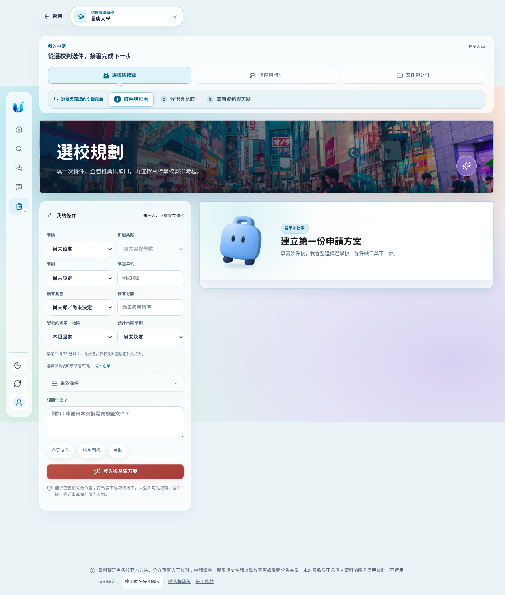
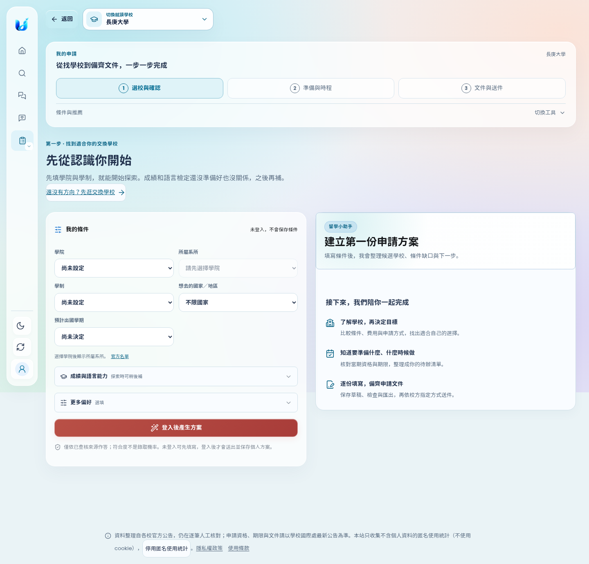
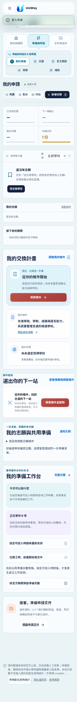
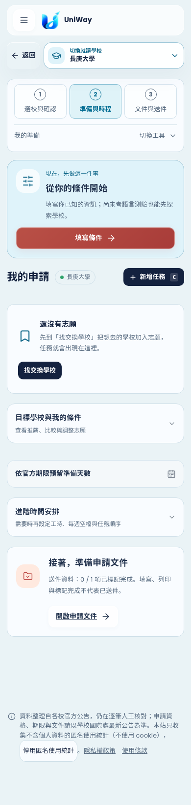
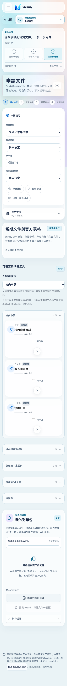
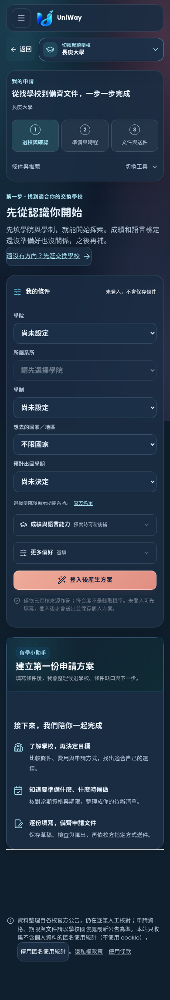

# 我的申請：新手流程簡化

以首次準備交換的學生為情境，在本機啟動正式前端與 API，使用隔離測試帳號操作。現況截圖取自 `a7cc7c58`；所有截圖均於本次工作擷取並檢視，未使用既有設計稿代替操作畫面。

問題主要是資訊層級：入口同時呈現階段、編號工具列、完整條件與問答；準備頁又重複呈現進度、個人計畫、推薦、志願與工時工作台。功能齊全，但學生必須自己判斷先做哪一件事。

## 1. 進入「我的申請」與探索學校 — 已改善

- 三個主要階段保留在同一位置，只有主階段編號；次要工具改為「切換工具」展開，顯示目前所在頁面。
- 以「先從認識你開始」說明第一步，先顯示學院、系所、學制、地區與學期；成績、語言能力、偏好與額外問題按需展開。未考語言檢定仍可探索，不會被當成零分。
- 加入不用先完成個人方案的「先逛交換學校」入口，並說明選校、準備、文件與校方送件之間的關係。
- 正式核對資格時自動展開成績與語言欄位；保留原本同一份表單、條件、草稿與驗證規則。
- 移除占據入口的大幅照片，讓表單與指引更容易找到。

| 改善前 | 改善後 |
| --- | --- |
|  |  |

## 2. 準備與時程 — 已改善

- 將既有依學生資料判斷的「現在，先做這一件事」移到頁面最前面。依目前狀態引導填條件、選目標、核對資格、安排時程或準備文件。
- 無任務時收起空白統計、檢視切換與重複的側欄；有任務後恢復列表、看板與時程。
- 將條件摘要、推薦與多志願工作台整理在「目標學校與我的條件」，將工時設定整理在「進階時間安排」。保留原本資料與操作，不建立第二份進度。
- 官方期限規劃仍有獨立入口；從下一步或日曆進入時能直接展開、聚焦，不必先找到進階設定。
- 壓縮日曆上方重複資訊，手機與桌面的首屏都能看到完整月份。

| 改善前 | 改善後 |
| --- | --- |
|  |  |

## 3. 文件與送件 — 已改善入口指引，保留文件流程

- 說明先確認申請設定，再從目前階段選一份文件填寫。
- 手機也顯示「建立申請、填寫文件、檢查簽核、下載列印」文字，不再只剩四個數字。
- 修正條件式文件勾選控制超出手機畫面的問題，保留鍵盤勾選與焦點提示。
- 保留依學校／階段的文件、草稿、核對與列印功能；填寫完成或匯出仍不代表已正式送件。

## 可操作性與驗證範圍

原生 `details`／`summary` 支援鍵盤展開；保留連結的目前頁面與階段語意。檢查了 390px 手機、1440／1754px 桌面、深色模式、水平溢位、表單錯誤、跨階段草稿、登入交接、重新整理、目標與志願保留、時程與文件跳轉。

收合欄位若有無效值，送出時會自動展開並聚焦第一個錯誤，避免學生不知道為什麼無法繼續。最終各案例結果共 **172 passed、1 既有 skipped**，包含 61 個瀏覽器案例、58 個前端契約案例與 53 個 API／文件／排程案例；這是本次選定的回歸範圍，並非全儲存庫測試。重現指令見 [驗證紀錄](validation.md)。

這是以測試學生操作本機產品的流程檢查，並非真人受測結果；未對正式帳號或正式申請資料寫入，也未驗證校方外部送件系統。截圖與鍵盤檢查不代表完整的螢幕閱讀器或 WCAG 合規檢測。
