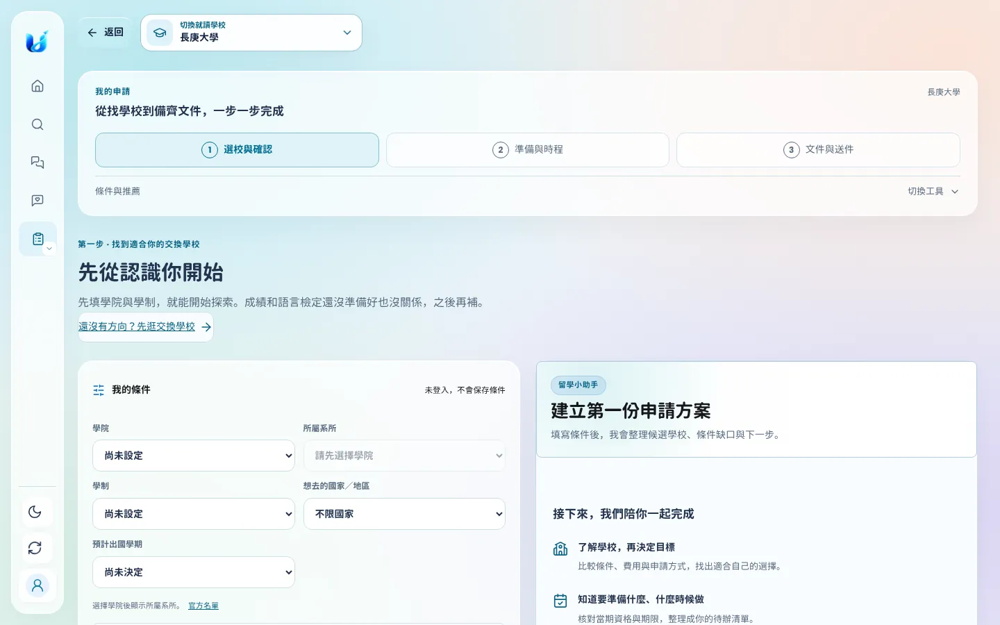
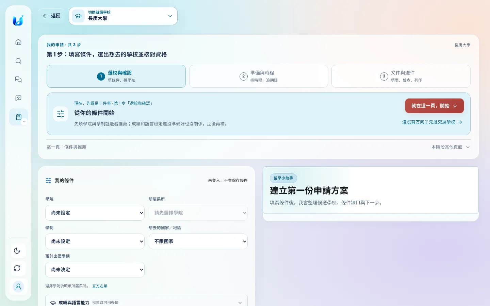
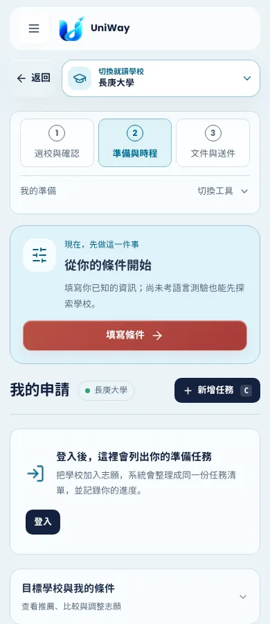
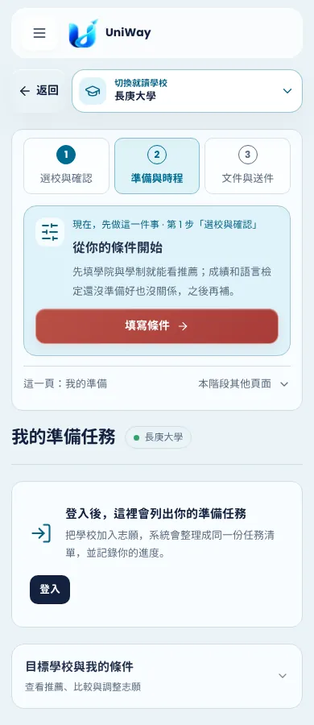
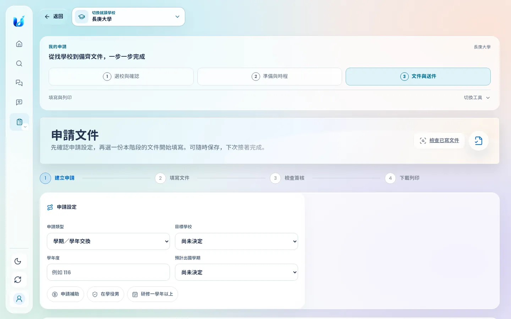
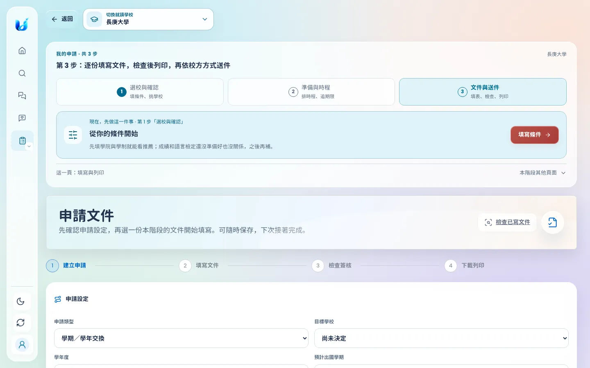
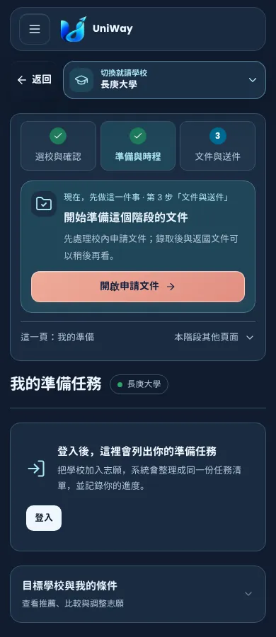
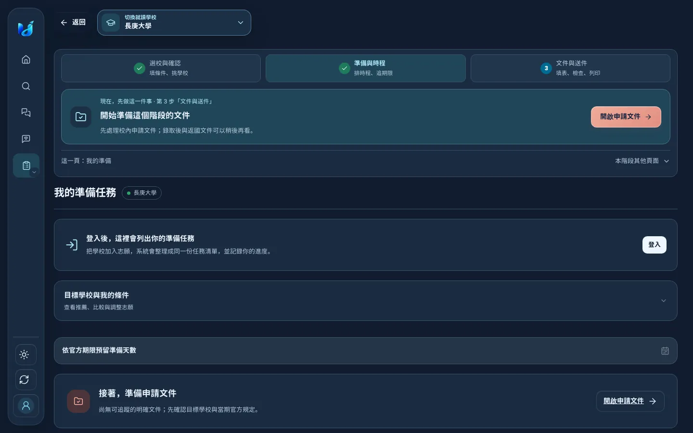

# 我的申請：一張地圖、一個下一步

以第一次使用平台的學生身分，在本機啟動正式前端與 API，從首頁點「我的申請」→ 選擇長庚大學，依序操作三個階段（未登入與已登入各一次）。現況截圖取自 `fe18cb58`。

## 第一次使用時遇到的問題

10/18 那一輪已把欄位收合、把「現在，先做這一件事」放到準備頁最前面；但實際走一遍，仍有這些地方讓人不知道下一步：

1. **只在第 2 步看得到下一步。** 「我的申請」預設打開第 1 步，但「現在，先做這一件事」只出現在第 2 步；第 3 步完全沒有提示，未選目標學校時只看到「尚未選擇目標學校」與 10 份工具。
2. **三個階段只是三個按鈕。** 沒有說明每一步做什麼，也看不出哪一步已完成、該往哪一步走。
3. **同時有好幾套步驟。** 工作區 3 步、第 1 步標題又寫「第一步・找到適合你的交換學校」、右欄「接下來，我們陪你一起完成」再列 3 項、文件頁還有 4 步。學生得自己對照這些步驟彼此的關係。
4. **系統狀態干擾。** AI 依設計暫停，表單下方仍顯示「AI 暫停」與黃色的「本機 AI 服務離線」警告，看起來像出錯。
5. **用詞與雜訊。** 「切換工具」看不出是什麼；準備頁標題又叫「我的申請」，和整個工作區撞名；未登入也顯示「新增任務 C」鍵盤提示；未登入時文件頁「申請設定」旁有一大塊空白面板。

## 改了什麼

- **工作區標題變成地圖。** 標題直接寫「第 N 步：這一步要做什麼」；三個階段各附一行說明（填條件、挑學校／排時程、追期限／填表、檢查、列印），已完成的階段顯示 ✓，建議的下一步以實心編號標示，並提供螢幕閱讀器可讀的狀態。
- **同一個「下一步」，出現在每一頁的同一個位置。** 原本只在準備頁的提示移到工作區標題內，三個階段都看得到，並標明它屬於第幾步。判斷邏輯沿用原本依學生資料決定的規則（`planningNextAction()`），沒有另建第二份進度。下一步就在目前頁面時，按鈕會直接捲到並聚焦第一個要填的欄位，而不是重新整理同一頁。日曆與填寫文件頁不顯示，避免擠掉月曆首屏與干擾填寫。
- **只留一套步驟。** 移除第 1 步重複的標題說明與「接下來，我們陪你一起完成」清單；「還沒有方向？先逛交換學校」改放在下一步卡片內（只在第 1 步顯示）。
- **移除系統雜訊。** AI 為預期的暫停狀態時不顯示狀態標籤與離線警告；真的離線或降級時仍會顯示。
- **用詞。** 「切換工具」改為「本階段其他頁面」，並標示「這一頁：…」；準備頁標題改為「我的準備任務」。
- **小修正。** 未登入時隱藏「新增任務」（空狀態已提供登入），觸控裝置與手機不顯示單鍵快捷提示；未登入時「申請設定」占滿整列；深色模式下「依官方期限預留準備天數」不再是淺灰色色塊。

| 改善前 | 改善後 |
| --- | --- |
|  |  |
|  |  |
|  |  |

已完成的階段會打勾（以下兩張是把下一步設為第 3 步後的畫面，用來呈現打勾狀態；實際學生需先完成前兩步）：

| 手機・深色 | 桌面・深色 |
| --- | --- |
|  |  |

## 沒有改動的範圍

- 首頁「我的交換計畫」4 步（找學校 → 校內甄選 → 合作校申請 → 出發與生活）依學生自填的申請階段顯示，涵蓋錄取後的生活，與工作區 3 步的範圍不同，本次未合併。
- 文件頁的工具清單、列印包與 4 步文件流程維持原樣；本次只在頁首補上前置提示。
- 判斷規則、資料儲存、登入閘門與 API 皆未改變。

## 驗證

這是以測試學生操作本機產品的流程檢查，並非真人受測結果。新增 `tests/e2e/test_application_stage_guide.py`（390／1440px）：未登入時三個階段都在同一位置顯示同一個下一步、階段狀態、聚焦第一個欄位、日曆頁不顯示、無水平捲動；登入並選定目標後，已完成階段打勾且下一步前進。重現指令與結果見 PR 說明。
