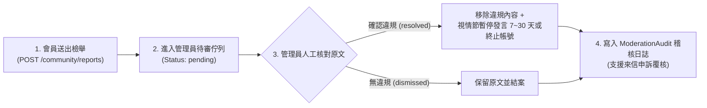

# UniWay 社群版規與檢舉處理規範（階段 0 正式版）

> **適用範圍**：UniWay 站內所有社群空間，包含「公共留學板」、「語言學校板」、18 所大專校院專屬「校級交換板」、學校詳情頁之「學生問答／公開討論／交換心得」以及站內「邀請制私訊」。

---

## 一、看板架構與發言身分規則

1. **瀏覽與發言門檻**
   - **公共看板（公共留學板、語言學校板）**：所有訪客皆可公開瀏覽；完成 Google 登入（或驗證電子郵件）之會員即可發文、留言與回報勘誤。
   - **校級交換看板（各大學專屬看板）**：限已驗證電子郵件之登入會員瀏覽、發文與留言（不限同校學生，方便跨校請益與學長姐經驗傳承）。
2. **每篇貼文獨立選擇署名**
   - 發文或留言時，可逐篇選擇以「**匿名學生**」或「**帳號顯示名稱**」發表；系統預設為「匿名學生」，且不在公開 API 或網頁原始碼中暴露內部帳號 ID。
   - 若透過學校 Google 信箱（如 `@ntu.edu.tw`、`@g.nccu.edu.tw`、`@gs.ncku.edu.tw` 等 18 校網域）登入，系統會自動帶入預設母校；使用一般 Gmail 登入後亦可自行選擇母校。
   - **防跳板鎖定機制**：母校一經選定或變更，**3 天（72 小時）內不得再次更換**。嚴禁冒用他校、系所或學校國際處官方人員身分。
3. **防洗版頻率限制**
   - 為維持討論品質，每個帳號於 **10 分鐘內最多可發布 5 則** 社群內容（含貼文、留言與問答），超過時系統將自動冷卻 10 分鐘（HTTP `429`）。

---

## 二、歡迎發布的內容（可發內容）

1. **交換與留學申請請益（`question`）**
   - 校內甄選流程、GPA／班排計算、TOEFL / IELTS / JLPT 等語檢門檻、學海飛颺／學海惜珠與各校出國獎助學金申請問題。
   - 姊妹校選課規定、學分抵免經驗、住宿申請、簽證辦理與當地生活開銷請益。
2. **學長姐實戰經驗與落點分享（`experience`）**
   - 歷屆申請落點、志願序排列策略、書審（讀書計畫／CV／推薦信）與面試準備心得。
   - 海外交換期間之課程評價、治安交通、文化衝擊與「避雷提醒」（建議標註交換年份與申請階段，幫助學弟妹判斷時效）。
3. **跨校交流與官方規定勘誤（`discussion` / `warning`）**
   - 當期簡章名額異動提醒、申請截止日互助確認，或針對站內整理資料提出官方來源勘誤。

---

## 三、嚴格禁止的內容（不可發內容）

### 1. 【系統即時攔截】公開個人聯絡方式與敏感證件資料
- **規則**：公開貼文、留言、問答、心得與公開聊天室中，**嚴禁包含任何個人聯絡方式**（Email、手機號碼、LINE ID、Instagram、Telegram、Discord 等社群帳號）或**敏感身分證件號碼**（護照號碼、身分證字號）。
- **系統機制**：後端（`_reject_contact_details`）會對全形／半形文字進行即時正規化掃描，偵測到上述資訊時將**直接拒絕發布（回傳 HTTP `422`）**。
- **替代方式**：若同學之間需要一對一深入請益，請使用站內「**邀請制私訊**」（需對方同意接受邀請後才能展開對話，且雙方隨時可封鎖對方）。

### 2. 【系統預審攔截】商業代辦推銷、保證錄取廣告與收費仲介
- **規則**：UniWay 為純學生互助與資訊整理平台，**嚴禁留學代辦機構、商業顧問、付費代寫／代考業者發布廣告、業配、招生攬客或宣稱「付費代辦保證錄取」**。
- **系統機制**：包含高風險商業推銷字詞（即便刻意插入空白或特殊符號混淆）之貼文，系統會自動標記為**待審核狀態（`pending`）**，在內容管理員人工審核通過前**不會出現於任何公開頁面**。

### 3. 冒用身分與蓄意散布不實申請資訊
- 禁止冒充各校國際事務處（OIA）教職員或官方代表。
- 禁止蓄意捏造截止日期、篡改名額或散布誤導其他申請者錯過校內收件期限之假消息（所有申請資格、期限與文件均以各校國際處與各國政府最新官方公告為準）。

### 4. 人身攻擊、騷擾、歧視、肉搜（Doxxing）與侵權內容
- 禁止針對特定個人、學校、科系或國籍進行謾罵、霸凌、性騷擾或仇恨言論。
- 禁止未經當事人同意公開他人之真實姓名、學號、照片或私人對話截圖。
- 禁止未經授權全文轉載他人受著作權保護之文章、補習班講義或付費教材。

---

## 四、檢舉後的處理方式與處置流程

當你在社群中發現過期錯誤資訊、疑似代辦廣告或不當言論時，可隨時透過以下四步驟機制處理：

1. **步驟一：送出檢舉（保密與防濫用）**
   - 登入且驗證 Email 之會員，點擊貼文或留言旁之「檢舉」按鈕並填寫具體原因即可送出（HTTP `202 Accepted`）。
   - **檢舉人身分絕對保密**，被檢舉者不會看到是誰提出檢舉。系統同時禁止「自己檢舉自己」，且同一人對同一內容的重複檢舉會自動歸併，避免灌水。
2. **步驟二：管理員人工審核與稽核留痕**
   - 案件進入後台待審清單（`/admin/community/reports`），由內容管理員依據本版規核對原文與上下文。
   - 審核完成後，管理員必須填寫處置說明（`resolution_note`）並將狀態更新為「**已處置（`resolved`）**」或「**不成立（`dismissed`）**」；每筆操作皆自動寫入不可竄改之審核稽核紀錄（`ModerationAudit`）。
3. **步驟三：分級違規處置**
   - **初犯或輕微違規（如誤貼過期資訊、不當言詞）**：下架／退回該則貼文或留言（狀態改為 `rejected`），不顯示於公開列表。
   - **中度或累犯違規（如蓄意洗版、發布商業代辦廣告、騷擾他人）**：下架內容，並對該社群身分執行**暫時停權禁言（例如 7～30 天）**。停權期間（`community_suspended_until`）仍可查閱公開交換學校資料，但無法在任何看板發文、留言或發起私訊。
   - **嚴重違規（如詐騙、惡意洩漏他人個資、攻擊網站安全）**：永久終止帳號使用權限。
4. **步驟四：申訴與去識別化資料保護**
   - **申訴管道**：若作者認為內容遭誤判下架或對停權處置有異議，可來信網站頁尾之營運者聯絡信箱提出申訴，管理員將於人工覆核後回覆。
   - **資料最小化保留**：若檢舉人日後刪除帳號，已結案之檢舉紀錄會立即清除；尚在處理中的安全檢舉則會立即抹除檢舉人 ID（去識別化），並於結案時或最長 **90 天** 後自動永久刪除。
