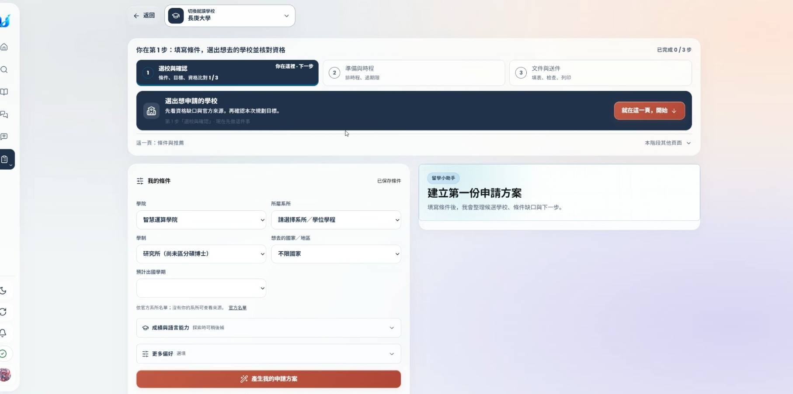
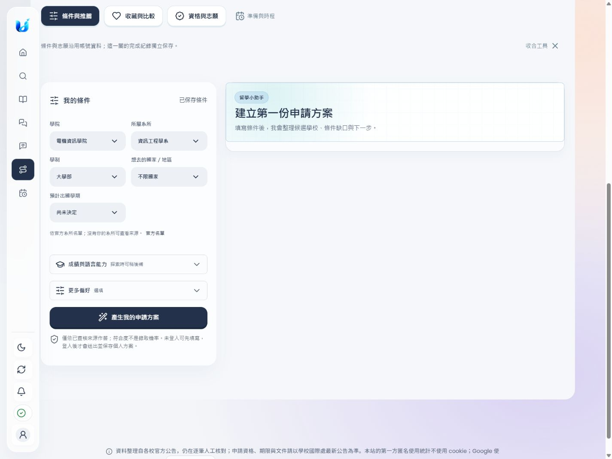
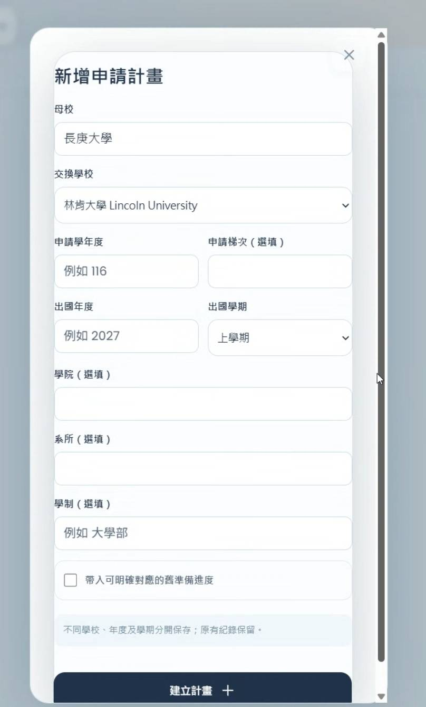
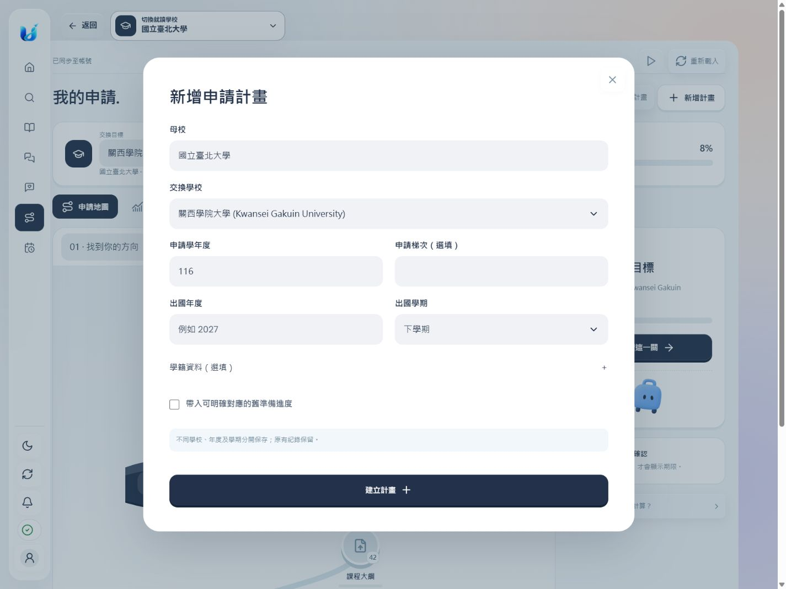
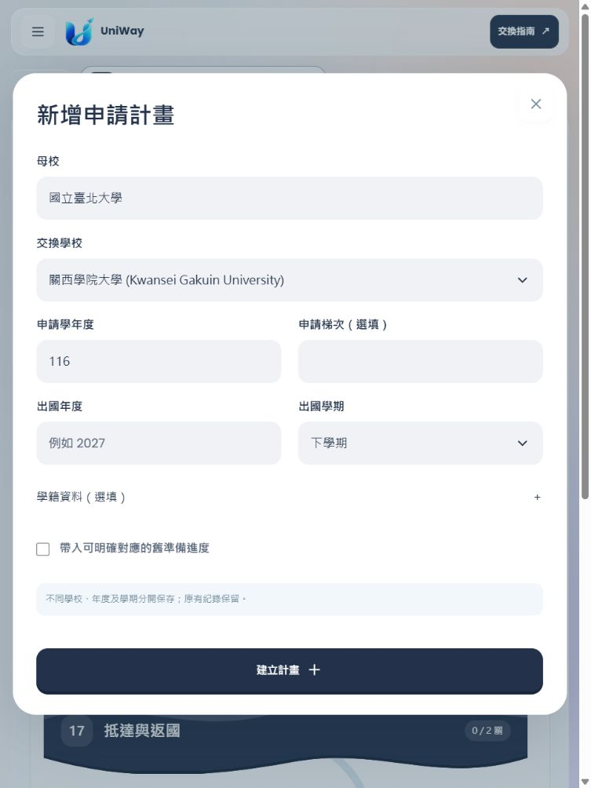
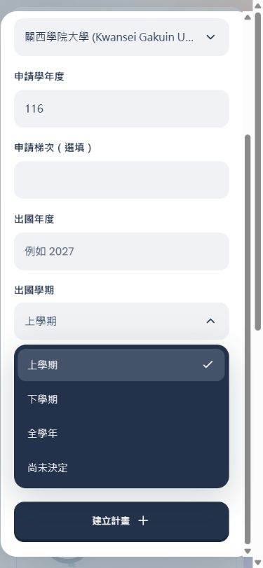

# 我的申請：關卡工具整合

這次把選校、資格與文件操作放回關卡內，移除重複的三階段導覽。「準備與時程」保留為獨立頁面。沒有新增大學資料查核、Migration、合併或正式部署。

## 操作差異

- 左側「我的申請」直接開啟關卡地圖，不再有下拉工具選單；旁邊新增獨立的「準備與時程」。
- 選校關卡可以直接開啟條件與推薦、收藏比較、資格與志願；文件關卡可以使用原本的填表、檢查、列印與私人文件庫。
- 原本的 DOM 表單移入關卡，不複製第二份表單。切換工具後保留尚未送出的欄位，原有事件、帳號同步、授權與加密保存仍走既有流程。
- 在關卡推薦列表選擇其他學校時，開啟預填的新計畫視窗；不覆蓋目前計畫的學校與進度。
- 「新增申請計畫」桌機寬度上限 900px；移除巢狀卡片與欄位框線，以淡灰底區分輸入區。選填學籍資料先收合，手機改成單欄。
- 主平台及公開跨校學校頁的原生下拉選單統一使用 Glide Select 互動，保留動態選項、分組、多選、必填驗證、鍵盤操作、重設及表單原始值。
- 舊工具網址仍可直接使用，但不再出現「選校與確認／準備與時程／文件與送件」三階段橫幅。

## 資料邊界

各計畫的關卡紀錄、分段寫作與文件連結仍以既有帳號、計畫 ID 與 revision 保存。打開工具不會自動完成關卡，也不代表校方受理或錄取。

選校條件、志願與舊表單草稿原本就是帳號共用資料，本次維持此模型，並在工具上方標示。文件規則與目前計畫不同時，必須點擊「載入本計畫的文件工具」；沿用原有目標變更確認並使先前核對結果失效，保留草稿與其他計畫進度。

測試發現讀書計畫工具將合法的較長規則文字傳給較短的回傳欄位，造成 500。`CrossSchoolHomeAgreement` 與 `StudyPlanWorkbenchPayload` 的對應欄位改為與 `VerifiedRuleFact` 一致的 600 字上限，沒有截斷、重寫或查核來源內容。

## 修改範圍

| 檔案 | 用途 |
| --- | --- |
| `static/application-workspace.js` | 移除三階段橫幅、管理原表單移入／移出、獨立時程頁 |
| `static/application-path.js`、`static/app.js` | 關卡工具路由、計畫與文件規則對應、新學校建立獨立計畫 |
| `static/application-path-select.js`、`static/glide-select.css` | 共用 Glide Select，維持原生表單語意 |
| `static/application-level-tools.css`、`static/application-path-template.js` | 寬版無邊框新增視窗、關卡工具版面 |
| `static/index.html`、`static/navigation.js`、`static/application-path.css`、`seo.py` | 網站導覽、樣式拆分、版本化資源、公開頁選單 |
| `models.py`、`docs/api/openapi.json` | 對齊規則文字的傳輸長度上限與 API 規格快照 |
| 相關單元／瀏覽器測試 | 新導覽、原工具功能、選單語意、保存與隔離、規則傳輸回歸 |

## 驗證

- 92 項 API、資料隔離、前端結構與靜態快取測試通過。
- 26 項瀏覽器測試通過：關卡保存及重載、不同學期隔離、表單 DOM 保留、新推薦學校另建計畫、舊工具網址、條件與志願保存、時程預覽、日期適用性、重複新增防護、文件列印核對，以及 Glide Select 的鍵盤、必填、多選、重設與公開頁切換。
- 主回歸命令為 `116 passed`；最後兩個新增案例連同同檔兩個既有案例重跑為 `4 passed`，合計 118 個不同案例。
- 手動瀏覽器檢查 390px、768px、1440px；新增視窗與關卡工具沒有橫向溢出。手機選單可在 modal 上選取，表單草稿重新載入仍保留。
- 修改的 JavaScript 通過 `node --check`，`git diff --check` 通過。
- `scripts/export_openapi.py --check` 通過；既有 Migration 解析檢查通過，未套用或新增 Migration。
- Python wheel 打包通過。專案的網頁使用原生 JavaScript，沒有 TypeScript 或前端 bundler，未新增框架與執行時依賴。
- 靜態圖片測試原本仍期待已移除的首頁結尾吉祥物；改為檢查現有四張圖片，保留首屏與延後載入的斷言。

測試使用隔離資料目錄與合成帳號，不操作正式使用者資料。截圖中的資料是本機測試資料。

## 改版前後

原本的三階段橫幅：

關卡內開啟選校工具，左側分開顯示申請與時程入口：

原本的新增計畫視窗：

放大後的無邊框視窗：

手機的 Glide Select 與關卡工具：

選單參考 [React Bits Glide Select](https://reactbits.dev/micro/glide-select)，沿用既有原生 JavaScript 適配；來源與 MIT + Commons Clause 授權見 [第三方說明](../application-path/third-party/README.md)。
