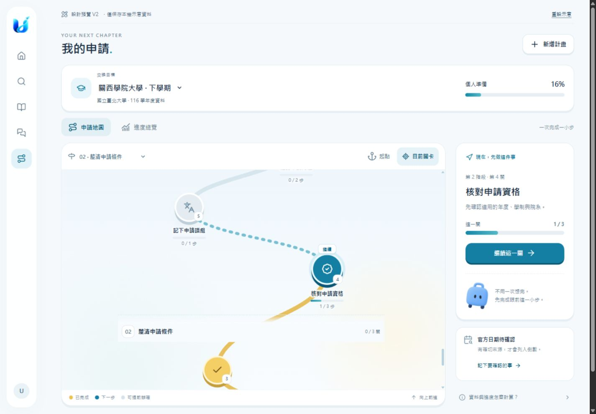
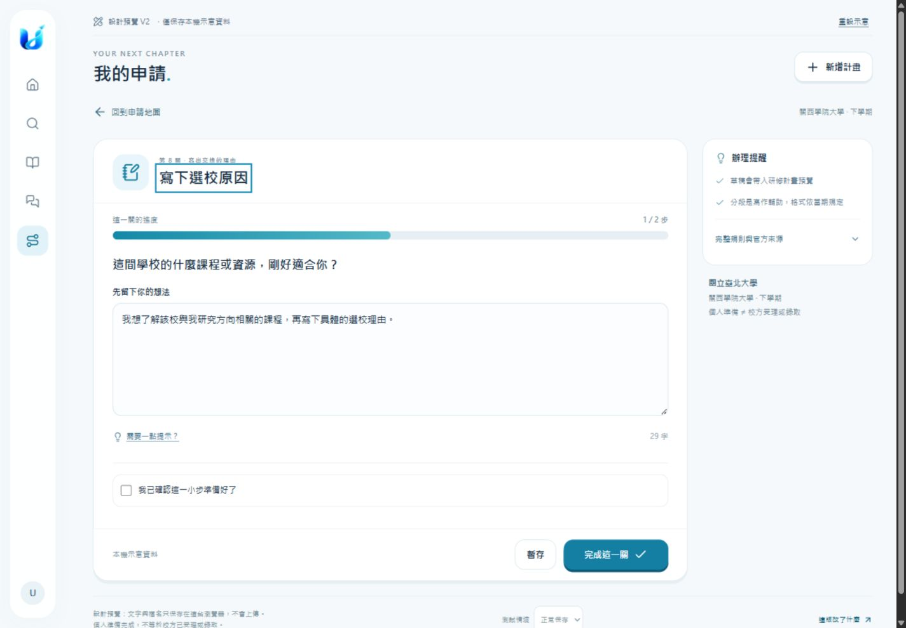
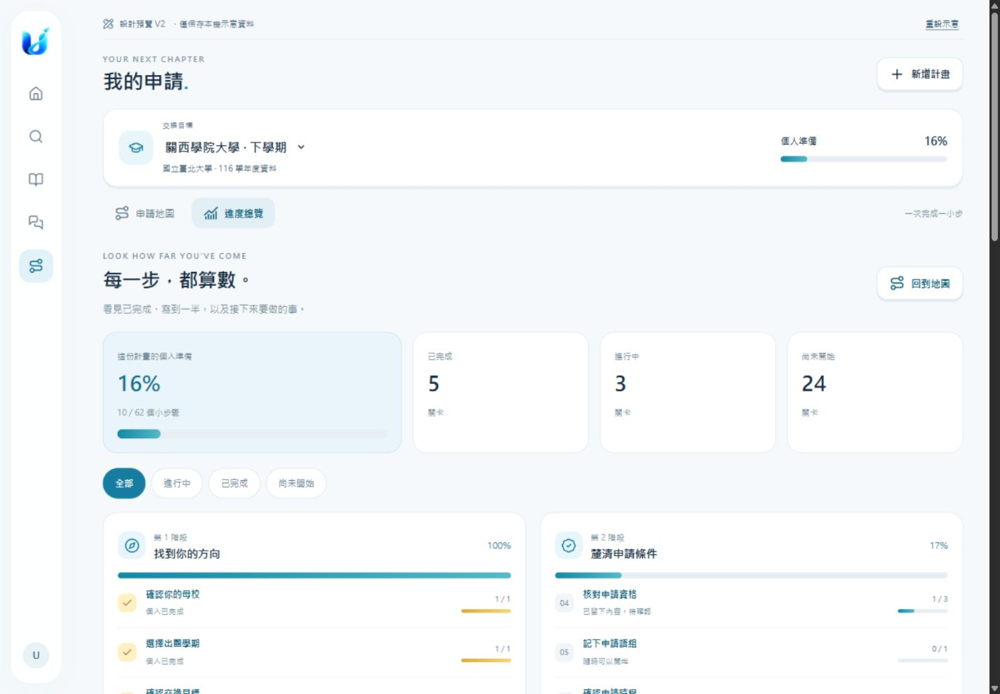

> 2026-10-29：設計已獲確認，正式程式整合與 PR 驗證見 [帳號資料整合](integration.md)。以下保留 Phase 1 設計歷史。

# 我的申請：Phase 1 V2 互動設計預覽

本機預覽：<http://127.0.0.1:18774/design-preview/>。

本次依回饋改為 **12 階段、34 小關、由下向上的地圖**，每關有自己的表單或操作；另設進度總覽。尚未取代正式網站，等待外觀與操作方向確認後再進入 Phase 2。

- [這版改了什麼與正式整合方案](revision-2.md)
- [九項瀏覽器標註修訂與最新截圖](review-comments-20261029.md)
- [現況分析及原版方案](phase-0-and-design.md)
- [V2 瀏覽器驗證](preview-validation.md)
- [V1 歷史驗證](preview-validation-v1.md)

## 開啟預覽

從 repository 根目錄，以已安裝專案依賴的 Python 執行：

```powershell
python docs/design/application-path/serve-preview.py
```

只綁定 `127.0.0.1:18774`。隔離資料放在 `output/application-path-review/isolated-data`；本機合成帳號、JSONL／vault／草稿、停用寄信。不要將此預覽伺服器與自動登入 fixture 部署到正式環境。

`/design-preview/` 是設計預覽；`/local-review-session` 是舊網站的本機合成帳號畫面。新增或重設示意計畫只寫 localStorage 的 `uniway.design.application-path.v2`，V1 紀錄不受影響。

## 可以試的操作

1. 在地圖向上捲動；「起點」回第一關，「目前關卡」回建議位置。
2. 從「跳到階段」選擇寫作、文件或送件階段，點任一關。
3. 寫一段想法後暫存；單關顯示 1/2。確認完成後變成 2/2，回地圖或總覽查看。
4. 開啟「預覽你的研修計畫」，看看已填的小段落如何集中；未填段落可直接前往補上。
5. 文件關卡用示意檔案試操作，不選取、讀取或上傳使用者檔案。
6. 在進度總覽篩選進行中、已完成與尚未開始。
7. 切換學校，或建立同校不同學期計畫；各自保存。重新整理仍可恢復。
8. 頁底切到「保存失敗」，測試輸入保留且進度不增加；切回正常保存可重試。

預覽使用兩筆既有公開流程節錄；不表示已確認適用本期，也沒有新增大學資料查核。34 關是這次的 UX 範例，不是所有大學統一要求。

## 畫面







另附 390px 手機起點、地圖、修課表單、進度總覽及 768px 平板截圖。改版前畫面保留在 `screenshots/before-*.png`；其餘無 v2 前綴的 after/task 圖為 V1 歷史版本。
