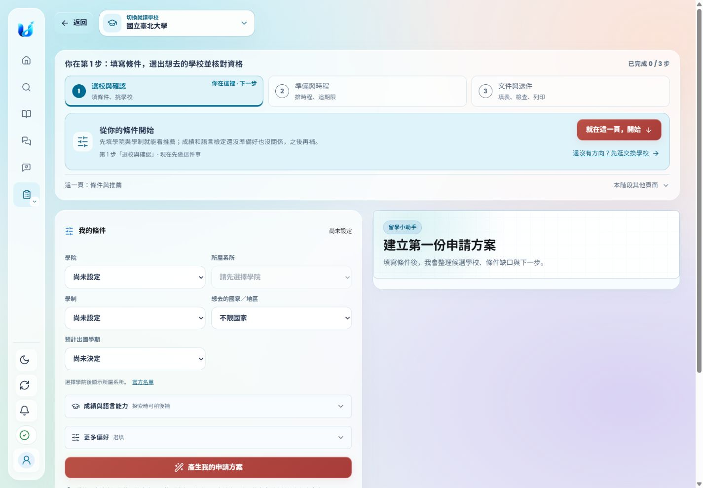
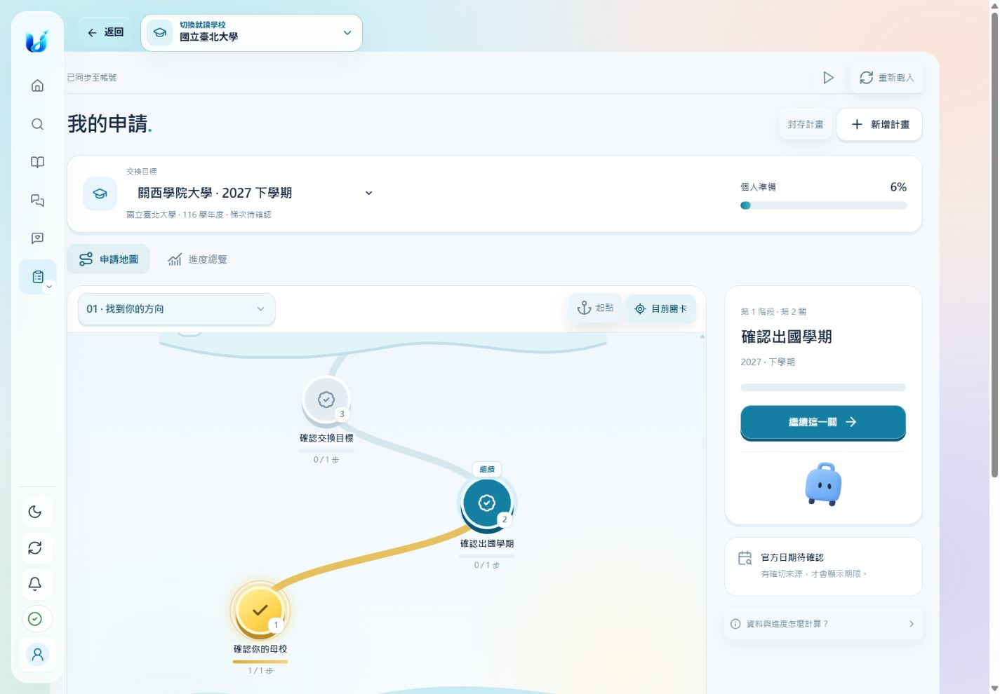
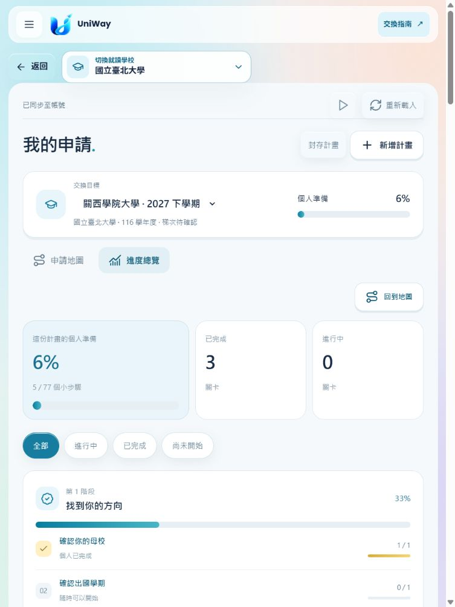
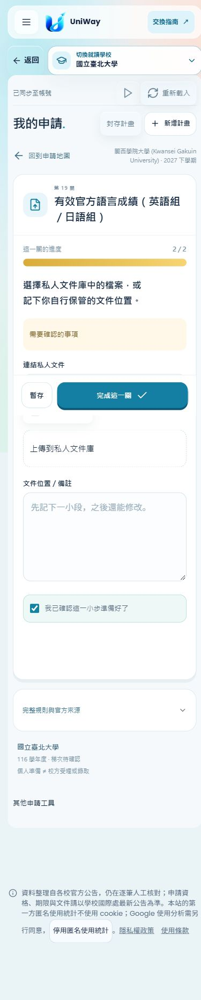

# 我的申請：帳號資料整合（PR 待審）

使用者於 2026-10-29 確認設計預覽，授權網站整合與建立 PR。未合併、未部署、未執行 migration；沒有新增大學資料查核或原生 App 變更。

## 現在的入口與功能

網站「我的申請」開啟 `#my-application`。保留原網站導覽及所有既有深連結；頁尾「其他申請工具」可進入原有選校、排程、文件／列印、日曆、預算與私人文件庫。

- 由下往上的彎曲關卡地圖、波浪章節標題、完成亮光與流動進度條，延續已確認的預覽。
- 實際關卡依目前計畫條件呼叫既有 evaluate 與 document catalog；每章最多三個動作。關卡數不固定，不套用預覽的 34 關。文件與流程按既有階段排序。
- 資格確認、分段寫作、文件連結／上傳、個人送件紀錄與校方通知紀錄各有對應操作。分段文字可匯出 TXT 與 Word 草稿；既有正式文件工具仍保留。
- 每份計畫固定母校、交換校、申請學年度／梯次、出國年度／學期與院系條件。不同計畫的文字與狀態分開保存；文件只有明確選取才連結。
- 進度由伺服器計算。校方通知不算個人完成比例；條件式文件未確認適用性前暫不計入。不適用或尚未到適用階段的文件依既有 catalog 結果排除。
- 只有既有真實依賴及六段草稿組合依賴會阻止完成。仍可查看被鎖定的關卡；撤回前置完成時，後續關卡退回待確認。
- 文件過期／刪除、來源 signature 改變時重新要求確認；原紀錄保留。只顯示既有服務確認的官方期限，缺日期不倒數。
- 可封存及恢復計畫。維持既有公開方案目標學校限制，限制計算也包含舊工作區選校。

## 保存與相容性

採用較小的擴充，取代 Phase 0 中新增資料表的草案：直接重用現有 FormDraftService、AES-GCM 加密及 revision compare-and-set，在每個帳號／母校保存一份內部 `uniway-application-paths-v1` registry。正式環境沿用既有自架 PostgREST／資料庫 adapter；本機測試才使用隔離 JSONL。

- 不新增資料表或 migration，不需要外部託管服務。
- 每次寫入使用整份 registry revision；同帳號不同計畫同時編輯也可能得到 409，以防清單或權限競態。單次最多 30 份計畫、2 MB registry。
- 所有 `/account/application-paths*` 路由沿用既有帳號認證、同源防護與 `no-store`。客戶端不接受 account_id，不把示意 localStorage 帶入真實帳號。
- 內部 registry 不出現在舊表單清單，舊 PUT／DELETE 不可直接改它；既有帳號刪除仍清除此加密資料。
- 使用者明確勾選匯入，且學校／年度／梯次／學期／院系可精確對應時，只複製 stable-ID 的準備進度，保留來源 revision；不猜測舊草稿學期，不改原始工作區，不把舊個人送件或錄取狀態升級為官方確認。
- 新分段草稿不會靜默覆寫舊 Word/PDF 表單；使用者可下載本計畫 Word 草稿，或從保留入口使用原有文件工具。
- 保存成功才慶祝。409 保留輸入，讓使用者載入最新版再確認；503 不假裝完成；登出清除畫面與記憶中的私人資料。

## 修改檔案

| 範圍 | 檔案 |
| --- | --- |
| API、動態任務與計畫保存 | `src/exchange_info/application_path.py`、`api.py`、`form_drafts.py` |
| 網站入口與帳號生命週期 | `static/index.html`、`static/app.js` |
| 關卡、表單、總覽、響應式動畫 | `static/application-path.js`、`application-path-template.js`、`application-path.css` |
| 階段選單 | `static/application-path-select.js`、`static/assets/licenses/react-bits-LICENSE.md` |
| API 合約與測試 | `docs/api/openapi.json`、`tests/test_application_path.py`、`tests/test_my_application_entry.py` |
| 審閱材料 | 本目錄的設計歷史、驗證說明及整合截圖 |

Glide Select 為 React Bits 原始互動的原生 JavaScript 適配，保留來源與 MIT + Commons Clause 授權；沒有新增 React runtime 或建置依賴。

## 驗證結果

- 相關回歸：**193 passed、1 skipped、3 deselected**。略過與排除狀態完整保留；不是全專案測試全綠。
- 最終新增 API 測試：**11 passed**（包含帳號隔離、同校不同學期、免費目標數、CAS、依賴撤回、官方狀態拒絕、加密 namespace 防護、封存、文件 owner／過期／刪除、條件式適用性、舊進度匯入、Word 內容與保存失敗）。
- 初次回歸的快取配對失敗已修正：`app.js` 與 `community-reader.js` 使用一致新版 URL；對應路由測試已通過。
- 剩餘三個失敗在乾淨 **main 28a4f3987** 控制 worktree 全部重現：兩項 bundled workflow 測試預期 1124 筆、目前為 5769；一項舊首頁吉祥物測試預期 5 個 img、目前為 4。此次不修改這些資料／測試，也不把它們報為通過。
- 瀏覽器實測 390×844、768×1024、1440×1000：建立首份計畫、寫作暫存／完成、文件真實上傳與連結、重新整理、登出後清空、重新登入恢復、同校上下學期進度隔離、封存、階段選單鍵盤操作、進度總覽、原有工具導覽；這三種寬度均未出現橫向溢出。
- 僅使用隔離合成帳號與不含個資的測試文字檔；未測試正式帳號、正式 DB、Google OAuth 或實體手機。60fps 是設計目標，沒有宣稱實機量測。

測試命令（在 repository 根目錄，先安裝既有 dev 依賴）：

```powershell
$env:PYTHONPATH = (Join-Path (Get-Location) 'src')
$env:EXCHANGE_INFO_DATA_DIR = (Join-Path (Get-Location) 'output/application-path-review/pytest-data')
$env:EXCHANGE_WARM_CACHES = '0'
python -m pytest tests/test_application_path.py -q
python -m pytest tests/test_application_path.py tests/test_my_application_entry.py tests/test_application_plan_api.py tests/test_application_plan_schedule_api.py tests/test_task_documents_and_reference_plan.py tests/test_account_workspace_api.py tests/test_form_drafts.py tests/test_document_vault.py tests/test_auth_api.py tests/test_independent_page_routing.py tests/test_frontend_contract.py tests/test_request_origin.py tests/test_static_caching.py tests/test_multi_application_plan.py tests/test_submission_progress.py -k 'not test_every_bundled_step_is_either_linked_listed_or_documentless and not test_every_bundled_workflow_yields_a_schedulable_estimated_plan_for_an_unpublished_year and not test_pictures_on_pages_nobody_has_opened_yet_wait_but_the_ones_everyone_sees_first_do_not' -q
python scripts/export_openapi.py --check
node --check src/exchange_info/static/application-path.js
node --check src/exchange_info/static/application-path-select.js
node --check src/exchange_info/static/application-path-template.js
node --check src/exchange_info/static/app.js
```

Python compileall、四個 JavaScript 語法檢查、凍結 OpenAPI 與 git diff --check 均通過。減少動態偏好會停止動畫，使用者可明確切換播放／暫停。

網站沿用原生 JS／CSS，沒有本次新增的 npm build、TypeScript typecheck 或 lint 任務；既有 React Aria bundle 未修改。未跑全部 Web E2E／Docker runtime suite，本機驗證不等於正式部署驗收。

## 本機審閱

```powershell
python docs/design/application-path/serve-integrated.py
```

開啟 `http://127.0.0.1:18775/local-review-session`，以隔離測試帳號操作實際 API。只監聽 loopback；fixtures 留在 `output/application-path-review/integrated-data`，不得部署此自動登入腳本。舊純設計預覽仍在 18774，不會讀寫新計畫資料。

## 前後畫面

改版前：



整合後（隔離合成帳號）：






