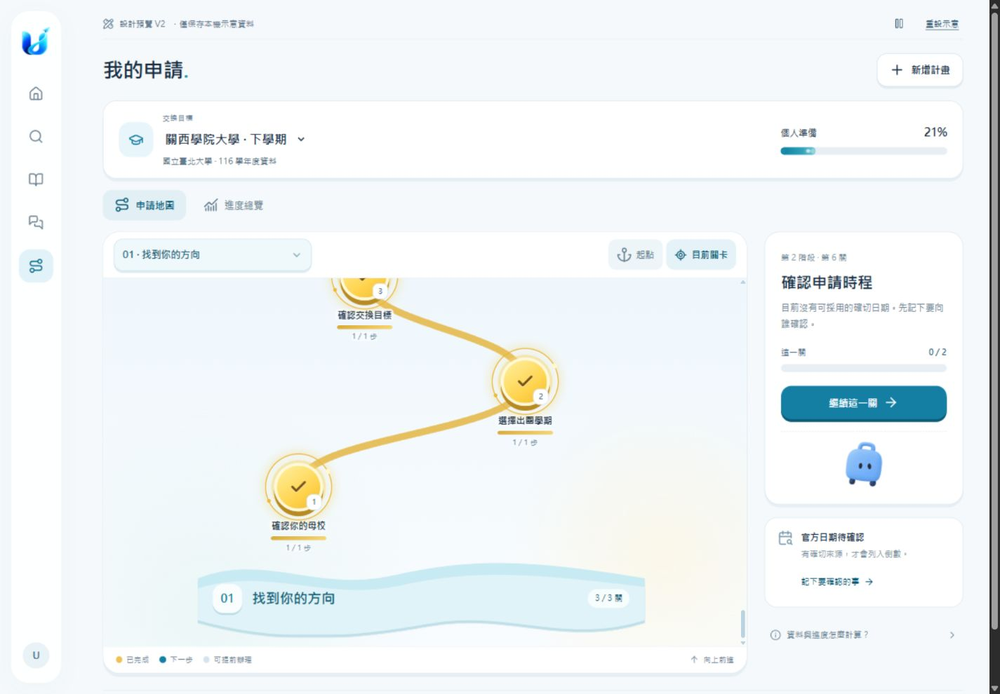
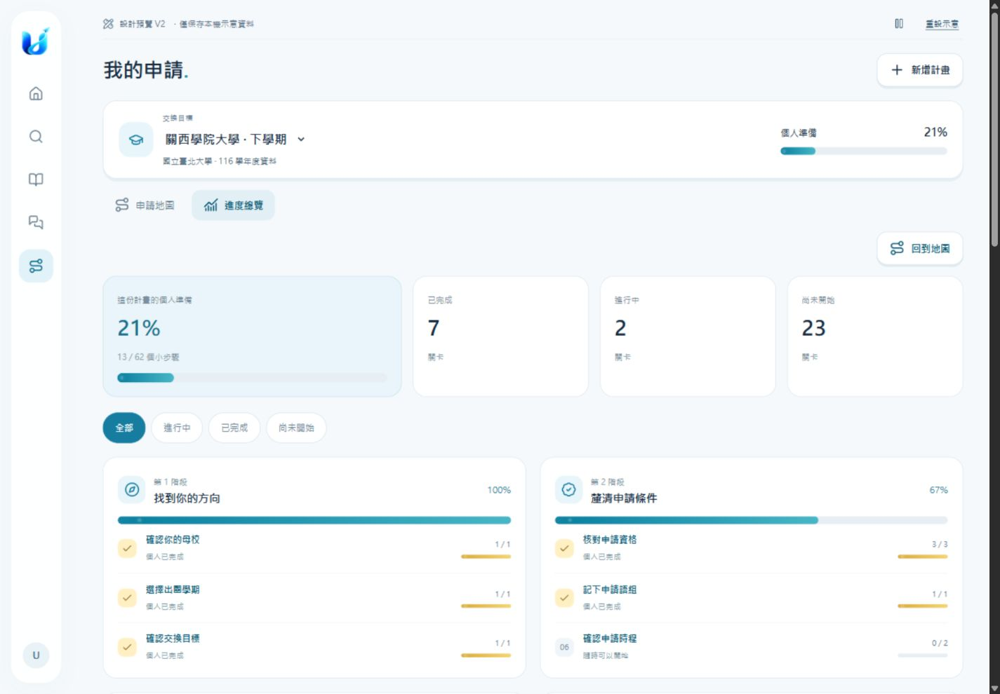

# V2：九項瀏覽器標註修訂

範圍：Phase 1 本機設計預覽。沒有修改正式網站、資料庫、App 或部署；沒有新增大學資料查核。本輪保留瀏覽器原有 21%（13/62）示意進度，未重設計畫。

## 修訂

1. 移除總覽的英文眉題、鼓勵標題與說明副標，以及同類的裝飾標語。
2. 移除地圖起點說明區。
3. 階段標題改成雙層波浪底板；桌機 20px、手機 17px，保留階段號碼與完成數。
4. 整體、階段與關卡進度條改為持續流光及粒子動畫；0% 不播放填色動畫，真實計算值不變。
5. 已完成節點增加金色漸層、光圈與星點動畫。畫面外動畫暫停。
6. 階段選單依 React Bits Glide Select 改為彈出選單與滑動高亮；沿用原生 JS，詳細來源及授權見 [third-party](third-party/README.md)。
7. 頁頂提供播放／暫停。預設尊重系統「減少動態」；使用者可明確選擇播放，僅本次頁面有效。

## 本輪實測

- Chromium：390×844、768×1024、1440×1000；文件 scrollWidth 分別 375、753、1425，沒有水平溢出。平板／桌機地圖 scrollWidth 與 clientWidth 相同。
- 390px 波浪標題、起點、選單與進度總覽視覺檢查通過；選單各列 48px，12 個階段可捲動。
- 選單 ArrowDown / Home / End / Enter / Escape：活動選項、高亮位置、選取標籤與關閉狀態正確；End 可選第 12 階段，再回第 1 階段。
- 動畫：流光為 2.8 秒無限循環，跨兩次觀察 transform 改變；完成光圈為 3.4 秒循環。總覽 100% 階段仍播放流光。
- 本機瀏覽器實際回報 prefers-reduced-motion: reduce；預設停動畫，按播放後運行，按暫停後 animation-play-state=paused，再播放可恢復。
- Console 無 warn/error。此次未變更保存流程或重新填寫任務。
- `node --check` 檢查 preview.js、glide-select.js；`git diff --check` 檢查設計資料夾。

這些是本機設計與桌面瀏覽器 viewport 測試，不代表正式同步或實體手機效能驗收。正式後端測試待 Phase 2 整合時執行。

## 新截圖

