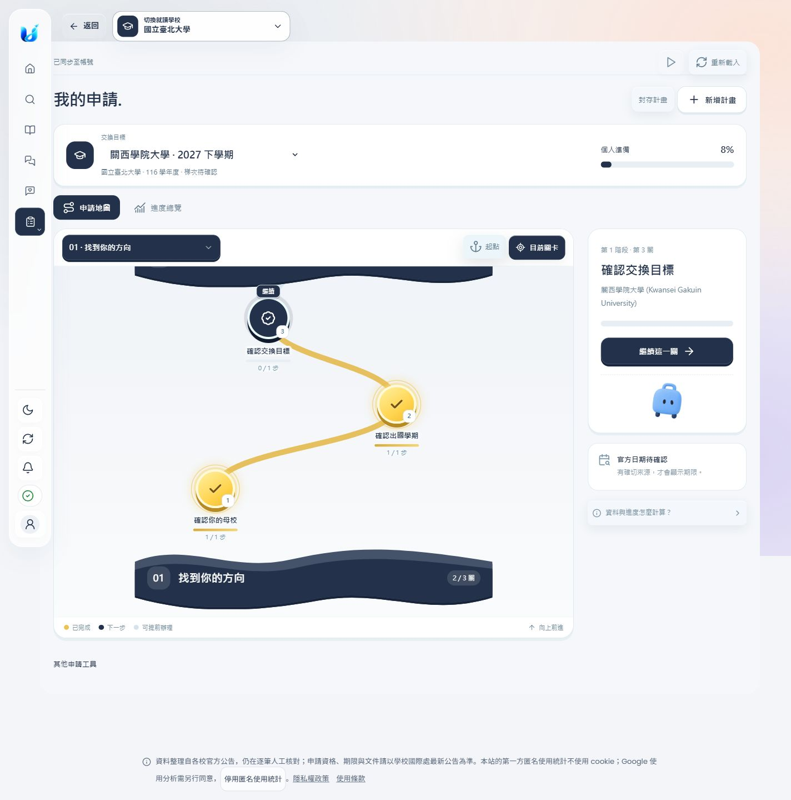
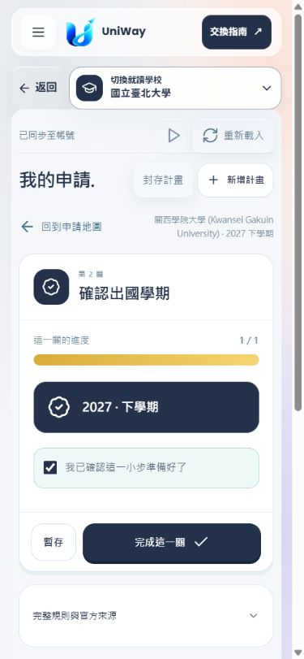
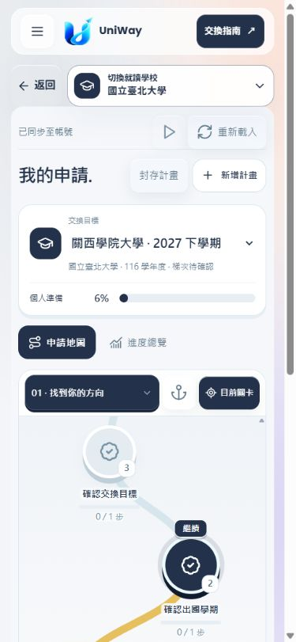
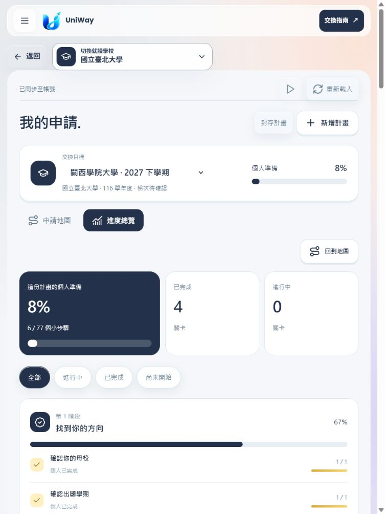
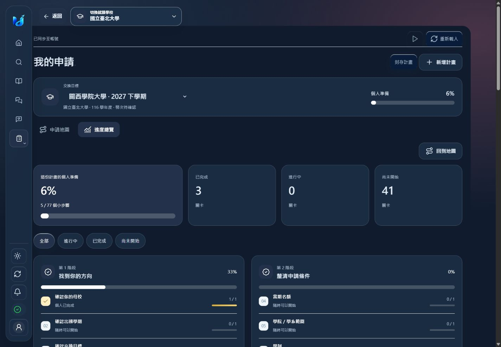

# 網站墨夜藍主題

以使用者提供的色票 `#23324A` 統一網站的藍色介面，實色藍底搭配白字。這是接續 PR #163 的獨立配色變更，base 為 `codex/web-application-path`；不包含合併或部署。

## 範圍

- `brand-tokens.css`：共用主色、滑入色、白字與淡色畫布。白底上的文字連結使用墨夜藍，深色畫布上的文字連結使用白色。
- `midnight-theme.css`：網站導覽、選中頁籤、標籤、提示區塊、申請地圖／進度／關卡表單／Glide Select、公開指南閱讀頁及深色模式。只作用於螢幕，保留既有列印樣式。
- `platform-globe.js`、`partner-map.js`：首頁地球、地圖海色及學校標記。標記數字維持白色，聚合範圍與資料不變。
- `index.html`、`glass-theme.css`、`app.js`、`seo.py`：載入共同主題並更新靜態檔快取版本；SEO metadata、URL 與內容不變。
- 保留金色完成狀態、錯誤與警示色、非藍色分類色、照片、校徽與既有品牌插畫。沒有新增大學資料查核，沒有更動原生 App、帳號、API、資料庫、migration 或部署設定。

## 驗證

所有互動都在 `127.0.0.1:18775` 本機整合伺服器，以隔離的合成測試帳號執行；並未操作正式使用者資料。截圖中的申請進度是本機測試狀態。

| 項目 | 結果 |
| --- | --- |
| 1440 × 1000 | 首頁、選校清單、學校詳細頁、地圖、論壇、公開指南、申請地圖及總覽可操作；沒有橫向溢出 |
| 768 × 1024 | 進度總覽正常換行，沒有橫向溢出 |
| 390 × 844 | 公開指南、申請地圖及關卡表單正常；沒有橫向溢出 |
| 關卡操作 | 確認出國學期 → 完成 → 重新整理，仍為 1 / 1；總覽從 5 / 77 更新至 6 / 77 |
| 階段選單 | 可切換到第 5 階段，再使用「目前關卡」返回第 1 階段 |
| 淺／深色 | 主色填滿元件均為 `rgb(35, 50, 74)`，主要標籤為白色；深色申請頁補齊畫布與文字對比 |
| 文字對比 | `#FFFFFF` / `#23324A` 為 **12.91:1**（WCAG 相對亮度公式） |
| 動態進度 | 保留原有粒子、光帶與暫停／減少動態設定；白色進度填滿處改用深色粒子，維持可見性 |
| JavaScript | `node --check`：app.js、platform-globe.js、partner-map.js 通過 |
| 差異檢查 | `git diff --check` 通過 |

相關既有測試最終結果：**82 passed, 38 deselected**。Windows 使用 `PYTHONUTF8=1`；首次以系統 cp950 執行時，一項 SEO 測試在讀取既有中文資料檔失敗，UTF-8 下同批測試全部通過。

```powershell
$env:PYTHONUTF8='1'
$env:PYTHONPATH=(Join-Path (Get-Location) 'src')
$env:EXCHANGE_WARM_CACHES='0'
$env:EXCHANGE_INFO_DATA_DIR=(Join-Path (Get-Location) 'output/midnight-review/test-data')
python -m pytest tests/test_frontend_contract.py tests/test_brand_assets.py tests/test_static_caching.py tests/test_seo.py -k 'not pictures_on_pages and not every_catalogue and not sitemap_index and not partner_status and not unavailable_catalogue and not catalogue_cache' -q
```

排除範圍為全校資料／sitemap 測試，以及 PR #163 已記錄、與本次配色無關的吉祥物數量舊斷言。此變更沒有新增前端依賴；純靜態樣式與既有 JavaScript，不需重新建置 React 元件，也未變更 TypeScript。

## 畫面

改色前：[PR #163 申請地圖](../application-path/integration-screenshots/map-1440.png)。以下為改色後：



| 手機關卡 | 手機地圖 |
| --- | --- |
|  |  |





其他畫面：[桌機進度](progress-1440.png)、[學校詳細頁](school-detail-1440.png)、[論壇](forum-1440.png)、[公開指南](guide-1440.png)、[選校地圖](partner-map-1440.png)。
