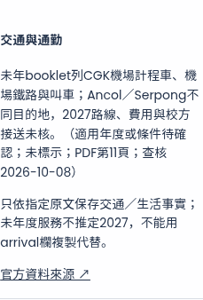
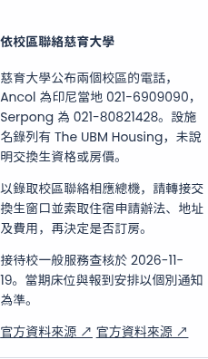

# 中正大學 16 個開放方案的接待校生活服務

2026 年 11 月 19 日（臺灣時間）逐校讀取 19 份接待校資料，核對住宿、到校交通或諮詢窗口。這 16 份生活指南已可提供有官方來源的部分資訊。各校原有的 2027 春季配房、費用、簽證及報到欄位仍保留各自的年度與查核狀態。中正的「開放」係該梯次名單列有名額，學生可否繼續申請仍須查母校截止時間。

慈育大學的例子呈現生活指南裡的第一張服務卡。兩張圖使用相同的 Chromium 畫面函式與正式樣式，分別載入原始生活檔案及本次補查後的資料。

| 原先顯示的交通參考 | 補查後的校區聯絡方式和住宿下一步 |
| --- | --- |
|  |  |

| 接待校 | 校方公開資訊 | 學生下一步 | 接待校來源 |
| --- | --- | --- | --- |
| 重慶大學 | 重慶大學校園地圖分列沙坪壩 A、B、C 校園和科學城虎溪校園。沙坪壩 A 校園在沙正街 174 號，虎溪校園在大學城南路 55 號。 | 收到通知後，按報到單的校區查地圖，再向接待單位確認宿舍地址和入住時間。 | [重慶大學校園地圖](https://www.cqu.edu.cn/xysh/xydt.htm) |
| 廈門大學 | 廈門大學港澳臺校際交流辦法將註冊與管理交由學生處海外學生事務科（osao@xmu.edu.cn）。住宿費依兩校協議處理，住宿安排與金額以最新通知為準。 | 先確認錄取學院位於思明或翔安，再向海外學生事務科核對報到地點、住房通知及押金。 | [廈門大學港澳臺地區校際交流學生辦法](https://visiting.xmu.edu.cn/Web/Info/e3d294da-f1f5-4a89-bd9f-c6848f4a17b8) |
| 東北師範大學 | 東北師範大學國際學生辦公室列出單人與雙人房、獨立衛浴，各樓層有共用廚房與洗衣設施。 | 向 iso@nenu.edu.cn 說明自己經中正提名、持臺灣證件，請對方確認適用宿舍、床位、費用和登記方式。 | [東北師範大學國際學生辦公室住宿說明](https://iso.nenu.edu.cn/Campus_Life/Accommodation.htm) |
| 千葉商科大學 | 千葉商科大學的國際宿舍提供床架，學生要自備床墊及寢具。宿舍設共用廚房，住戶可自炊或到校內食堂用餐。 | 收到配房通知後，先問能否代訂或租用寢具，再安排抵達當晚用餐。 | [千葉商科大學 International Dormitory](https://www.cuc.ac.jp/eng/studentlife/dormitory.html) |
| 常磐大學 | 常磐大學指引從 JR 水戶站北口 5 號站牌搭公車，約 20 分鐘到自由ケ丘（Jiyugaoka）站。另有少數班次直達校內。 | 按報到地址查當日公車時刻。若要先去宿舍，請接待窗口提供宿舍地址及領鑰匙時間。 | [常磐大學 Access](https://www.tokiwa.ac.jp/en/access/) |
| 東亞大學 | 東亞大學國際處把 Seokdang Global House 列在 Bumin 校區附近，Hanlim 的 Seunghak Hall 位於 Seunghak 校區內。兩處都列有洗衣設施。 | 先確認主要上課校區，再向國際處詢問可申請的宿舍、入住日期與本期費用。 | [東亞大學國際處 Dormitory information](https://dongaoia.donga.ac.kr/dongaoia/CMS/Contents/Contents.do?mCode=MN060) |
| 中央大學 | 韓國中央大學交換生 Housing & Life 頁分列 Seoul 和 Da Vinci 校區的宿舍網站。宿費依學期調整，用餐另外計費。 | 依錄取校區進入相應的宿舍網站，並向國際處核對申請日期、房型和費用。 | [韓國中央大學國際處 Housing & Life](https://oia.cau.ac.kr/cauoia/exchange/housing.do) |
| 國立法政大學 | 法政大學國際處的住宿頁分 Tha Prachan 與 Rangsit 校區列住宿選項。校方交換資料說明學生自行預訂，國際處提供清單。 | 先確定授課校區，再直接向住宿單位核對空房、押金和取消條件。2027–28 指南可作訂房流程參考，春季的住宿以自己的接待通知為準。 | [法政大學國際處住宿名單](https://oia.tu.ac.th/accommodation-page/)、[法政大學國際處 2027–28 交換資料](https://oia.tu.ac.th/wp-content/uploads/2026/08/OIA_TU-Fact-Sheet-2027-28.pdf) |
| 蒙庫國王科技大學 | 蒙庫國王科技大學交換計畫頁列出校內旅宿 Heliconia House，也列有校外住房選項，押金及水電依住宿類型計算。 | 先向接待系所確認上課校區，再向旅宿或房東索取可入住日期、含水電的報價與退訂條款。 | [KMUTT Exchange Programs](https://www.kmutt.ac.th/internationalization/mobility-program/exchange-programs/) |
| 慈育大學 | 慈育大學公布兩個校區的電話，Ancol 為印尼當地 021-6909090，Serpong 為 021-80821428。設施名錄列有 The UBM Housing，未說明交換生資格或房價。 | 以錄取校區聯絡相應總機，請轉接交換生窗口並索取住宿申請辦法、地址及費用，再決定是否訂房。 | [Universitas Bunda Mulia 校區聯絡資料](https://www.ubm.ac.id/en/)、[Universitas Bunda Mulia 設施名錄](https://www.ubm.ac.id/en/facilities/?pg=2) |
| 聖基茲工學院 | Saintgits 住宿頁列有分別供男女住宿的宿舍，並指定 Food & Residence Officer 為詢問窗口。 | 請宿舍窗口依你的交換系所確認校區、是否接受一學期入住、費用及入住日。 | [Saintgits Hostel](https://saintgits.org/resources/hostels/) |
| 維爾特克科技大學 | Vel Tech 給來校交換生的 FAQ 說明校內住宿會在抵達印度前分配，並列有住宿負責人的聯絡方式。 | 請接待窗口在出發前書面確認你的宿舍樓、抵達日與接送安排，保留聯絡方式。 | [Vel Tech FAQ for Incoming Exchange Students](https://veltech.edu.in/faq-incoming-exchange-students/) |
| 史特拉斯堡大學 | 史特拉斯堡大學要求國際交換生在提交交換申請時一併提出 Crous 住宿申請。校方另列合作租屋平台 Studapart。 | 填合作校交換申請時一併檢查 Crous 欄位。若需自行租屋，可從校方頁進入 Studapart 比對租期、押金與服務費。 | [University of Strasbourg Housing Search](https://international-welcome.unistra.fr/housing-in-strasbourg/housing-search/) |
| 南丹麥大學 | 南丹麥大學的住宿規則允許交換生在送出入學申請後立即申請住宿；依校區和期限提供一個住房選項，房型依供給分配。 | 選擇錄取或預計就讀的校區。若過了住宿頁列的期限、或錄取校區變更，立即向 Accommodation Office 詢問候補與校外選項。 | [University of Southern Denmark Student Housing](https://www.sdu.dk/en/uddannelse/studenthousing) |
| 德根多夫應用科技大學 | 德根多夫應用科技大學 2026 國際生指南區分 Deggendorf 和 Pfarrkirchen 的住房，並列住宿聯絡信箱 accommodation-dit@th-deg.de。 | 來信附上錄取校區、交換起訖日與抵達日，索取當期可申請的宿舍或出租單位清單。 | [DIT International Prospectus 2026](https://th-deg.de/Studieninteressierte/infos-fuer-internationale-studieninteressierte/International_Prospectus_2026_web.pdf) |
| 蘇黎世應用科技大學-工學院 | 蘇黎世應用科技大學工學院交換資料列明學生自行安排校外住宿並簽約。校方住房頁列 Winterthur 的 SWOWI 學生住房及管理方 WOKO。 | 先核對工學院的上課地點，再透過校方列出的機構查租期、押金與入住日。 | [ZHAW School of Engineering Incoming Exchange Factsheet](https://www.zhaw.ch/storage/engineering/studium/internationales-studium/vom-ausland-in-die-schweiz/ZHAW_School_of_Engineering_Factsheet_-_Incoming_Exchange.pdf)、[ZHAW Student Accommodation](https://www.zhaw.ch/en/study/before-your-studies/student-accommodation) |

來源紀錄保留引用原句及查核日期。[逐校來源與原文](../../src/exchange_info/official_data/ccu/host-life-services.json)
