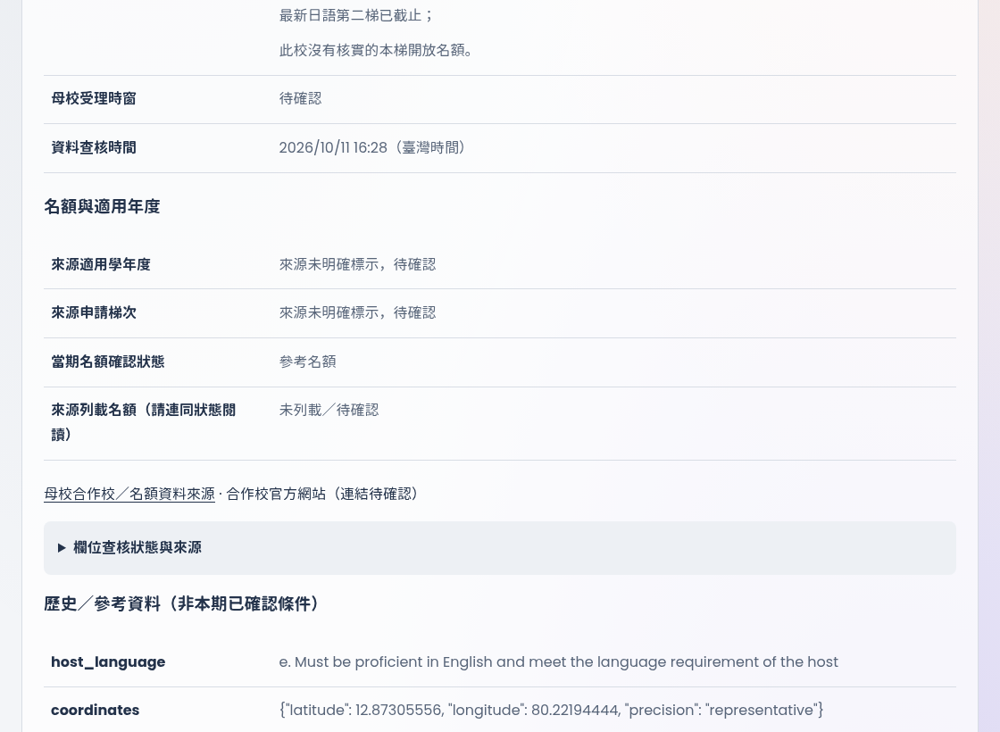
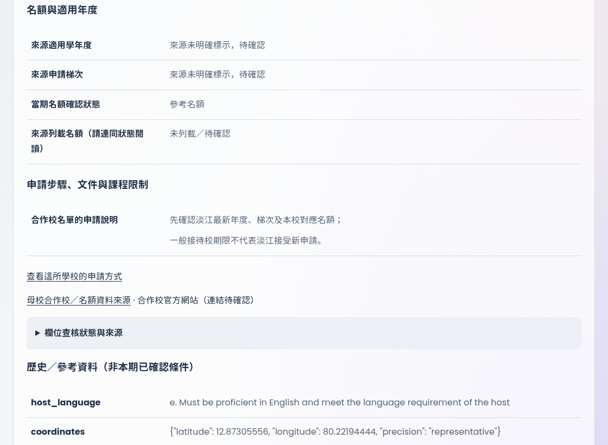
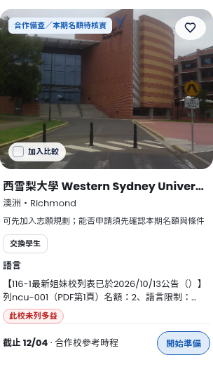
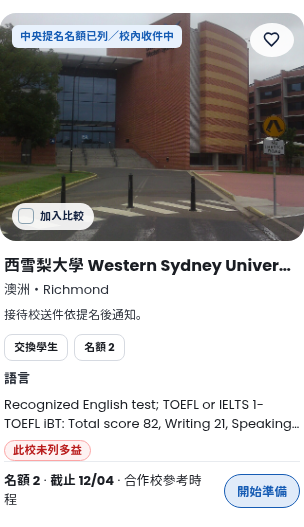

# 合作校頁面的瀏覽器檢查

學校總覽的公開網頁與學生在平台內開啟的合作校詳情有兩種入口。相同母校、國家與學校可能有多個方案，因此專頁與方案分開計數。

## 公開合作校專頁

[逐頁結果（gzip CSV）](partner-ui.csv.gz) 記錄 Chromium 從 71 個母校目錄取得的 10,960 個專頁。瀏覽器向本機平台發出真正的 HTTP 請求，解析每一頁回傳的 HTML，核對頁名、母校、方案欄位、官方來源連結及詳情目標。此項檢查確認連結存在、指向哪所學校。學生在校外是否能登入官方系統需另行確認。

[修改前的 335 個專頁（gzip CSV）](partner-ui-before-gaps.csv.gz) 未列出申請步驟或文件專節，分別屬於淡江 283 頁、中正 51 頁及臺大 1 頁。現在每項方案均提供「查看這所學校的申請方式」，可打開正確母校與合作校的申請分頁。名單缺申請說明時，頁面顯示已收錄的校方名單摘要，或明示目前缺少此項資料。淡江薩蒂亞巴馬大學為參考名額，畫面保留「先確認淡江最新年度、梯次及本校對應名額」的提醒。

| 淡江薩蒂亞巴馬大學原畫面 | 同位置修正後 |
| --- | --- |
|  |  |

修正後 10,960 頁全數通過檢查，10,965 個方案均有申請分頁連結。輔仁有 5 個頁面各列出兩個方案。

## 中央西雪梨大學的互動選校卡

同一張選校卡在修正前標示「合作備查／本期名額待核實」，語言欄混入舊名單的名額說明。修正後，官方 11 月 17 日名單的 2 個名額會顯示在名額欄，卡片標示「中央提名名額已列／校內收件中」。學生可從「開始準備」繼續，接待校送件依提名後通知。[中央國際處 116 學年度第一梯次名單](https://oia.ncu.edu.tw/static/file/26/1026/img/277/116exchangeschoollist-1117.pdf)

| 修正前 | 修正後 |
| --- | --- |
|  |  |

使用 Chromium 的匿名瀏覽工作階段，以國立中央大學為母校，到選校頁搜尋「西雪梨大學 Western Sydney University」，截取預設收合的真實搜尋結果卡。舊圖使用 Git 版本 `af32b61d` 的 Web 版、API 和原始名單（214 個方案），新圖使用本次變更的 Web 版、API 和名單（222 個方案）。兩者皆設定臺灣時區、1280 × 1100 視窗，沒有登入或設定個人資格。

中央原有 80 筆生活檔案缺少城市。本次逐校查到 50 個具名的校區或教學地點。生活頁會顯示地名與「就讀校區依錄取通知」，逐方案結果的 `reviewed_campus` 欄保留 Chromium 讀到的畫面文字。其餘 30 個無法確認就讀地點，逐校保留欠查原因。[中央 80 校地點與來源紀錄](../../sources/ncu/2026-11-17/reviewed-campus-cities.csv)

## 平台內合作校詳情

[逐方案結果（gzip CSV）](partner-ui-tabs.csv.gz) 記錄六個分頁與面板是否一一對應、總覽是否有方案資料，以及申請、官方生活指南、出發前提醒的實際 DOM。檢查器在 Chromium 載入正式 Web 版的詳情 HTML、畫面函式與本機公開資料。逐筆檢查內容與分頁選取狀態時省略外層首頁、圖示和捲動動畫。每個母校的第一筆另以真正的 HTTP 申請流程回應對照。其餘逐筆使用相同的流程選擇器及隨平台發行的資料。未選年度、學院或系所，代表學生從公開選校頁第一次進入。個人已選梯次、文件準備與校方交接屬另份學生流程實測。

`workflow_steps` 為畫面顯示的步驟數。零步時另外檢查是否可找到有來源的準備方向。`destination_status` 是該校官方生活資料的查核程度。`prep_guide` 區分已有國家指南，或提供外交部領事事務局的入境資料入口。這項內容檢查不把來源尚待核實、國家指南尚未整理、學生未曾發表心得等情況計為已有完整資料。

共 10,965 筆方案通過。10,633 筆有獨立申請步驟，另 332 筆仍可查看有來源的準備說明。這 332 筆為淡江合作備查 149 筆、淡江參考方案 134 筆及中正未開放 49 筆。申請分頁均至少有一個來源連結。

| 官方生活檔案的查核狀態 | 方案數 |
| --- | ---: |
| 已查核 | 7,348 |
| 部分查核 | 3,543 |
| 待確認 | 2 |
| 尚未找到可查證的接待校生活資訊 | 1 |
| 尚未收錄 | 71 |

尚未收錄的 71 筆均為淡江合作備查或參考方案。中正本期開放的 16 校已補上接待校的住宿、交通或聯絡方式，另 2 個招生狀態待確認的方案，其生活資料也仍待確認。臺北的吉羅卡斯特大學已核對城市與臺北名額表，但尚未取得可佐證當地住宿或費用的接待校資料，獨立列為尚未找到。[中正逐校生活服務及來源](partner-ui-ccu-life.md)

出發前分頁有 10,547 筆取得目的地國別指南，418 筆使用外交部領事事務局的入境資料入口。

[學生心得、生活與社群的逐方案結果（gzip CSV）](partner-ui-student.csv.gz) 使用平台相同的公開心得來源整理函式逐筆準備資料，再交給正式的學生心得與學生生活畫面。在每個母校抽取第一筆和 HTTP 心得端點核對來源網址。檢查每個來源是否列入學生心得或其他參考網頁，若無心得，檢查是否提供空狀態說明。10,965 個方案中，2,824 個有學生心得，2,856 個僅有其他參考來源，另 5,285 個沒有公開來源，畫面均有相應說明。匿名社群使用無貼文及聊天紀錄的本機資料庫，確認各校社群標題及空社群的訊息。

## 重跑

在與本次修正相同的 checkout 啟動本機開發服務，使用專案 Python 環境及 Chromium。

```sh
.venv/bin/python docs/exchange-journey-audit/partner-ui.py --base http://127.0.0.1:8819
.venv/bin/python docs/exchange-journey-audit/partner-ui-tabs.py --base http://127.0.0.1:8819
.venv/bin/python docs/exchange-journey-audit/partner-ui-tabs.py --base http://127.0.0.1:8819 --student-runtime "$EXCHANGE_INFO_DATA_DIR"
```

心得與社群檢查使用同一服務的 `EXCHANGE_INFO_DATA_DIR`，需要空白的本機社群紀錄。各項檢查均支援 `--parts` 指定每校中間結果目錄。服務中斷後，可在同一版本、同資料設定下加 `--resume` 接續。變更程式或資料後請使用新的目錄。
