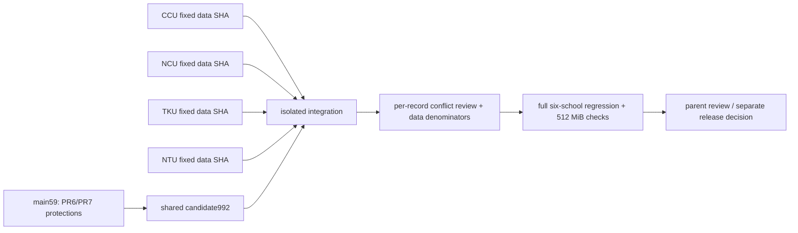

# 六校地球／照片共用候選隔離驗收 — 2026-10-11

本報告是 draft 候選的開發環境證據。**未合併、未部署、未變更正式 DB；四校資料完整度尚未完成。**

- 基線／正式站 commit：`59a20f27fcee00fb597abc79e75ec11778317422`（PR #7）。
- 共用修復 commit：`aa741df24e820ae4ddc649bc9d414047623be6cf`。
- 最終候選：[`9927ec1d8765a9772671bbaa68e7f920995f1258`](https://github.com/blizzard-new/abroad/commit/9927ec1d8765a9772671bbaa68e7f920995f1258)，分支 `fix/six-school-globe-coverage-20261011`。
- 兩候選之間 `src/` 完全相同；後一 commit 只補分母報告欄位、文件與可攜式測試截圖路徑。[來源相同性證據](raw/application-source-identity.json)。
- [六校驗收規格](specification/six-school-visual-coverage.md)、[完整機器結果索引](raw-results.json)、[not-run 清單](not-run.json)。

## 已確認的原因與修復

原清冊只有長庚與臺北大學母校座標，另四校缺首頁標記。既有合作校圖資和照片又因 PDF 字間空白、中英雙語順序、明確國別標籤差異而配不到。共用索引只在沒有精確記錄時採用唯一別名；有歧義、不同國家、院系／分校限定，或精確 pending／needs_review 時均不越過。香港／澳門沒有併入中國別名。原帳號及治理身分函式 AST 未改。

四校母校新增有來源的代表校區座標；淡江明示淡水校區，不假定所有校區同點。前端補可展開的缺座標清單、来源、詳情入口、首頁定位狀態、照片待補／待核對／載入失敗，以及手機地圖預覽照片。清冊與 app 資源版本一併更新；未改合作校名單、名額、年度或治理邏輯。

## 資料覆蓋 — 分母不是本期開放名單

下表的分母僅為 `/student-dashboard.partner_universities` 顯示列數。**合作協議學校、申請計畫／track、本期可選學校**須各有官方來源、年度和去重方式；沒有資料時機器報告明列 `null / not_established`。例如 TKU 287 校合作目錄、128 計畫與本期可選名單不是同一集合；工作者自報數量尚未納入本候選。零名額、未公告、缺漏與舊年參考皆保留。

| 校別 | API 列數 | 正式站 點 / 圖 | 同資料 main 控制組 點 / 圖 | 候選 點 / 圖 | 候選照片有授權欄位 |
| --- | ---: | ---: | ---: | ---: | ---: |
| 長庚大學 | 77 | 44 / 75 | 44 / 75 | 44 / 77 | 2 |
| 國立臺北大學 | 206 | 108 / 165 | 119 / 205 | 123 / 205 | 15 |
| 國立臺灣大學 | 288 | 269 / 266 | 269 / 266 | 269 / 266 | 266 |
| 國立中正大學 | 104 | 0 / 0 | 0 / 0 | 30 / 31 | 17 |
| 國立中央大學 | 214 | 7 / 11 | 7 / 11 | 40 / 51 | 24 |
| 淡江大學 | 4 | 0 / 0 | 0 / 0 | 1 / 1 | 1 |

正式站母校標記 2/6，候選 6/6。候選可用照片皆通過本地檔案及雜湊核對；瀏覽器逐校抽驗 verified／needs_review／missing 狀態，並不代表每張照片已人工辨識或已取得再利用授權。

**NTPU 的正式站部分校名字串與 repository 內建資料不同。**正式站 108 點／165 圖至候選 123／205 的全部差額不可當作共用修復效果。同資料控制組確認的效果為 119→123 點、205 圖不變。其他五校上述集合沒有這個差異。[控制組 1,560 檔 git 原始位元核對](raw/local-baseline-source-proof.json)、[78 筆恢復對應的原始來源清冊](raw/restored-visual-matches.json)、[非視覺欄位保持相同](raw/controlled-partner-field-preservation.json)。

- [正式站完整 coverage 與逐校缺口](raw/final-baseline-audit/report/coverage.json)
- [同資料 main 控制組](raw/local-base-audit/report/coverage.json)
- [最終候選完整 coverage](raw/final-coverage-audit/report/coverage.json)：同目錄 `*-gaps.json` 含逐校缺口、座標來源、照片來源、授權及身分链接。
- [人工照片品質發現](raw/manual-photo-quality-findings.json)：NCU 舊 EDHEC 素材可載入但呈現圖形，無法辨識為校園照片；交原 NCU 資料任務補核。它是既有素材，本候選未改清冊狀態。

## 固定候選的測試結果

| 驗收組 | 原始結果 | 證據／範圍 |
| --- | --- | --- |
| 共用 API、身分／座標、照片、PR6 memory、PR7 年度、六校帳號、verified-email 跨校、workflow cache | 208 passed | [fixed-unit](raw/fixed-unit/stdout.log)，clean `aa741df`，應用程式與最終候選相同 |
| 六校 × 桌面／手機、真實本地 API／MapLibre、全六校切換 | 13 passed | [fixed-browser](raw/fixed-browser/stdout.log)，無 dashboard／素材攔截，[畫面與逐校 JSON](raw/fixed-browser/artifacts) |
| 原有六校條件、保存、文件、導覽與 NTU 內容流程 | 30 passed / 2 failed | [原始紀錄](raw/fixed-school-regression/stdout.log)；兩失敗都是最後截圖寫入不存在的舊絕對目錄 |
| 既有地球互動＋上述 2 項 NTU 年度畫面重跑 | 21 passed | [final-existing-globe](raw/final-existing-globe/stdout.log)，clean `9927ec1d`；含 marker、群聚、重疊、手機拖曳縮放、direct URL、復原與往返篩選 |
| frozen uv lock、Python/JS 語法、OpenAPI、SQL parser、原 workflow parity | passed | [final-contracts](raw/final-contracts/stdout.log)；35 migrations、564 statements、11 SQL bodies、74 PL/pgSQL units，只解析不寫 DB |
| 本機單 worker API 循環＋並行 | passed，78 samples，345.45 MiB peak | [fixed-memory-api](raw/fixed-memory-api/memory-samples.json) |
| 同配置瀏覽器暖機＋之後並行 | passed，123 samples，**449.98 MiB peak** | [summary](raw/final-memory-summary.json)、[完整 samples](raw/final-memory-browser/memory-samples.json)；36 次切校、6 次 NTU 地球／照片／生活頁、3 組 8 併發後測 |
| PR6 手機 menu pointer/icon redraw | passed | [3 個實際指標操作](raw/final-memory-browser/menu-icon-race.json)，重繪過程原 SVG 保持連接 |
| 非視覺欄位／原三校 workflow | passed | CGU154／NTPU409／NTU288 原資料檔與 `f6ad1b8` 逐位元相同；same-school 治理函式不變；全六校 partner 非視覺欄位值不變 |

上述有效範圍共 272 個不同 pytest cases 通過；保留原始 2 failed，不把重跑寫成從未失敗。不同開發版的測試不累加到這個數字。

### 失敗與執行限制如實保留

[raw-results.json](raw-results.json) 列出所有 harness 執行。早期 `browser-first` 1 passed / 1 failed 是測試選中手機隱藏的桌面圖片，修成 visible 選擇器後 13 passed；`unit-aliases` 190 passed / 1 failed 和 `ntu-rebuild-diagnostic` 是子程序誤匯入舊共用 venv 的套件，明訂本分支 PYTHONPATH 後 191 passed，固定版擴充 208 passed。`fixed-contracts` 的自製 parity 腳本誤用 partner `school_name`，改查 `home_university` 後控制組通過。`final-restored-matches*` 失敗揭露正式站 NTPU 文字與內建資料不同，未掩飾；另建同資料控制組驗證。

公開站低頻觀察第一批在 NTU 導覽等待超时；第二批 headless-shell 多個 WebGL 地球後 GPU 卡住，停止本機該觀察瀏覽器。已完成的六校資料與畫面保留，最後 NCU/TKU 使用完整 Chromium 通過，候選亦用完整 Chromium 通過。沒有 mock 正式站 API。雲端瀏覽器有代理 CA 相容措施（`ignore_https_errors`）；未改應用程式 TLS 設定，正式 `/health` 另以啟用憑證驗證的請求取得 200。這些是觀察工具限制，不把整批失敗改標成功。

本機峰值為 process RSS/HWM，不等於 Render cgroup。正式既有版本低頻觀察窗 08:20–08:43 UTC，Render memory 最大約 492.1 MiB，未查到該窗新增 OOM/restart，餘裕偏窄；沒有對正式站做負載測試。[原始 memory](raw/production-memory-0820-0843.json)、[events](raw/production-events-0820-0843.json)。

## 四校資料整合依賴與下一步

本分支只負責共用行為與母校座標，並不替代四校原任務。固定資料 SHA 尚未收到：

| 校別 | 原任務 thread | 狀態 |
| --- | --- | --- |
| CCU | `01a11942-ed8a-720e-917f-4053cf9dc0aa` | pending fixed SHA、官方名冊／照片／座標差集 |
| NCU | `01a1199b-7beb-7623-b0d5-a8e203cbb09f` | pending fixed SHA；含 EDHEC 舊素材品質問題 |
| TKU | `01a11943-3a15-7298-95eb-928fbdcb00b6` | pending fixed SHA；287 合作目錄／128 計畫／本期可選須分開 |
| NTU | `01a1147e-f828-714a-816b-cc64f4e0b0f9` | pending fixed SHA；288 校來源嘗試的 503 不可當已取得內容 |

建議以此共用候選為底，逐一納入校別固定 SHA；尚無證據要求四校互相先後。每次對共同 `university_locations.jsonl`、`school-images.json`、素材檔及共用 API／前端逐 record/hunk 協調，保留四校母校來源與其他校記錄，不因 Git 無衝突就視為通過。重跑名冊差集、照片身分／作者／license／hash、可靠校園坐標、current/reference 年度邊界、六校帳號／切校／手機／桌面、論壇與治理發布回滾、記憶體。完整四校合成套件的全測在此階段 **not run**，不能宣稱全校完整或上線成功。

## 發布／回滾邊界

本共用候選無新 migration、無依賴／workflow 設定修改。[GitHub 狀態](raw/final-github-state.json) 和 [Render service](raw/final-render-0.json) 確認：main 保持 `59a20f2`，Quality `374368612` 仍 `disabled_manually`，Render autoDeploy=yes / commit / main，PR previews 關閉。最新 live deploy 仍 `dep-db4qe3p5efls73a1jg7g`（main59）；[deploy 證據](raw/final-render-1.json)。沒有動 branch protection、憑證、付費、權限。

**現在不執行發布。**父對話取得四校固定 SHA 後，先重新盤點合成差異的 migrations。若仍無新 SQL，資料／程式是同一可回退 artifact，不需要 DB 寫入；若新校別候選新增 SQL，先驗 additive schema 與舊程式相容性，在 disposable DB 做前後相容／治理 rollback 測試，再由父對話另行協調授權的 DB 先行與 app 後續順序。main 更新會立即觸發 Render；Actions 帳務未排除，不能假定 production `supabase db push` 會同步。任何 DB 未確認的依賴不能靠先 merge app 解決。

後续若获發布授權，先固定合成 SHA、保存當前 live artifact／必要資料備份，確認 DB 前置後再更新 main，核對 Render 實際 deployed SHA、健康、六校低頻驗收及記憶體事件。程式／靜態資料故障可回到先前已驗證 artifact 或以明確 revert commit 觸發回復；不可刪除 schema 或倒灌資料作為通用 rollback。保留帳號／論壇 runtime 資料與 additive DB，DB 修復另行授權。此為待父端決策計畫，沒有執行 rollback 或 deployment。

## 重現與證據完整性

`harness/` 保存本次測試／匯出／觀察腳本；metadata 保存完整命令、起迄時間、SHA／tree／工作目錄狀態、exit code。使用 Python 3.12.14、現有 dev venv 和完整 Chromium；避免讓子程序取到舊安裝版，需 `PYTHONPATH=<candidate>/src:<candidate>`。實际 e2e 與 API 使用隔離 development data，移除正式 DB/Supabase 環境，單 worker。原始 evidence 中的路徑為此執行環境。

`raw/` 保留 public snapshots、測試 stdout/stderr、圖資來源與瀏覽器截圖；排除 disposable runtime account-data、cache 與瀏覽器二進位。`SHA256SUMS` 涵蓋所有交付檔案（自身除外）。舊輪 2026-10-09 的 2,647-case／PostgREST 成果僅作歷史證據，未冒稱此候選重跑。
