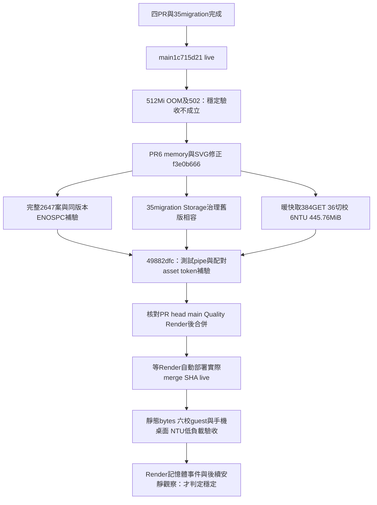

# PR6 固定版本發布與回復計畫

正式DB已依原順序成功套用35份migration，四支原PR已合併；`release-plan.md`保留的是PR2套用前的發布方案。PR6沒有migration，不能因Actions帳務失敗再bulk push或repair。

發布前必須完成原始pytest/JUnit/collection對帳，保留原3筆ENOSPC、1筆配對asset token及所有過往失敗，不以補驗覆寫原run。最終49882dfc與完整測試f3的所有Python/JavaScript、資料、SQL、依賴、runner、部署設定Git物件一致；差異只是一處HTML配對快取token與測試I/O修正，最終6contract與9browser已通過。14原有skip不變，其中pytest opt-in Docker由實際完整runtime另行驗證。

父對話已明確授權必要記憶體修復PR、測試、合併與部署；因此門檻通過後以expected_head_sha=49882dfce64449abeb682d01ae01a8da5c10ba8d正常merge。不改Quality停用狀態、Render autoDeploy/branch/plan、權限、憑證、branch protection或費用。Render main commit會自動部署，不另觸發duplicate deploy。

正式驗收只執行連續低負載公開GET與單一瀏覽器：新index/app.js bytes、六校資料/401論壇guest邊界、390/1440選校與台大照片地球生活來源。不得把本機RSS/HWM冒充Render cgroup數值；查實際merge SHA部署live與該instance的memory_usage/memory_limit、server_failed/server_restarted，再做短時安靜觀察與health讀取。外部使用者活動無法控制，因此記錄實際觀察窗與數值，不宣稱任意流量永不OOM。

若build/live/任一驗收失敗，保留事件和原始證據並停止宣布成功。PR6不改DB，程式問題可按正常Git revert該merge，DB35份與append-only治理記錄保留；但前一1c715d21已知會OOM，該回退僅是暫時行為恢復，不是穩定修復。原五校e5c6d5c也曾接近512Mi，不能盲目稱其安全。優先在隔離分支定位並forward修正；任何超出既有授權的付費、設定或安全權限改動需另外回報精確步驟。
