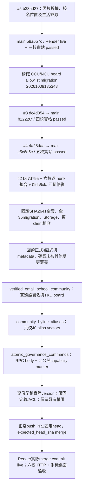

# 精確發布順序與回退（2026-10-09）

## 正式 DB 的精確範圍

目前正式 DB 已有31份原migration與CCU/NCU compatibility，共32份。原31份中五個既有遠端timestamp與repo不同，是發布前就有的歷史差異；禁止bulk db push、migration repair或重跑舊migration來掩蓋。Actions目前帳務受阻，Quality保持disabled_manually；DB是否成功僅以工具回執與實際定義readback為準。

只按上述順序套用PR2三份必要migration。使用現有授權Supabase MCP，不取得新憑證。MCP會產生實際UTC version，成功後以返回/查回的真正version重命名尚未進main的三個檔案，SQL bytes不變；保存old-path/new-path/SHA256 mapping。runtime與parser以唯一migration名稱辨識，不因換timestamp漏掉permission assertions。新建排序將與已驗證的部署排序一致。

已備份原四個函式definition、MD5、owner、ACL、security mode及search_path於production-pre-tku-function-definitions-decoded.json。每份套用前再次確認預期定義；每份套用後回讀並核對欄位。不得改grant/owner/RLS/security、寫入正式測試帳號、變更Render設定或Quality、付費／branch protection。

函式兼容性：舊revision分支只多同步既有revision content_hash，publication只增加同一把advisory lock；既有簽章與權限不變。以正式e5c6d5c治理client連新完整DB完成stage、雙人審核、發布與新舊payload一致讀回，全12 HTTP200。新RPC純built-in hashing在隔離317向量與正式DB唯讀317向量均與owner-only helper一致，未授權helper給service_role。

## 停止條件與回退

- 正式函式前置MD5/metadata不符、任一migration失敗、readback不符：停止PR2 merge，現有五校app維持運作，釐清差異後只做精確forward修復。
- #2程式部署失敗：停止後續动作，按正常Git revert该merge恢复前一五校程式，等待Render對應revert commit live並再驗收。相容的新DB保留，不能把git revert當DB已回退。
- DB升级本身為transactional migration；失敗依工具回讀確認該份未提交。前三步非跨三份原子交易，已成功的允許保留與舊client相容。若需要DB修復，用已備份definition作精確forward migration；不drop table，不清除audit，不還原整庫。
- 不盲目還原舊governance RPC：capability marker是append-only治理證據，新版client仍存在時降回舊RPC會造成錯誤能力判斷。程式回退保留新相容DB是已驗證路徑。
- 內容發布/回滾採既有雙審、CAS與append-only命令；全35runtime已包含17安全組、74RPC、31audit及實際Storage清理。這不授權合成資料寫入正式站。

## 資料缺口

不得把CCU55 legacy、NCU214 pending、TKU4有限流程說成全校完整。長庚154／北大409／台大288完整model payload與原f6ad canonical SHA逐校相同。NTU266張具授權可展示，20 needs_review，2 missing；269代表位置；生活1622節錄/124校，來源舊年原樣保留。新座標範圍的出發提醒43份，另14地區尚未研究（丹麥、以色列、冰島、南非、哥倫比亞、墨西哥、希臘、斯洛維尼亞、智利、澳門、盧森堡、科索沃、芬蘭、葡萄牙），API明示404還在整理，不偽造來源/日期；南韓/韓國與澳大利亞/澳洲以既有alias統一。
