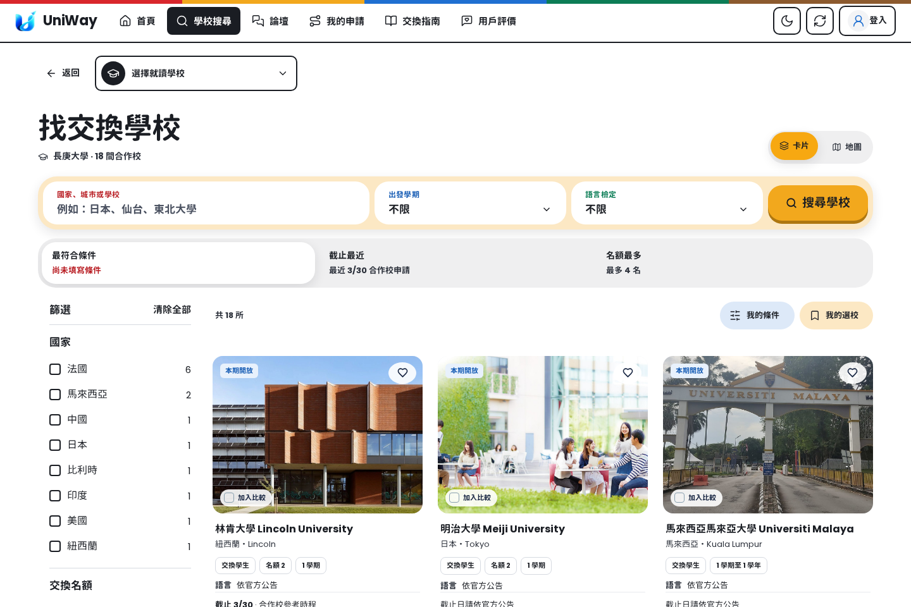
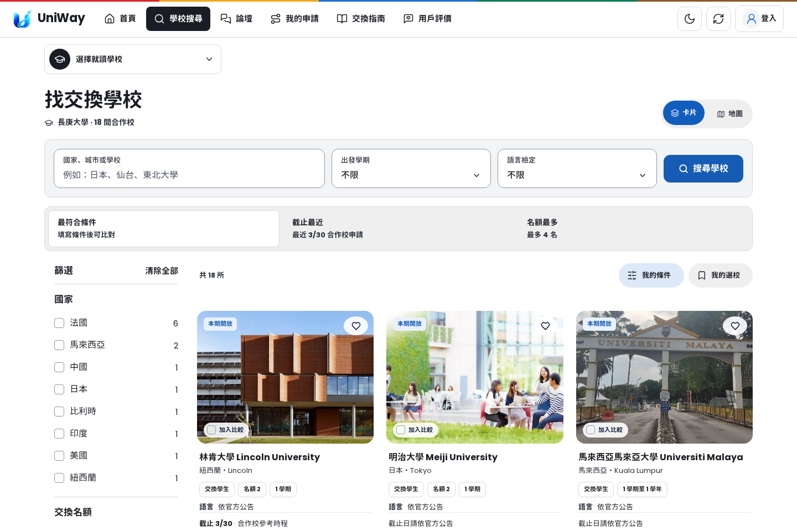
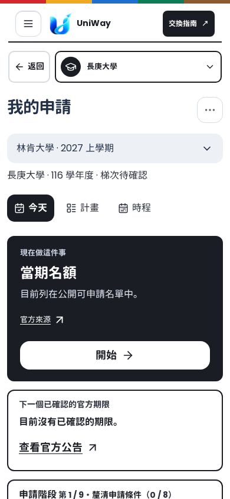
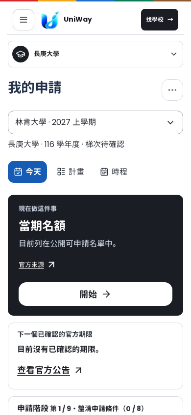

# Uniiway 指定範圍優化與 PR #299 測試紀錄

依使用者確認的《交換平台 UI/UX 優化》理念：降低資訊焦慮、建立社群信任、簡化複雜決策。

本次延續 [PR #299](https://github.com/blizzard-new/abroad/pull/299)，修改範圍為全站桌機頂部列、學校搜尋與詳情、我的申請及其工具。首頁、論壇、意見回饋、個人頁及伺服器產生的閱讀頁延續原 PR 保留的線上外觀。未合併或部署。

## Claude 的測試當時出了什麼問題

沒有取得 Claude 當時那 18 個失敗案例的完整紀錄，因此不能把這次重現的案例冒充為當時的全部案例。

在原 PR commit `7ba502353419d8defa26453a7eac08475a167d57` 重跑 8 組與修改有關的瀏覽器測試，結果是 **113 個：98 通過、15 失敗**。

| 類別 | 數量 | 原因與處理 |
| --- | ---: | --- |
| 過時的介面操作／斷言 | 14 | 還找已移除的 `#application-tools`、舊申請工具選單與導覽項目；預期舊「我的準備任務」標題；未切到列表就點隱藏卡片。改為操作目前可見的導覽、申請選單及列表，繼續驗證收藏、比較、篩選、返回與鍵盤操作。 |
| 全頁網路閒置逾時 | 1 | `networkidle` 把地圖、圖片等背景請求也當成應用程式尚未就緒。改為等待實際 `boot()` Promise 完成並檢查載入失敗。 |

原 PR 的 GitHub 綠燈是當時查到的 TLS trust regression 檢查，不能代表上述瀏覽器套件已通過。

另修正載入畫面的靜態測試：`noscript` 是無 JavaScript 時的替代內容，不能因此判定載入畫面不在最前面。此失敗也在主分支 `bff878eaf829230e2da1de027652300aa6cad5de` 重現。

## 網站調整

- 共用 1280px 內容容器、36px／28px 頁面標題、400／500／700 字重；主要申請頁的標題改為真正的 `h1`。
- 使用細邊線、清楚的欄位邊界、相同的控制項圓角與藍色主要動作。保留地球、學校標記及細頂帶的原有辨識色。
- 移除頂層搜尋與我的申請的多餘返回欄位，保留詳情與子工具返回路徑。指定範圍手機主連結改成「找學校」，回到其他頁會恢復原「交換指南」。
- 申請文件頁移除舊漸層與橫幅內距，學校詳情深色背景跟隨共用主題。
- 不再把偏好國家、資料查核等理由加總成「你符合 X / Y 項資格」。詳情分別說明未填條件、已知條件初步相符、資格待確認、條件不符，以及當期開放／名額狀態。待核實或未開放的名額不會因為個人條件相符而呈現肯定結果。手機固定按鈕列只保留摘要，完整理由仍在「申請條件」，避免長文字遮住內容。
- 保留官方來源、校方最終認定說明與現有資格／名額判定規則；未更動學校資料或自行補造門檻。

直接整理現有 `metro.css`，沒有增加另一支覆蓋樣式表。全站仍依賴既有樣式表，這次不宣稱已完成整站 CSS 重寫。

## 驗證範圍與證據

瀏覽器測試涵蓋桌機／手機、深淺色、未登入與本機合成登入帳號、搜尋／篩選／比較／收藏、地球、學校詳情、申請首頁／任務、換頁與返回、首頁與論壇外觀範圍。

最終結果與測試清單記錄於 `evidence/summary.json`；原 PR 的失敗、主分支對照及修改後結果分開保留，沒有把重跑通過混寫成原始跑次零失敗。

**指定範圍 125 個瀏覽器案例的最新結果全部通過，另有 20 個載入畫面、快取與版本檢查全部通過。**

| 跑次 | 結果 |
| --- | --- |
| 修改後完整瀏覽器跑次，約 19 分鐘 | 120 通過、5 失敗；發現重複的圓角變數、後續舊工具操作，以及首頁動畫影響表單點擊。 |
| 修正後針對失敗與樣式範圍重跑 | 13 / 13 通過。 |
| 最後版面對齊、資格提示與靜態資源驗證 | 25 / 25 通過，其中瀏覽器 5 個、靜態資源 20 個。 |
| 手機固定列精簡後的詳情與靜態資源驗證 | 21 / 21 通過。 |

最後的 JavaScript 語法、`git diff --check` 與靜態檔案版本對照也通過。

另外對原 PR 的後端測試做了延伸掃描：4,644 個已收集案例中，完成 **671 個，660 通過、4 失敗、7 跳過**。這不是全套後端驗證；大型校務目錄測試持續累積記憶體，因此停止擴大與 UI 無關的掃描，將資源用於完成指定範圍驗證。

以下 4 項在原 PR 與上述主分支都失敗，且相關資料、程式及測試在本次沒有修改。保留斷言，沒有為了綠燈放寬資料正確性要求：

| 測試 | 需後續查核的資料落差 |
| --- | --- |
| `test_yzu_return_report_follows_the_official_deposit_page` | 儲存的官方文字未含預期的 2 週、1,500 字、6 張照片敘述。 |
| `test_yzu_study_plan_is_not_the_cf02r3_application_form` | 儲存文字未含預期的 CF-02-R3 申請表敘述。 |
| `test_ntut_templates_follow_archived_step1_and_step3_pages` | 儲存文字未含預期的 1 頁 A4 規定。 |
| `test_numeric_writing_limits_name_evidence_and_match_stored_school_text` | 彰師讀書計畫的 2,300 字設定未能對應儲存的官方文字。 |

內容與表單測試固定減少動態效果；首頁捲動與動畫另外由既有動畫案例驗證。截圖使用本機測試資料，畫面中的學校數量、期限及帳號不是正式資料稽核結果。

沒有使用正式站帳號、寫入正式資料或驗證所有外部校方連結；正式 OAuth 登入亦不在本機合成帳號測試範圍。

## 畫面

桌機搜尋，原 PR 與本次優化：

| 原 PR | 優化後 |
| --- | --- |
|  |  |

手機我的申請，原 PR 與本次優化：

| 原 PR | 優化後 |
| --- | --- |
|  |  |

[手機搜尋](screenshots/after-search-mobile.png) · [深色學校詳情](screenshots/after-detail-dark-mobile.png)

## 重跑

在安裝開發相依套件及 Playwright Chromium 後執行：

```sh
uv sync --frozen --extra dev
uv run python -m playwright install chromium
EXCHANGE_ENVIRONMENT=test uv run python -m pytest \
  tests/e2e/test_uniiway_clarity.py tests/e2e/test_skin_scope.py \
  tests/e2e/test_round_two.py tests/e2e/test_globe_card_and_hero.py \
  tests/e2e/test_platform_redesign.py tests/e2e/test_home_motion.py \
  tests/e2e/test_partner_space.py tests/e2e/test_mascot_solid.py \
  tests/e2e/test_glass_theme.py tests/e2e/test_application_today.py \
  tests/e2e/test_my_application_entry.py -q
EXCHANGE_ENVIRONMENT=test uv run python -m pytest \
  tests/test_loading_screen.py tests/test_static_caching.py \
  tests/test_static_asset_versions.py -q
uv run python scripts/update_static_versions.py --check
```
