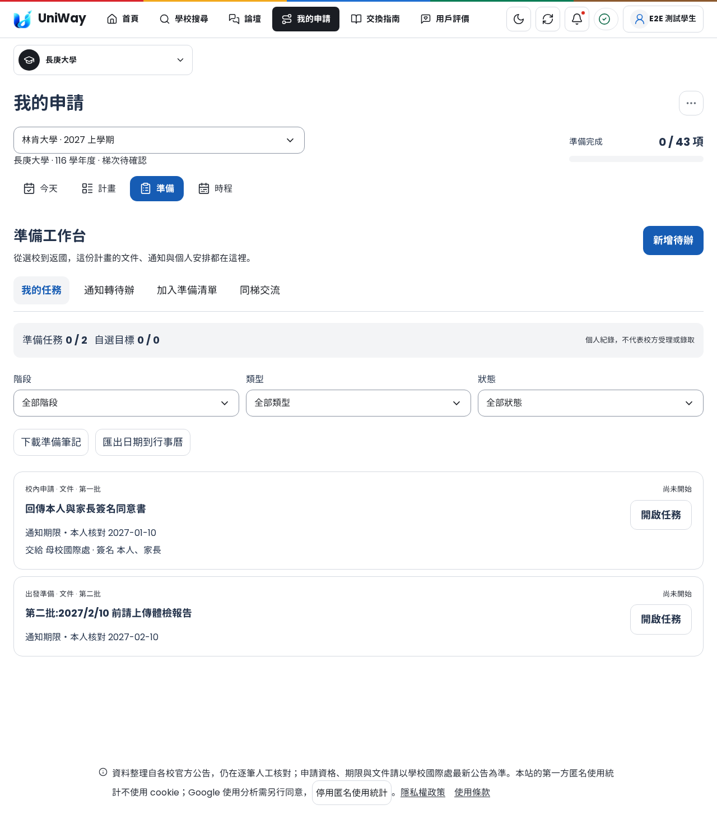

# 從申請到交換生活：準備工作台

入口：登入 → 我的申請 → 選擇交換計畫 → **準備**。

依使用者確認的「降低資訊焦慮、建立社群信任、簡化複雜決策」，延伸原有申請計畫。學生案例只用來發現需求；目的校、出發年份、學期與個人日期都由每份計畫決定，沒有寫死南京大學或 11 月／1 月的安排。

## 已實作

| 學生要做的事 | 可以在哪裡完成 |
| --- | --- |
| 同一份計畫一路準備 | 九個階段：選校、校內申請、面試、錄取提名、合作校申請、出發、抵達、交換生活、返國。任務與原有申請進度保存於同一份帳號計畫。 |
| 把老師通知整理成待辦 | 貼上文字，或讀取 PDF／DOCX／TXT，產生待核對的項目。修改標題、批次、日期、收件對象、簽名者與階段，勾選核對後才保存。保留來源名稱、網址與原文。 |
| 分批文件與版本管理 | 每項文件可記錄批次、收件單位、簽名、檔案位置／版本說明；可連結自己私人文件庫的版本、上傳及下載。保存沿用既有文件庫權限，需明確同意加密保存 30 天。 |
| 邊等待邊準備 | 準備工作可以先開始。正式送件可選多個前置任務；未全部完成時不能新標記送件完成。前置事項重開或文件失效後，相依項目改顯示等待中。 |
| 讓文章變成自己的清單 | 「加入準備清單」載入目的地行前提醒與實際來源，選取後成為可填筆記、設定目標與標記完成的個人任務。已加入的項目不會覆寫原筆記。 |
| 區分通知與個人安排 | 日期分為待確認、個人目標、通知期限。通知期限需本人核對與來源；不會改寫平台已確認的官方期限。今天、時程列表與行事曆顯示同一份計畫的任務，亦可匯出 ICS。 |
| 面試準備 | 加入自介、選校理由、追問練習及歷屆經驗整理；在任務中寫回答、保留來源、下載準備筆記。練習題明確標成準備建議。 |
| 課程安排 | 記錄學分、星期、時間、認列詢問狀態與個人學分目標，顯示重疊時段。 |
| 找同梯交流 | 依填寫的目的校、出發年份與學期查詢現有論壇。學生主動勾選同意後發布邀請，回覆沿用站內討論與審核流程。私人任務不會變成貼文。 |
| 旅行與實習 | 自選清單，分開顯示完成數，不併入準備任務進度；可記錄行程、職缺來源及需確認的資格。 |

## UI／UX

- 在原「今天／計畫／時程」加入「準備」入口；沿用同一個計畫選擇器。
- 「我的任務／通知轉待辦／加入準備清單／同梯交流」分開顯示，避免一進頁面就要求填完所有資訊。
- 基本任務先顯示標題、階段、類型、狀態、日期與筆記；來源、簽名、批次與文件放在可展開區塊。
- 手機篩選欄使用兩欄排列；表單採單欄，保留足夠觸控面積。深淺色沿用既有配色，主要按鈕與頁籤的文字對比另做檢查。
- 保存失敗保留編輯內容；站內切換計畫時草稿按計畫隔離。提供捨棄本次編輯；關閉分頁前對未保存內容提示。
- 同一份通知或清單重複加入時，不覆寫已有的任務與筆記。

## 能力界線

這版是可保存、可操作的準備工作台。校方系統正式送件、親簽、體檢、開戶、購物與正式選課仍由相應單位辦理；學生在工作台保留入口、準備材料和記錄結果。

通知整理使用本機規則擷取，沒有將內容傳給外部 AI。支援明確條列與完整西元／民國日期；省略年份、同段多日期或無效日期留待核對。PDF 須有可讀文字，掃描圖片尚不提供 OCR。日期匯出是全天事件，原文中的截止時間與時區仍須核對。任務建議、待人工審核的目的地資料、學生通知、平台確認的官方期限各保留原本來源層級。

同梯交流依自行填寫的計畫資訊分組，並非校方身分驗證或私人聊天室。已保存任務同步帳號；尚未保存的草稿只保留在目前分頁。每份計畫最多 250 項任務，沿用現有計畫保存容量。

## 實作與驗證

新增 `exchange_workspace.py` 的模型／通知擷取／建議清單，以及 `exchange-workspace.js` 的操作介面。四個帳號 API 掛在既有計畫路徑下，沿用加密保存、擁有者檢查與版本衝突檢查；沒有新增資料庫 migration。已更新 OpenAPI 契約與靜態資源版本。

測試逐跑紀錄見 [workspace-summary.json](evidence/workspace-summary.json)。新功能測試、原申請流程回歸、第一次失敗與修正重跑分別保留；不把歷次執行次數相加成獨立案例數。這些測試使用本機合成帳號與資料，不代表正式校方資料稽核或全庫所有測試皆通過。

原本 UI 優化及 Claude 測試盤點見 [README](README.md)，先前首頁調整見 [home-hero-followup.md](home-hero-followup.md)。本次延續 PR #299，未合併或部署。

## 畫面



[通知核對畫面](screenshots/workspace-notice-review.png) · [課程與撞課](screenshots/workspace-courses.png) · [手機淺色](screenshots/workspace-mobile-light.png) · [手機深色](screenshots/workspace-mobile-dark.png)

## 重跑

```sh
EXCHANGE_ENVIRONMENT=test python -m pytest tests/test_exchange_workspace.py tests/test_application_path.py -q
EXCHANGE_ENVIRONMENT=test python -m pytest tests/e2e/test_exchange_workspace.py tests/e2e/test_application_workbench.py -q
EXCHANGE_ENVIRONMENT=test python -m pytest tests/test_static_asset_versions.py tests/test_static_caching.py tests/test_loading_screen.py -q
python scripts/export_openapi.py --check
python scripts/update_static_versions.py --check
```
