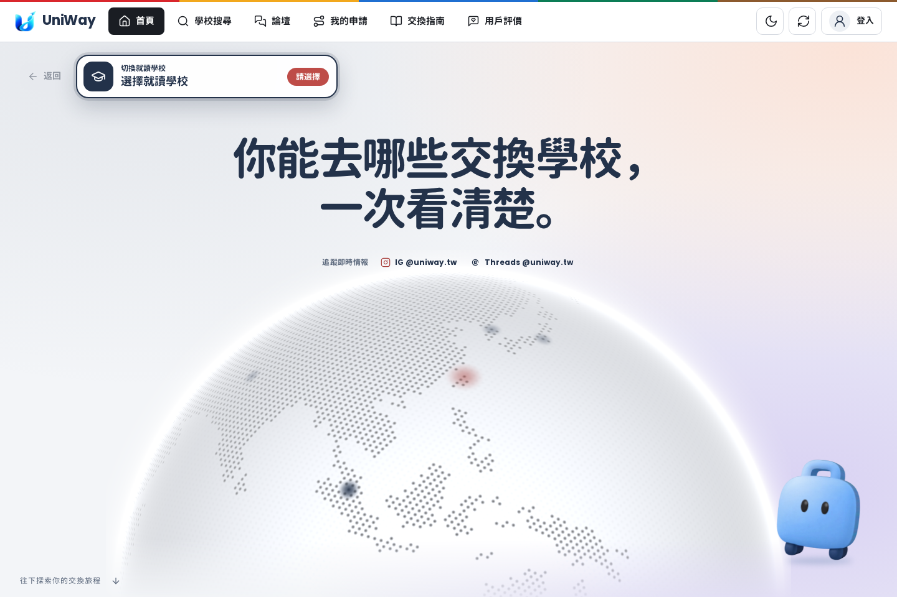
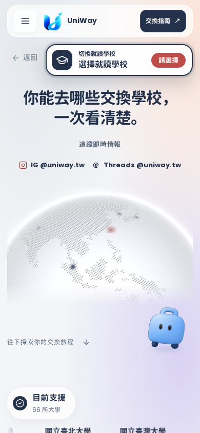
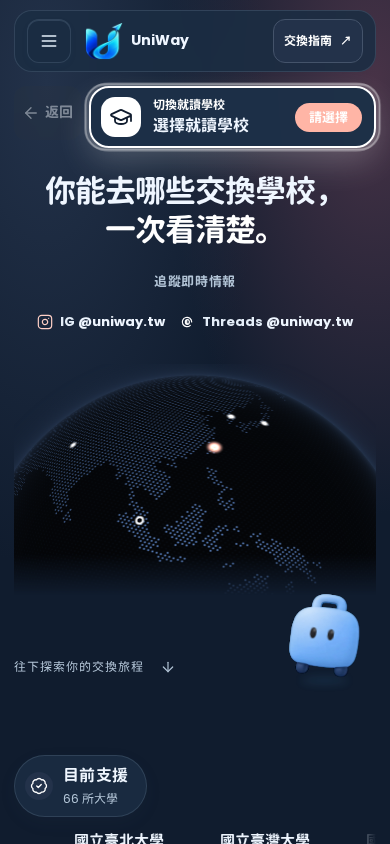

# 首頁首屏追加調整

使用者檢視首頁截圖後，要求刪除右下「我的交換計畫」、將 slogan 移到中間，並確認中間的旋轉地球。

- 刪除首頁首屏的四步交換計畫卡片，同時移除它的資料渲染及專屬動畫，避免留下查找已刪除元素的程式。
- 標語與社群連結置中，地球沿同一中心線排列；手機讓地球接在文字之後，避免壓到標語。
- 保留行李箱角色，移到側下方；我的申請及其實際計畫功能維持不變。
- 延用既有 COBE 旋轉半球。前一張截圖呈現平面地圖，是因本機無硬體 GPU，觸發軟體繪圖備援；不是首頁缺少地球程式。保留低效能與無 WebGL 時的地圖替代，以及減少動態效果設定。

修改既有 HTML、CSS 與 JavaScript，沒有新增覆蓋樣式表。只調整首屏，首頁後續內容維持原有設計。

## 驗證

本次驗證紀錄與前一輪 125 個瀏覽器案例分開保留。截圖使用隔離的本機測試資料。

- 首頁、捲動導覽、角色不遮字、主題／手機排列、學校搜尋跳轉，以及地球啟動／效能備援：**18 個瀏覽器案例全部通過**，見 [JUnit](evidence/home-hero-browser.xml)。
- 載入畫面、快取與靜態版本：**20 個全部通過**，見 [JUnit](evidence/home-hero-static.xml)。
- 實際畫面檢查：1440px 淺色、390px 深／淺色、320px 備援；標語與地球中心對齊、無橫向溢出、無 JavaScript 錯誤。WebGL 畫面的旋轉角度持續變化，見 [量測紀錄](evidence/home-hero-observations.json)。
- JavaScript 語法、靜態版本對照與 `git diff --check` 通過。

WebGL 畫面使用實際 COBE／WebGL 繪製；測試瀏覽器覆寫繪圖器名稱，才能在軟體繪圖環境檢視原本僅在硬體 GPU 啟用的路徑。首次截圖在此環境等待載入畫面逾時；截圖改為載入期間減少動態效果，頁面就緒後恢復動畫，完成旋轉確認。上述 18 個瀏覽器案例仍使用各案例自己的動態設定。這不是實體 GPU 效能驗證。

## 畫面

| 手機淺色 | 手機深色 |
| --- | --- |
|  |  |

[320px 軟體繪圖備援](screenshots/home-hero-mobile-fallback.png)
