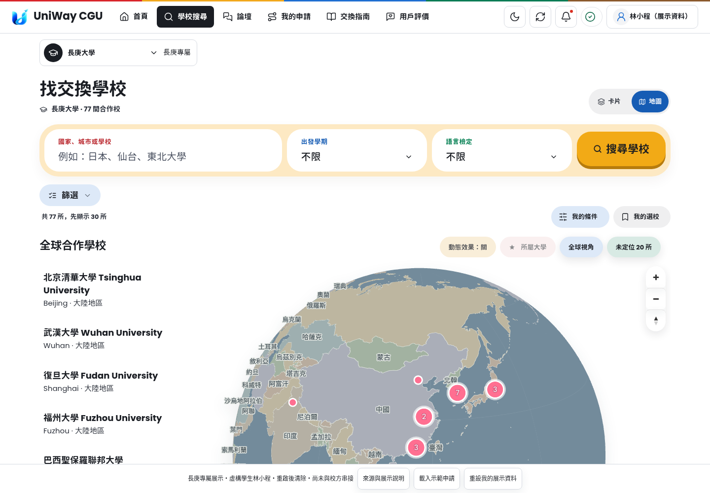
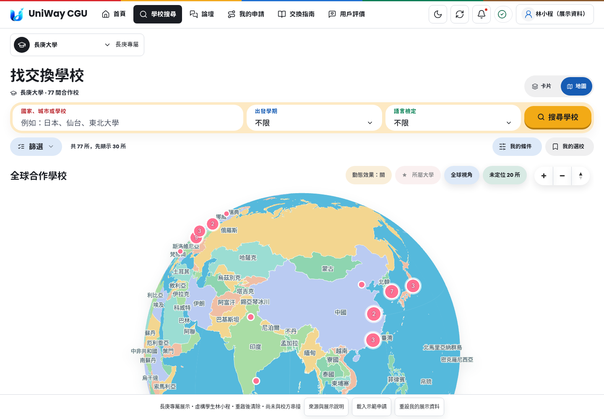
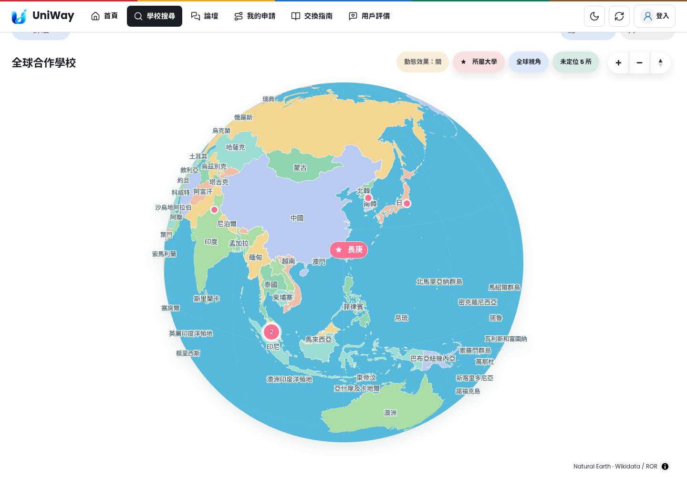
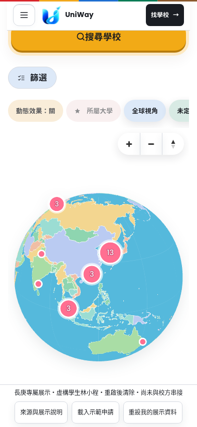
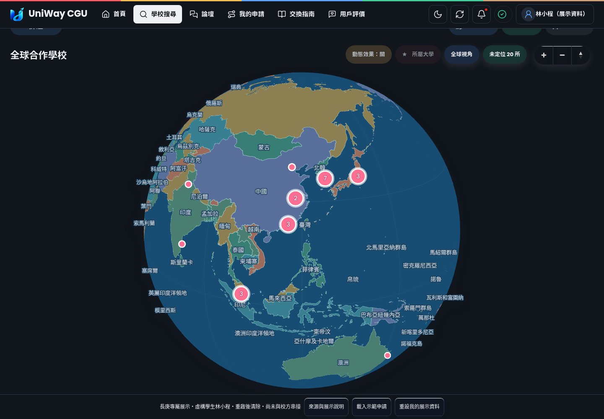

# 學校搜尋：明亮地球與寬版地圖

此變更沿用 PR #299 的 UniWay 介面，修改主站及長庚展示站共用的 `index.html`、MapLibre 地圖與 Metro 樣式。沒有新增依賴、改動資料來源、登入、資料庫或部署設定。

## 實際變更

- 海洋改為明亮海藍，陸地使用薄荷綠、暖黃、粉紫等配色；深色模式保留清晰的國名、邊界和粉紅學校標記，切換主題即時重繪。
- 移除地圖左側重複的學校清單及相關 JavaScript／CSS。保留卡片模式、地球標記、下方可用鍵盤操作的快速定位選單及「未定位」入口。
- 桌面搜尋列約從 106px 縮為 73px；地圖模式將篩選、結果數及我的條件／選校放在同列。
- 地圖使用完整內容寬度，桌面最大寬度 1800px。在 1440 × 1000 視窗，實際畫布從 1020 × 912 增為 1392 × 900，可操作面積增加約 35%；地圖上緣也提早出現。
- 縮放及方向按鈕橫向排列，保留 44px 點擊範圍；桌面與地圖粉彩按鈕同列。手機的粉彩按鈕維持單列，可橫向捲動，縮放控制另佔一列，避免擠壓地球。
- 學校預覽在較小空間可捲動，手機仍從底部呈現；完整資料、收藏及回到地圖流程沿用原有功能。
- 更新所有修改資源的快取版本，避免回訪者取得舊 CSS／JS。

## 畫面

截圖來自本機隔離環境。主站測試使用虛構資料；長庚站使用既有公開展示目錄與虛構學生。畫面不是已部署的線上站台。

| 修改前 | 修改後 |
| --- | --- |
|  |  |







## 驗證與更新

本機另以實際 Chromium 操作 1440 × 1000、1024 × 768、393 × 852、320 × 740，確認縮放、篩選／我的條件展開、主題切換與頁面寬度，四組均通過且無 JavaScript 例外。長庚站也完成桌面／手機選校預覽與亮暗模式檢查。相關 pytest 共 27 個案例：綜合執行 26 個通過，選校重新整理案例修正測試初始化（保留母校與等待啟動完成）後單獨重測通過。JavaScript 語法、靜態資源版本與 diff 檢查通過。Safari／Firefox 及真機尚未測試。本次 MapLibre 為原生 ES module，HTML／CSS／JS 直接由 FastAPI 供應，沒有需重新產製的地圖 bundle。首頁 COBE 與 React Aria bundle 未變更；未重新建置 Docker image 或執行整個專案的安全／資料庫測試。

可重現檢查：

```sh
PLAYWRIGHT_CHROMIUM_EXECUTABLE_PATH=/usr/bin/chromium .venv/bin/python -m pytest \
  tests/e2e/test_partner_globe.py tests/e2e/test_partner_globe_layout.py \
  tests/test_partner_map_geometry.py tests/test_static_asset_versions.py \
  tests/test_cgu_demo.py::test_exact_shared_assets_and_main_dom -q
node --check src/exchange_info/static/app.js
node --check src/exchange_info/static/partner-map.js
.venv/bin/python scripts/update_static_versions.py --check
```

瀏覽器測試涵蓋桌面、平板、393px 與 320px 手機，檢查畫布寬度、控制項排列、鍵盤與滑鼠縮放、展開篩選、亮／暗模式，以及原有地圖互動與錯誤回復。新畫面輸出至忽略追蹤的 `output/partner-globe-layout/`。

這次只交付 PR，沒有合併、部署、修改 DNS 或操作正式資料。兩個網域都須在審查後各自更新到含此 PR 的版本。Windows 長庚容器固定在既有 revision，合併 main 不會自動更新它；依既有部署文件重建長庚容器時保留原本的埠號與 Caddy 設定。展示容器重啟會清除暫存的虛構進度，正式主站與展示站仍維持各自資料隔離。
