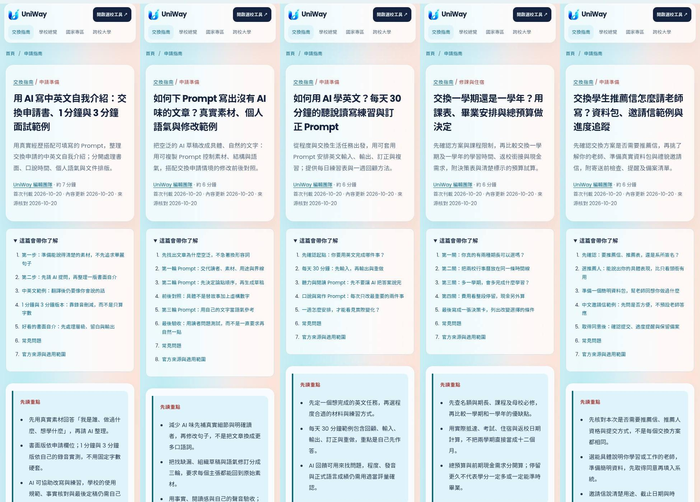
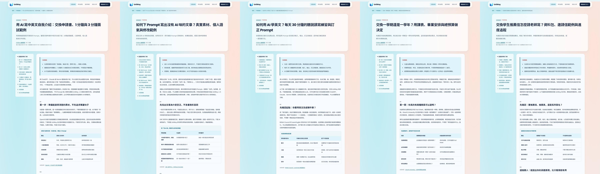

# 五篇交換與 AI 教學文章：驗收紀錄

依使用者「現在再做五篇並開 PR」的要求，新增五篇完整繁體中文 SEO 圖文文章。這是手動追加批次，每日 08:00 兩篇的排程仍照既定設定執行；後續批次須檢查本 PR，避免重複選題。

以 `bb73210281edaf2d648e981cae5c950635090480` 的 main 為基礎，在隔離分支 `codex/seo-five-guides-20261020` 製作。既有十篇文章、渲染器與路由未改寫，文章目錄與 Sitemap 沿用資料驅動機制。

## 文章與內容分工

| 文章 | URL | 正文可見字元 | 重點 |
| --- | --- | --- | --- |
| 用 AI 寫中英文自我介紹：交換申請書、1 分鐘與 3 分鐘面試範例 | `/guides/ai-self-introduction` | 3,632 | 素材表、分輪 Prompt、中英文示例、錄音計時與文件排版 |
| 如何下 Prompt 寫出沒有 AI 味的文章？真實素材、個人語氣與修改範例 | `/guides/natural-writing-prompts` | 3,317 | 草稿診斷、三輪 Prompt、前後對照與人工驗收 |
| 如何用 AI 學英文？每天 30 分鐘的聽說讀寫練習與訂正 Prompt | `/guides/ai-english-learning` | 3,497 | 任務診斷、30 分鐘循環、聽讀及說寫練習、一週回顧 |
| 交換一學期還是一學年？用課表、畢業安排與總預算做決定 | `/guides/exchange-semester-or-year` | 3,413 | 方案限制、兩校行事曆、學習目標、支出及資金試算 |
| 交換學生推薦信怎麼請老師寫？資料包、邀請信範例與進度追蹤 | `/guides/exchange-recommendation-letter` | 3,200 | 文件要求、推薦人選擇、資料包、中文信件與提交分工 |

字元數來自渲染後的 `.article-body`，包含表格、FAQ 與來源，並非全為段落文字。每篇含直接回答問題的開頭、三個摘要、五至六個內容段落、實用表格、原創無障礙 HTML 步驟圖、文中攝影、三個 FAQ、官方來源及相關文章；母校與選校工具連結由既有版型提供。

讀書計畫已存在，這次沒有再做近似頁。自介處理快速認識申請者，Prompt 文章處理修稿方法，英文文章處理日常練習；沒有把同一份教學拆成三個品牌版本。選題依使用者的候選池及編輯判斷，未提供或推測搜尋量、排名與 Search Console 成效。

## 來源、圖片與假設

- [來源紀錄](seo-editorial-five-sources-2026-10-20.json) 包含十個已讀取的官方／大學來源、最後網址、擷取內容 SHA-256、適用範圍與查核日期。OpenAI、Anthropic 與 UNC 支持一般提示及精簡寫作原則；British Council 支持程度資源與以學習者為中心的 AI 使用；Utrecht 提供交換期長與 2026–2027 行事曆案例；Oxford 的推薦信制度明示為研究所案例，未套用成交換生通則。
- Prompt、人物、翻譯與修稿例句均明示為編輯教學示例，未冒充工具實測輸出、真實學生經歷、官方評分或錄取結果。沒有實作或宣稱三款工具的勝負、付費功能或方案效能。
- 所有時間與金額示例已驗算：每日練習 30 分鐘；口說分配分別為 60 與 180 秒；假設支出為新臺幣 185,000／325,000 元、差額 140,000 元，含可退押金及備用金的示例預留為 235,000／375,000 元。例文不把它們當作官方生活費或簽證財力標準。
- [攝影紀錄](seo-editorial-five-photos-2026-10-20.json) 記錄五張不同的 Pexels 照片、原作者、來源頁、授權、裁切 URL、雜湊及文章對應。已閱讀各圖頁的作者與授權資料及 Pexels License，逐張目視確認。人物是素材情境，不冒充申請者、推薦人、使用者或學校代表。
- 五張網站配圖為 1536×1024 WebP，85,910–121,464 bytes，各低於 450 KB，合計 536,806 bytes。保留自然色彩，沒有合成或修飾人物；alt、圖說、作者連結、尺寸與 lazy loading 已核對。
- 執行環境直接連線 NTU 申請與 FAQ 網頁回傳 503，這兩頁沒有作為本批的事實依據；沒有以無法讀取的來源支持規則。Gemini 的舊說明網址轉向地區可用性文件，也沒有當作 Prompt 教學證據。

## 驗證結果

| 檢查 | 結果 |
| --- | --- |
| `scripts/check_editorial.py --base-ref origin/main` | 全部 15 篇通過內容結構、圖片與日期檢查；[機器紀錄](seo-editorial-five-content-2026-10-20.json) |
| SEO 文章、SEO、內容、品質、報表及 release gate 單元／整合測試 | **81 passed** |
| Chromium 文章、SEO 頁面與分析事件測試 | **25 passed**；含全部 15 篇手機頁面與無 JavaScript 導覽 |
| 本批五篇另外在 390／1440 px、JavaScript 關閉下檢查 | **10 個閱讀畫面通過**；目錄、FAQ、相關文章、圖片實際載入、攝影署名、canonical、表格及頁面溢出；[紀錄](seo-editorial-five-browser-2026-10-20.json) |
| 目視檢查 | 五篇桌面與手機標題、目錄、閱讀欄及照片裁切已查看，未見內容遮擋或整頁橫向溢出 |
| Wheel | `uv build --wheel` 成功；15 篇 JSON、15 張圖片、renderer、CSS 等 33 檔逐位元相符；從套件抽出的模組在來源目錄外成功載入全部 15 篇；[紀錄](seo-editorial-five-package-2026-10-20.json) |
| `git diff --check` | 通過 |

執行命令（使用已安裝的環境及目前 worktree 的 `PYTHONPATH=src`）：

```bash
python scripts/check_editorial.py --base-ref origin/main
python -m pytest -q tests/test_seo_articles.py tests/test_seo.py tests/test_seo_content.py tests/test_seo_quality.py tests/test_seo_reporting.py tests/test_editorial_release_gate.py
PLAYWRIGHT_CHROMIUM_EXECUTABLE_PATH=/usr/bin/chromium python -m pytest -q tests/e2e/test_seo_articles.py tests/e2e/test_seo_pages.py tests/e2e/test_seo_analytics.py
uv build --wheel
```

這些是本機分支的驗證結果，沒有宣稱遠端 CI、正式部署或 Google 收錄已完成。建立 PR 後仍需審閱與合併；本批沒有部署正式站、寄信或要求搜尋引擎批量建立索引。

## 閱讀預覽

五篇手機首屏與目錄：



五篇桌面閱讀欄：



手機文中攝影與署名：


桌面文中攝影與署名：


候選與每日產文規則的文件更新在 [PR #92](https://github.com/blizzard-new/abroad/pull/92)。本批基於 main，內容不依賴該 PR 才能運作；候選清單中的批次紀錄已提醒後續排程避開本批五個方向。
