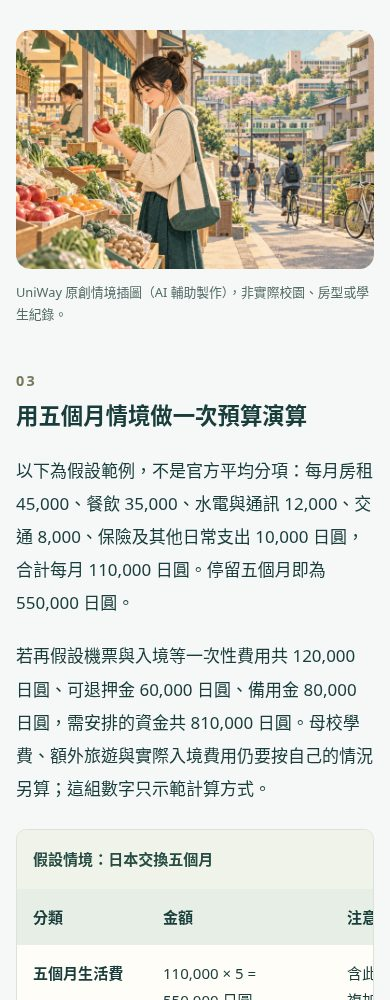

# Illustrated editorial batch: validation

Ten complete Traditional Chinese guides are ready for review: three existing URLs expanded and seven new URLs. Each has five substantive sections, a practical table, a topic-specific accessible diagram, one distinct original inline illustration, three answered FAQs, official references and related links. The body audit reports approximately 2,100–2,800 visible characters per article, including tables, FAQs and sources; this is not a claim that every character is prose.

## Evidence

| Check | Result |
| --- | --- |
| `check_editorial.py --base-ref origin/main` | 10 articles pass structure, source-reference, local-image and revision checks |
| Unit/integration: articles, SEO, content, quality and reporting | **69 passed** |
| Chromium: article journeys, existing SEO pages and analytics | **20 passed** |
| Viewports and JS | 390px and 1440px article journeys without JS; all ten pages checked for phone overflow and actual image loading |
| Navigation | Outline anchors, FAQ toggle, related article, country and school/planner links |
| Images | 10 WebP, 1536×1024, 2,543,616 bytes total; each below 450 KB, explicit dimensions and lazy loading |
| Package | Wheel built; all ten JSON and ten WebP plus renderer/CSS match current source byte-for-byte; extracted wheel loads all ten articles outside the checkout |
| Dates/indexing | Independent canonical, Article + Breadcrumb JSON-LD, visible version dates, original URLs retained, article `lastmod` based on material revision date |
| Source-only recheck | Test verifies a changed check date does not refresh sitemap `lastmod` |
| Safety of structured content | Unknown citation/table shape fails validation; text escapes markup and source URLs reject unsafe schemes/credentials |
| Regression | Existing partner/country navigation, unknown-page 404 and staging noindex preserved |

GitHub's **Web quality** workflow remains `disabled_manually` as observed on 2026-10-19; these are local test results, not a remote CI pass. The existing Supabase deployment workflow is a separate workflow and was not changed or manually dispatched.

## Source scope

The [source ledger](seo-editorial-sources-2026-10-19.json) records ten unique official references, versions, access evidence and numeric examples. JASSO's living-cost statistics are explicitly labelled 2023; its exchange scholarship page is dated 2024-01-31. DAAD's financial-proof figure is explicitly labelled 2025-01-01, not asserted as the user's current visa requirement. Korea's total and component ranges do not reconcile and are deliberately not added together as an official budget.

The NTU live source returned HTTP 503 in this environment. Its official PDF was read from the repository's 2026-10-11 archive and its SHA-256 verified against the source manifest. The article source notes disclose the archived version and tell applicants to recheck current rules. The MOE portal is a navigation link only; specific subsidy rules are supported by the official 2025-11-04 revision attached to SCU's announcement, which was fetched and read successfully.

Illustrations are original AI-assisted scenarios, explicitly labelled as such; they are not actual campus photographs, student testimonials, accommodation guarantees or scholarship awards. [Artwork provenance](seo-editorial-artwork-2026-10-19.json) records generation IDs, hashes and article mapping.

## Reading preview

Screenshots from the local branch, not the production website:

## Release boundary

This batch is not deployed by creating a PR. Review and merge first, then build the selected commit on the user's Windows self-hosted server using an isolated release checkout. No database migration or GA4 credential is required. The already-submitted sitemap index can discover the added article URLs after deployment; this validation does not establish Google indexing, rankings, traffic or field Core Web Vitals.

Continue batches with [the editorial workflow](seo-editorial-workflow.md) and [topic backlog](seo-editorial-backlog.md). The requested recurring delivery is three articles together each Monday with a review PR, without automatic merge or production deployment.
