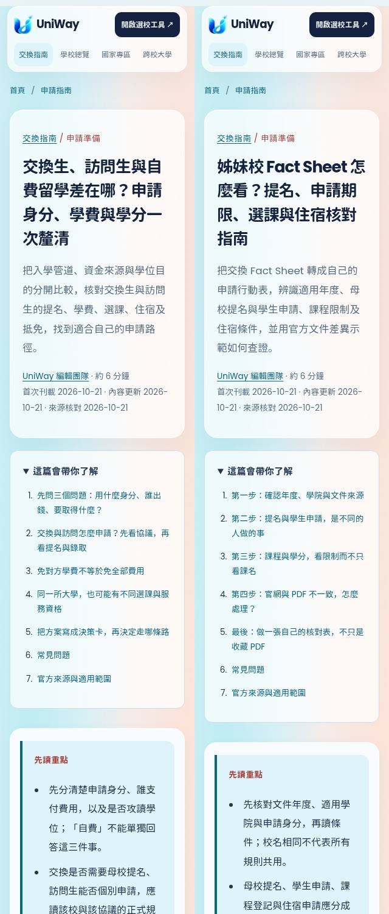
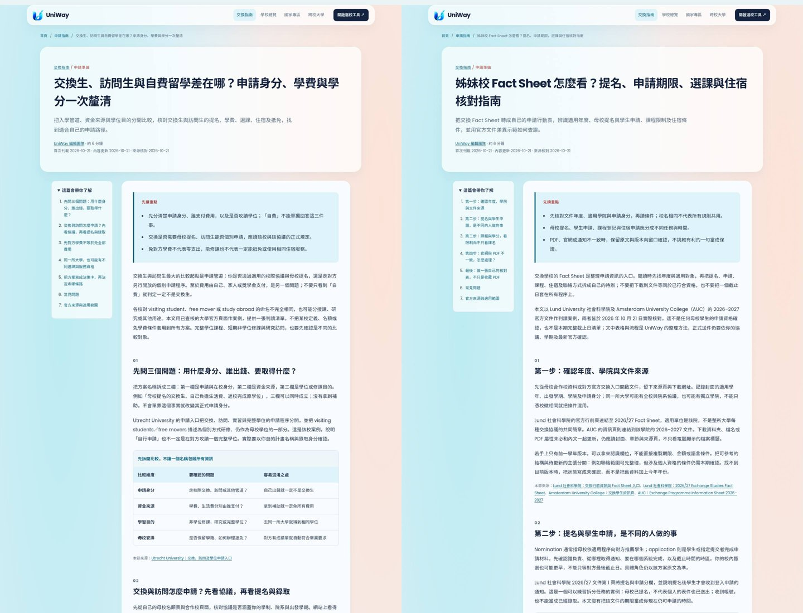

# 2026-10-21 每日雙篇：來源與驗收

本批完成兩篇原創繁體中文 SEO 圖文文章，集中於 [PR #109](https://github.com/blizzard-new/abroad/pull/109) 待審。批次日期採 Asia/Taipei，依使用者最新的每日兩篇規則執行。選題根據已確認候選池與編輯判斷，沒有使用或推測搜尋量、排名及 Search Console 成效。

基礎為 main `cf5d6f042b623a2ca1f590d33cec90a6ea25fff4`，於隔離分支 `codex/seo-daily-20261021` 工作。已核對十五篇既有文章、九個待審 PR、當日批次與既有分支；未找到另一個 2026-10-21 產文批次。PR #78、#95 已合併，昨天完成的五題未重做。PR #92 尚待合併，其候選規則仍依使用者指示納入判斷；本批不依賴其文件合併才能運作。

## 兩篇內容

| 題目 | URL | 正文可見字元 | 內容分工 |
| --- | --- | --- | --- |
| 交換生、訪問生與自費留學差在哪？申請身分、學費與學分一次釐清 | `/guides/exchange-versus-visiting` | 3,892 | 分開申請身分、資金來源與學位目的，提供程序、費用與服務核對表 |
| 姊妹校 Fact Sheet 怎麼看？提名、申請期限、選課與住宿核對指南 | `/guides/exchange-fact-sheet` | 4,300 | 判讀適用版本與責任、拆分提名／申請，將官方文件轉成個人行動表 |

字元數為渲染後 `.article-body` 的文字，包含表格、FAQ 與來源，並非全為段落文字。每篇有直接回答問題的開頭、三個重點、五個主題章節、可捲動表格、原創無障礙 HTML 步驟圖、文中攝影、三個 FAQ、來源及四篇相關文章。沿用既有 H1/H2、目錄、母校／國家專區／選校工具導覽、canonical、Article/Breadcrumb JSON-LD、社群圖片及 Sitemap。

沒有更改既有十五篇文章的網址、內容、出版日或 lastmod，也未修改 renderer、路由、CSS 或資料庫。完整申請流程、預算及抵免的既有指南仍保留，本批分別處理方案分類與文件判讀，不重製同一問題。

## 一手來源與待確認範圍

[來源紀錄](seo-editorial-sources-2026-10-21.json) 記錄八個已讀的官方頁面／PDF、最後網址、SHA-256、查核日期、適用範圍、版本及限制。

- Utrecht 的四份官方資料支持該校交換與訪問程序、費用分工及保留住宿資格案例。沒有把其期限、費用、語言分數、簽證條件或服務資格當成所有學校的通則。
- Lund 社會科學院的官方入口連結到兩頁 2026/27 Fact Sheet；完整讀取文件，並將第 1 頁渲染後目視確認提名與申請是不同欄位。PDF 屬性仍有舊學年標題，因此版本依官方入口與內文辨認，未依 metadata 假設。
- AUC 的官方交換頁與 2026–2027 PDF 均已讀取，PDF 共十五頁，另目視第 5、8 頁（頁腳 6、9）。官網宣稱住宿保證，PDF Campus／On-campus accommodation 則明示依供給、無法保證；本文並列差異，未判定哪份已失效，也不向讀者保證有房。
- AUC PDF 的最後申請章節另列其他學年日期。本文用它示範按章節辨認適用年度，沒有轉載任何一組日期為目前仍開放的申請承諾。
- **待確認事項**：申請 AUC 的讀者仍應就自己的學期與身分向校方確認住宿條件。此限制已寫在文章、FAQ 及來源註記；本批沒有寄信或代表讀者取得個案核准。
- 本批沒有引入金額、費用預測、語言門檻或移民法律判斷。比較表、假設人物與詢問信為原創編輯示例，沒有虛構學生心得、訪談、專家審核或錄取保證。

原始官方頁面、PDF、下載照片與 PDF 目視檢查畫面保存在本次工作環境的來源快取；PR 內保留來源指紋、短證據摘錄與判讀範圍，未把官方全文或來源照片當成本站原創發布。

## 攝影與閱讀版型

[攝影來源紀錄](seo-editorial-photography-2026-10-21.json) 包含兩張不同的 Pexels 真實攝影、原作者、來源頁、授權、下載網址、原尺寸、SHA-256、alt 及圖說。已讀來源頁 ImageObject 的作者／授權資料與 Pexels License，目視核對 3:2 圖片與 2:1 窄卡片裁切，人物、文件與畫面物件符合描述。

| 文章 | 攝影者 | 1536×1024 WebP |
| --- | --- | --- |
| 交換／訪問比較 | Mikhail Nilov | 120,056 bytes |
| Fact Sheet 判讀 | Armin Rimoldi | 112,292 bytes |

合計 232,348 bytes，每張低於 450 KB；保留自然色彩，沒有合成或修飾人物。圖說明示為素材情境，不宣稱是真實申請者、指定校園或官方文件；攝影署名、來源連結、尺寸與 lazy loading 已核對。

## 檢查結果

| 驗證 | 結果 |
| --- | --- |
| `scripts/check_editorial.py --base-ref origin/main` | 全部 **17 篇通過**；[機器紀錄](seo-editorial-checks-2026-10-21.json) |
| 文章、SEO、內容、品質、報表與 release gate 單元／整合測試 | **86 passed**，31.16 秒 |
| Chromium 文章、SEO 頁面與分析事件測試 | **27 passed**，102.27 秒；含全部十七篇的手機圖片載入及版面檢查 |
| 兩篇額外無 JavaScript 閱讀檢查 | **6 個畫面通過**，各於 320、390、1440 px；[紀錄](seo-editorial-browser-2026-10-21.json) |
| 額外閱讀檢查範圍 | 目錄、FAQ、相關文章、實際攝影載入、署名來源、canonical、可捲動表格與整頁橫向溢出 |
| 目視確認 | 已檢視桌面、320 px 首屏及兩篇手機文中攝影，內容未遮擋，裁切與署名可讀 |
| Wheel | 建置成功；17 篇 JSON、17 張圖、renderer 與 CSS 共 **37 檔逐位元相符**；從抽出套件的模組於來源目錄外成功載入全部十七篇；[紀錄](seo-editorial-package-2026-10-21.json) |
| `git diff --check` | 通過 |

命令使用目前 worktree 的 `PYTHONPATH=src` 與已安裝環境：

```bash
python scripts/check_editorial.py --base-ref origin/main
python -m pytest -q tests/test_seo_articles.py tests/test_seo.py tests/test_seo_content.py tests/test_seo_quality.py tests/test_seo_reporting.py tests/test_editorial_release_gate.py
PLAYWRIGHT_CHROMIUM_EXECUTABLE_PATH=/usr/bin/chromium python -m pytest -q tests/e2e/test_seo_articles.py tests/e2e/test_seo_pages.py tests/e2e/test_seo_analytics.py
uv build --wheel
```

以上為本機分支驗證，不代表遠端 CI、正式部署、Google 收錄或排名已完成。本批只交付待審 PR，沒有合併、部署 Windows 伺服器、寄信或批量要求建立索引。

## 預覽






