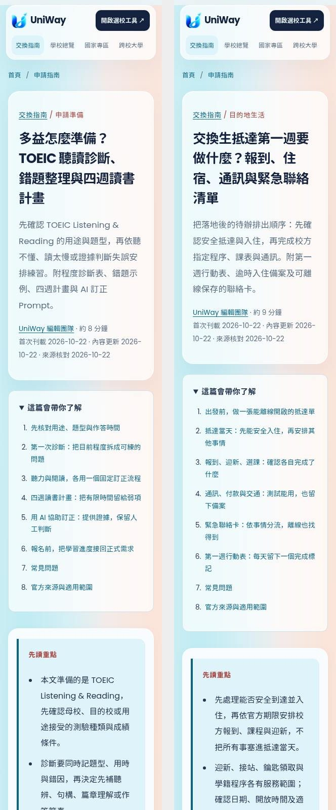
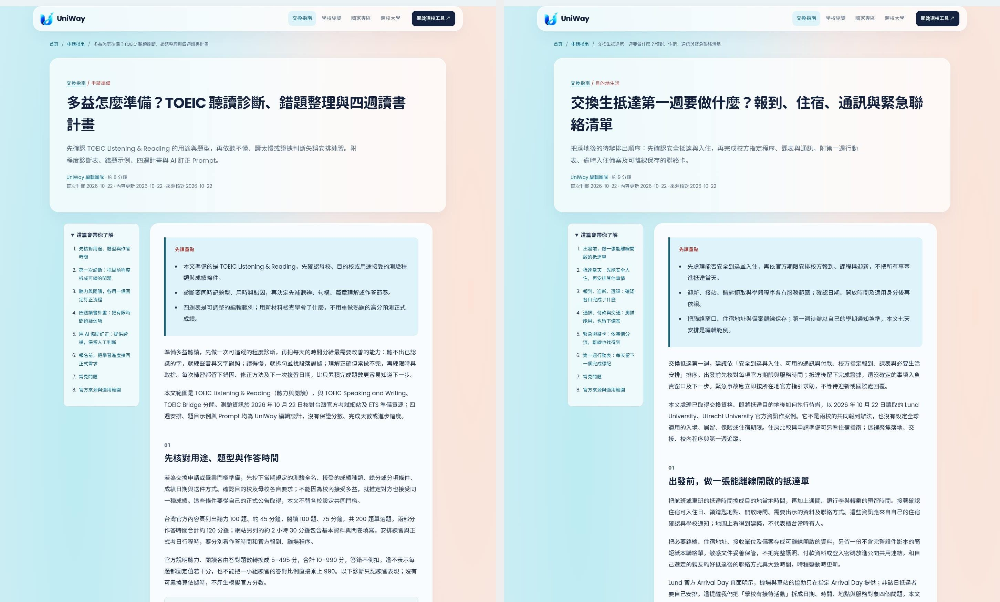
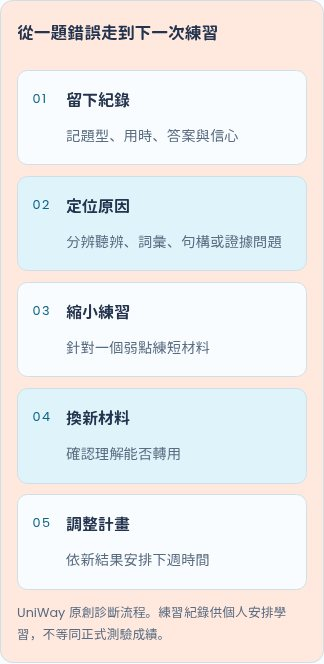
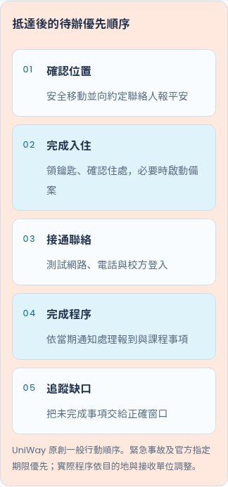

# 2026-10-22 每日雙篇：來源與驗收

本批依 Asia/Taipei 日期與每日兩篇規則，在隔離分支 `codex/seo-daily-20261022` 完成兩篇原創繁體中文 SEO 圖文文章，集中於待審 [PR #117](https://github.com/blizzard-new/abroad/pull/117)。選題來自使用者確認的候選方向 20 與 6，依編輯判斷，沒有使用者提供的 Search Console、搜尋量或排名資料。

基礎為最新 main `10c95f0fa91a83d023535ea6eb743c212beed486`。已讀既有十七篇、選題紀錄及五個待審 PR（#111、#113、#114、#115、#116），並核對當日分支與 PR；開始前未找到另一個 2026-10-22 產文批次。PR #78、#92、#109 均已合併，無未合併的文章基礎相依。沒有改動共用原 checkout，也沒有修改既有文章的 URL、出版日、內容或 lastmod。

## 兩篇文章

| 題目 | URL | 正文可見字元 | 獨立搜尋意圖 |
| --- | --- | --- | --- |
| 多益怎麼準備？TOEIC 聽讀診斷、錯題整理與四週讀書計畫 | `/guides/toeic-listening-reading-preparation` | 5,228 | 聽讀考試的題型、分項診斷、錯題證據與時間安排；與一般 AI 英文學習及申請資格指南分工 |
| 交換生抵達第一週要做什麼？報到、住宿、通訊與緊急聯絡清單 | `/guides/exchange-arrival-week` | 5,495 | 抵達後的交接、校內程序、聯絡與追蹤；既有住宿指南保留選房／契約證據，Fact Sheet 保留文件判讀 |

字元數為渲染後 `.article-body` 的可見文字，包含表格、FAQ 與來源。每篇提供直接回答、三項摘要、六個主題章節、可捲動表格、原創 HTML 五步驟圖、文中攝影、四個 FAQ、官方來源與四篇相關文章。沿用 renderer 的 H1/H2、目錄、母校／國家專區／選校工具連結、canonical、Article/Breadcrumb JSON-LD、社群標記及 Sitemap；沒有修改 renderer、CSS、路由或資料庫。

## 官方來源與內容限制

[來源紀錄](seo-editorial-sources-2026-10-22.json) 保存七個已實際讀取的官方頁面、HTTP 狀態、最終網址、回應 SHA-256、來源版本、查核日期、短證據及適用範圍。

- 多益題數、題型、時間與計分範圍依台灣官方內容頁核對。約 120 分鐘為聽讀作答時間；約 2.5 小時包含資料與問卷程序，文章已分開說明。題型範例僅作認識形式的入口，沒有當作完整模考，也沒有轉載官方試題或音檔。
- ETS 準備頁實際讀取並確認考生手冊與樣題入口；沒有宣稱讀過所連結 PDF，也沒有推論價格或地區販售方案。最初嘗試的台灣 `/prepare/` 路徑回傳 404，未引用；改用已核對的 ETS 官方頁，來源紀錄保留此情況。舊 ETS about 路徑轉址至 prepare，另讀取並引用最終網址。
- 四週／每天 45 分鐘為可調整的編輯範例，無分數或固定天數保證。十項算式逐項核對，包含聽力 6＋25＋39＋30＝100、閱讀 30＋16＋29＋25＝100、45＋75＝120、5＋15＋15＋10＝45、45×5＝225 分鐘＝3 小時 45 分鐘。
- TOEIC 篇的英文句子、填寫式 Prompt、輸入與預期回覆均為人工編寫的原創教學示例，明示不是 ETS 試題、模型實測輸出或官方成績；提供人工核對表，不聲稱特定工具比較結果。
- Lund 接待與迎新頁均標示 2026-09-08 更新，內文混有 2026 秋季與後續學期資訊。只引用服務範圍、住宿確認條件、院系分工與官方入口，不把某期日期、接站或住房當成個人保證。
- Utrecht 只引用 Arrival 區塊的歡迎活動分工、正式選課後課表與帳號入口，不轉用其護照、付款、語檢、學分或居留條件。
- Lund 安全頁標示 2026-10-13 更新。緊急服務與校方安全聯絡分流已核對，112 的敘述限瑞典／Lund 案例，其他目的地需另查所在地官方指引。
- 七天行動表為一般整理建議；各校、住宿與個人適用的正式程序及期限仍需自行核對。本批沒有未解的關鍵來源矛盾，也沒有發布費用、語言門檻、獎學金或簽證要求。

原始頁面、下載照片及本機完整閱讀畫面保存在 `/workspace/scratch/uniway-seo-20261022/`。PR 保存來源紀錄與選用的驗收畫面，沒有把官方全文或原始素材當成本站原創發布。沒有虛構考生／交換生心得、訪談、專家審核或錄取保證。

## 攝影與閱讀驗收

[攝影來源紀錄](seo-editorial-photography-2026-10-22.json) 保存 Pexels 來源頁、ImageObject 作者與授權、原尺寸、下載網址、檔案指紋、alt、圖說與目視紀錄；另已讀取 Pexels License。兩張均為真實攝影，無生成或合成畫面。素材人物不被當成實際申請者，也不暗示校方或人物為 UniWay 背書。

| 文章 | 來源作者署名 | 1536×1024 WebP |
| --- | --- | --- |
| 多益聽讀準備 | https://kaboompics.com/（Pexels 作者原署名） | 167,686 bytes |
| 交換抵達第一週 | Aman Uttam | 53,978 bytes |

共 221,664 bytes，每張低於 450 KB。已目視核對 3:2 文章及 2:1 卡片裁切；多益圖聚焦書寫與耳機線，抵達圖保留旅人剪影與航廈窗景。原先另一張直式抵達候選圖因裁切不合適而棄用，未交付。文中攝影的尺寸、lazy loading、正確圖說及來源署名已檢查。

## 測試結果

| 檢查 | 結果 |
| --- | --- |
| `scripts/check_editorial.py --base-ref origin/main` | **19 篇通過**；[紀錄](seo-editorial-checks-2026-10-22.json) |
| SEO 文章、內容、品質、報表與 release gate 單元／整合測試 | **94 passed**，32.99 秒 |
| Chromium 文章、SEO 頁面與分析事件測試 | **29 passed**，102.95 秒；含十九篇手機圖片及版面 |
| 兩篇額外無 JavaScript 閱讀驗證 | **6 個畫面通過**，各於 320、390、1440 px；[紀錄](seo-editorial-browser-2026-10-22.json) |
| 額外閱讀範圍 | 目錄、原生 FAQ、canonical、Article/Breadcrumb、圖片實際載入、署名、表格捲動、整頁無橫向溢出、母校／目的地／選校工具及相關文章導覽 |
| 目視驗收 | 已檢視桌面與 320 px 首屏、兩篇 390 px 文中攝影及步驟圖；標題、圖說與圖解可讀，裁切無內容誤認 |
| Wheel | 建置成功；19 篇 JSON、19 張圖、renderer、CSS 及初始化模組共 **41 檔逐位元相符**；在來源 checkout 外載入全部十九篇成功；[紀錄](seo-editorial-package-2026-10-22.json) |
| `git diff --check` | 通過 |

使用目前隔離 worktree 與已安裝的 Python 環境：

```bash
PYTHONPATH=src python scripts/check_editorial.py --base-ref origin/main
PYTHONPATH=src python -m pytest -q tests/test_seo_articles.py tests/test_seo.py tests/test_seo_content.py tests/test_seo_quality.py tests/test_seo_reporting.py tests/test_editorial_release_gate.py
PLAYWRIGHT_CHROMIUM_EXECUTABLE_PATH=/usr/bin/chromium PYTHONPATH=src python -m pytest -q tests/e2e/test_seo_articles.py tests/e2e/test_seo_pages.py tests/e2e/test_seo_analytics.py
uv build --wheel
```

待確認範圍是讀者自己的採認條件、當期校方／住宿通知及目的地程序，已在文中標示；沒有需補證據才可保留的核心事實。本批為本機驗證及待審 PR，不代表遠端 CI、正式上線、Google 收錄或排名成果；沒有合併、部署、寄信或要求建立索引。

任務附加限制：建立 PR 後已呼叫 `codex_app.attach_artifact`，等候超過三分鐘仍無回覆；中止等待並另重試 20 秒，同樣未取得結果。無法確認任務卡片的附加是否成功，不能宣稱已附加；GitHub PR 本身已成功建立，直接連結如上。

## 閱讀畫面









