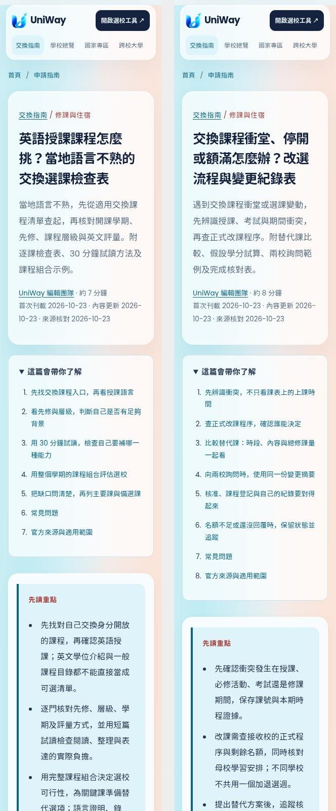
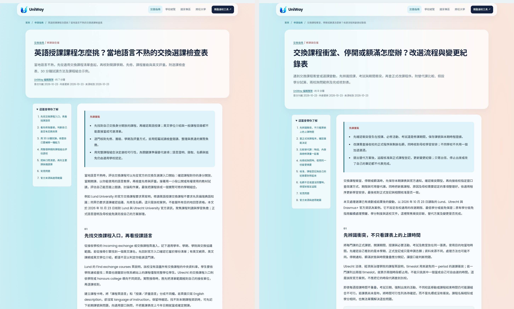
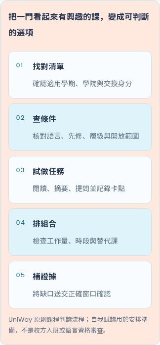
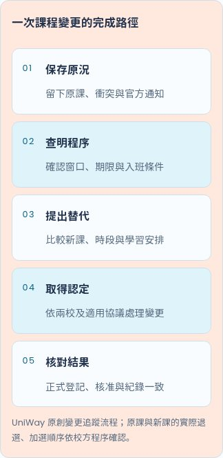

# 2026-10-23 每日雙篇：來源與驗收

本批依 Asia/Taipei 日期與每日兩篇規則，在隔離分支 `codex/seo-daily-20261023` 完成兩篇原創繁體中文 SEO 圖文文章，集中於新的待審 [PR #119](https://github.com/blizzard-new/abroad/pull/119)。選題來自使用者候選方向 4 與 8，依編輯判斷，沒有使用者提供的 Search Console、搜尋量或排名資料。

基礎為最新 main `0a790fc8c0d00ca891b63419b665540dd140a87f`。已核對十九篇既有文章、選題清單與全部待審 PR；開始時兩次 repository-scoped open PR 搜尋均為空，當日分支／PR 亦不存在。PR #78、#92、#117 均已合併，無未合併文章相依。未見適用的 AGENTS.md；依編輯流程與使用者每日雙篇指示製作。原共用 checkout 保留，既有十九篇文章的內容、URL、出版日及 lastmod 均未改動。

## 兩篇文章

| 題目 | URL | 正文可見字元 | 分工 |
| --- | --- | --- | --- |
| 英語授課課程怎麼挑？當地語言不熟的交換選課檢查表 | `/guides/english-taught-exchange-courses` | 4,716 | 選校前逐課判讀、先修與層級、30 分鐘試讀、學期組合；正式語言資格仍由既有指南處理 |
| 交換課程衝堂、停開或額滿怎麼辦？改選流程與變更紀錄表 | `/guides/exchange-course-changes` | 5,150 | 選課後的衝突診斷、正式改課程序、替代課與完成追蹤；預審材料及返校抵免仍由既有指南處理 |

字元數為渲染後 `.article-body` 的可見文字，含表格、FAQ 與來源。英語授課篇五個主題章節、改選篇六個主題章節；每篇均有直接回答、三項摘要、三個實用表格、原創 HTML 五步驟圖、文中攝影、四個 FAQ、官方來源與四篇相關文章。兩篇互相連結，另連到資格、讀書計畫、抵免、抵達與 Fact Sheet 等適合的既有指南。

沿用 renderer 的 H1/H2、目錄、母校／國家專區／選校工具連結、canonical、Article/Breadcrumb JSON-LD、社群標記與 Sitemap。沒有修改 renderer、CSS、路由或資料庫，不新增第三方腳本。

## 官方來源與範圍

[來源紀錄](seo-editorial-sources-2026-10-23.json) 保存七個實際讀取的官方頁面、日期、版本、原始 HTTP 回應 SHA-256、短證據與適用限制。

- Lund Find exchange courses 更新於 2026-09-02：核對依院系查課、沒有涵蓋所有交換課程的中央資料庫、一般課程可能限完整學位生，以及找不到課時聯絡協調人的做法。未以課程總量或搜尋結果保證個人可選。
- Lund Admission requirements 更新於 2026-09-04：核對協議、交換身分、先修與名額分開判斷，以及英語交換課程不要求瑞典語先備知識的該校案例。頁內語言分數、先修年數、ECTS 時數及申請期限未當成讀者的現行要求轉載。
- Utrecht 課程入口：核對 level 代表學科知識與技能而非年級，以及 UCU／UCR 與其他學院行事曆不可直接混排。未將該校跨院或修課數量外推至其他交換方案。
- Utrecht 法律、經濟與治理學院：核對 timeslot、雙時段均占用，以及截止後有時無法改課。僅用於該院程序案例，未發布特定學期名額、期限或課程保證。
- Lund Next steps 更新於 2026-10-22：實讀 Starting your exchange studies，確認沒有一般 add/drop period，須盡快與協調人討論，仍依條件及剩餘名額。沒有引用該頁的居留、保險或延長交換期限。
- Utrecht FAQ：核對剩餘名額與改課窗口，以及未登記不能旁聽、已修課不考試的該校紀錄案例；不外推他校成績或退選規則。
- Erasmus+ Student Charter：只引用適用該計畫的學習協議變更、兩校決定的期限及提交後確認，不設定全球通用週數，也不重製補助、保險或費用規定。

七份必要來源均成功取得 HTTP 200 並實際讀取。另一次使用 15 秒上限的 Lund `node/545`、`node/548` 診斷請求曾逾時；原本較長上限的正式擷取已取得完整 HTTP 200 回應並保存，亦透過網頁工具讀取同一官方頁。因此沒有以失敗回應或搜尋摘要支持主張，也未將來源連線情況描述為從未失敗。

30 分鐘試讀、假設課程卡、替代比較與詢問模板皆為原創編輯示例，不是校方測驗、實際學生經歷或錄取／抵免承諾。逐項驗算 10＋8＋7＋5＝30 分鐘、24－6＋6＝24 ECTS、24－6＋4＝22 ECTS；24／22 均為假設值，不是建議或最低修課標準，也沒有換算成臺灣學分。

**待確認範圍**：讀者本人的交換開放身分、先修認定、當期開課及名額、改課期限與母校認列，已在文中列成待查欄位。沒有需補證據才能保留的核心主張，也沒有發布未查證費用、語言門檻、獎學金或簽證規則。沒有寄信、虛構訪談、專家審核或學生心得。

原始頁面、原下載圖片與完整本機閱讀畫面保存在 `/workspace/scratch/uniway-seo-20261023/`。PR 保存來源指紋、有限摘錄及選用驗收圖，不把官方全文或原始素材當成本站原創發布。

## 攝影與目視檢查

[攝影來源紀錄](seo-editorial-photography-2026-10-23.json) 保存來源頁、ImageObject 作者與授權、下載網址、原尺寸、指紋、alt、圖說與裁切檢查。已讀 Pexels License；兩張皆為真實攝影，未生成、合成或修飾人物。

| 文章 | 作者 | 1536×1024 WebP |
| --- | --- | --- |
| 英語授課課程 | Yan Krukau | 101,560 bytes |
| 交換課程變更 | Zen Chung | 68,266 bytes |

合計 169,826 bytes，每張低於 450 KB。已檢視 3:2 文章與 2:1 卡片裁切：教室圖保留站立者、座位及學習者；桌面圖保留筆、紙本與書寫情境。圖說明示並非指定合作校、英語課、真實交換個案或官方變更表。署名、來源、尺寸及 lazy loading 已核對。

## 測試

| 驗證 | 結果 |
| --- | --- |
| `scripts/check_editorial.py --base-ref origin/main` | **21 篇通過**；[紀錄](seo-editorial-checks-2026-10-23.json) |
| SEO 文章、內容、品質、報表及 release gate 單元／整合 | **98 passed**，37.97 秒 |
| Chromium 文章、SEO 頁面與分析事件 | **31 passed**，112.35 秒；含全部二十一篇手機圖片與版面 |
| 本批額外無 JavaScript 閱讀 | **6 個畫面通過**，各於 320／390／1440 px；[紀錄](seo-editorial-browser-2026-10-23.json) |
| 額外閱讀範圍 | 目錄、原生 FAQ、canonical、Article/Breadcrumb、圖片實際載入、署名來源、表格實際捲動、整頁無橫向溢出、母校／目的地／選校工具及相關文章導覽 |
| 目視確認 | 已檢視桌面、320 px 首屏、兩篇 390 px 文中攝影與圖解，以及手機表格；標題、圖說、步驟可讀，表格可在容器內捲動 |
| Wheel | 建置成功；21 篇 JSON、21 張圖、renderer、CSS 與初始化模組共 **45 檔逐位元一致**；來源 checkout 外載入二十一篇成功；[紀錄](seo-editorial-package-2026-10-23.json) |
| `git diff --check` | 通過 |

命令使用隔離 worktree 的 `PYTHONPATH=src` 及已安裝環境：

```bash
python scripts/check_editorial.py --base-ref origin/main
python -m pytest -q tests/test_seo_articles.py tests/test_seo.py tests/test_seo_content.py tests/test_seo_quality.py tests/test_seo_reporting.py tests/test_editorial_release_gate.py
PLAYWRIGHT_CHROMIUM_EXECUTABLE_PATH=/usr/bin/chromium python -m pytest -q tests/e2e/test_seo_articles.py tests/e2e/test_seo_pages.py tests/e2e/test_seo_analytics.py
uv build --wheel
```

以上為本機驗收，無遠端 CI、正式上線、Google 收錄或排名成果的宣稱。只建立待審 PR，不合併、部署 Windows 正式伺服器、寄信或要求 Google 建立索引。

任務附加限制：成功建立 PR 後已立即呼叫 `codex_app.attach_artifact`，等候 20 秒仍未回覆，無法確認任務附加是否成功；未宣稱已附加。GitHub PR 本身已成功建立，可直接透過上方連結審閱。

## 預覽









