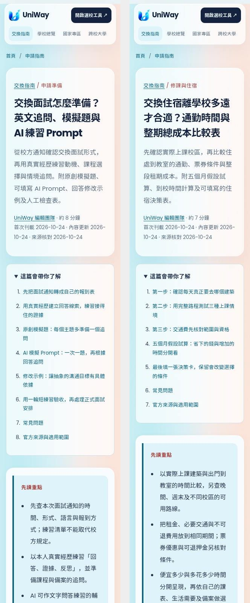
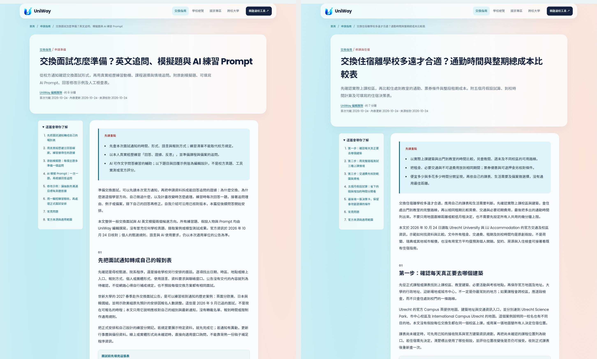
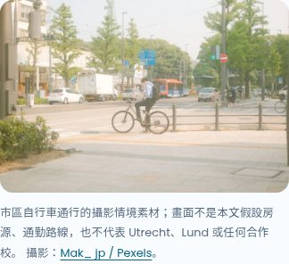
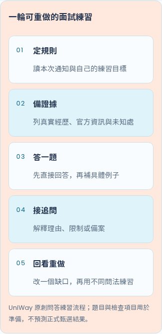
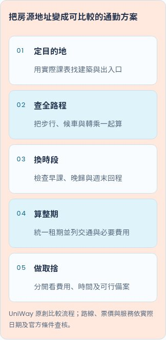

# 2026-10-24 每日雙篇：來源與驗收

本批日期採 Asia/Taipei。開始核對時工具時間為 UTC 2026-10-23 23:56:30，台灣已是 2026-10-24，因此在新隔離分支 `codex/seo-daily-20261024` 完成兩篇，一起放入待審 [PR #122](https://github.com/blizzard-new/abroad/pull/122)，不重做 10/23 的 PR #119。選題依使用者候選池及編輯判斷，無使用者提供的 Search Console、搜尋量或排名資料。

基礎為最新 main `ca98d5c34ccd404a3bc38f2986ccb313e02c7e93`。已讀十九篇文章、流程與選題清單，並核對所有待審 PR #119／#121，以及當日分支／PR。#119 的英語課程與改選兩題視為已選，排除本批；#121 是 Android 功能。開始前沒有其他 10/24 批次，PR #78、#92、#117 已合併。本批直接基於 main，無未合併文章相依，沒有更改既有十九篇內容、URL、出版日或 lastmod。未見適用 AGENTS.md；共用原 checkout 保留。

## 兩篇內容

| 題目 | URL | 正文可見字元 | 獨立意圖 |
| --- | --- | --- | --- |
| 交換面試怎麼準備？英文追問、模擬題與 AI 練習 Prompt | `/guides/exchange-interview-practice` | 4,838 | 候選 5／18 整併：面試問答、追問、分層任務與重答；自介稿及排版仍由原有自介指南處理 |
| 交換住宿離學校多遠才合適？通勤時間與整期總成本比較表 | `/guides/exchange-housing-commute` | 4,290 | 候選 10：用完整路程、整期費用及備案比較位置；原有住宿及預算指南保留契約交接與整體資金規劃 |

字元數為 `.article-body` 可見文字，含表格、FAQ 與來源。每篇有直接回答、三項摘要、目錄、五或六個主題章節、表格、原創 HTML 五步驟圖、一張攝影、四個 FAQ、官方來源及四篇相關文章。沿用 canonical、Article/Breadcrumb JSON-LD、社群標記、Sitemap、母校／國家專區／選校工具連結、手機捲動表格與原生 FAQ；全文無 JavaScript 可讀。未改 renderer、CSS、路由或資料庫。

## 來源、假設及限制

[來源紀錄](seo-editorial-sources-2026-10-24.json) 保存五份實際讀取的官方頁面、版本、日期、適用範圍、HTTP 回應指紋及短證據。

- 世新公告是 2027 春季交換、2026 年 9 月已過面試的歷史案例，只支持按組別及異動通知核對安排。沒有轉載個人名單、期限或報到制裁，也不推定其他學校的形式與語言相同。
- OpenAI 官方提示頁支持清楚背景及逐輪修改的一般原則；頁面顯示 `Updated: 4 days ago`，保留相對標示，沒有自行宣稱絕對發布日。所有模擬題、Prompt、人物及中英文回答都是人工撰寫示例，非模型實測或校方真題，不評官方分數、CEFR 或錄取機率。
- 面試練習提供起步、英文理由及臨場追問等不同任務難度，另有訂正、隔次換題重答與人工檢查表。正式使用本人真實材料，依本次要求核對使用與揭露規則；沒有品牌／方案／地區／語音功能比較。
- 一份擬用的亞洲大學報導回傳 **HTTP 503**，已完全排除其內容與主張，未拿搜尋摘要代替。世新計畫介紹頁亦讀取，但沒有由未讀附件推論面試細節。所引用五份頁面皆已取得 HTTP 200 並實際閱讀。
- Utrecht 校區與交通頁支持找實際建築、路線工具用途及資訊更新限制；LU Accommodation 交通頁更新於 2026-08-28，支持全程涵蓋與查核票種／班表。不轉載現行票價、折扣、路線編號或班次為個人保證。
- 住宿與時間數字完全是假設，以新臺幣作同一計算單位，無匯率或城市報價。五個月租期與十六個到校週分開假設；6,000÷48＝125 元只描述此例費用差額與增加時間的比值，非工資、收入或時間的客觀價格。

逐項驗算記於來源紀錄：20 分鐘練習；A＝（18,000＋600）×5＋800＝93,800 元、B＝（15,000＋2,400）×5＋800＝87,800 元，差 6,000 元；往返 A＝15×2×3×16＝1,440 分鐘＝24 小時、B＝45×2×3×16＝4,320 分鐘＝72 小時，差 48 小時；6,000÷48＝125。

待確認範圍是個人的本期面試要求、課表、房源、票券資格及實際報價，文中已列成待查欄位。沒有待補證據才能保留的核心主張；未發布未查證費用、期限、語言門檻、獎學金或簽證要求。未虛構學生心得、訪談、專家審核或錄取保證，也未寄信。

原始頁面、下載攝影及完整本機閱讀畫面保存在 `/workspace/scratch/uniway-seo-20261024/`；PR 保存有限摘錄、來源與授權指紋及選用驗收圖，未將官方全文或原始素材當成本站原創發布。

## 攝影及閱讀畫面

[攝影來源紀錄](seo-editorial-photography-2026-10-24.json) 保存兩張不同的 Pexels 真實攝影、ImageObject 作者／授權、最終來源頁、下載網址、原尺寸與檔案指紋。已閱讀 Pexels License，未生成、合成或修飾人物。

| 文章 | 作者 | 1536×1024 WebP |
| --- | --- | --- |
| 面試問答練習 | fauxels | 42,774 bytes |
| 住宿通勤比較 | Mak_ jp | 222,472 bytes |

合計 265,246 bytes，每張低於 450 KB。已檢查 3:2 文章與 2:1 卡片裁切，保留說明者／聆聽者、騎士／自行車及城市情境。圖說不將素材當成真實申請者、面試委員、指定房源、路線或合作校。已核對 alt、署名、來源、尺寸及 lazy loading。

## 驗證

| 檢查 | 結果 |
| --- | --- |
| `scripts/check_editorial.py --base-ref origin/main` | **21 篇通過**，main 十九篇加本批兩篇；[紀錄](seo-editorial-checks-2026-10-24.json) |
| SEO 單元／整合與 release gate | **98 passed**，33.78 秒 |
| Chromium 文章、SEO 頁面與分析事件 | **31 passed**，96.20 秒 |
| 本批額外無 JavaScript 閱讀 | **6 個畫面通過**，各於 320／390／1440 px；[紀錄](seo-editorial-browser-2026-10-24.json) |
| 閱讀範圍 | 目錄、FAQ、canonical、Article/Breadcrumb、圖片實際載入、署名、表格實際捲動、整頁無溢出、母校／目的地／工具與相關文章導覽 |
| 目視檢查 | 桌面、320px 首屏、兩篇 390px 文中攝影、圖解與表格均已檢視；內容、裁切及圖說可讀 |
| Wheel | 21 篇 JSON、21 張圖、renderer、CSS 及初始化模組共 **45 檔逐位元一致**；於來源 checkout 外載入全部二十一篇成功；[紀錄](seo-editorial-package-2026-10-24.json) |
| `git diff --check` | 通過 |

最終補齊分層任務後重新執行測試與建置，以上數字對應最終文章。命令使用目前隔離 worktree、`PYTHONPATH=src` 與已安裝環境：

```bash
python scripts/check_editorial.py --base-ref origin/main
python -m pytest -q tests/test_seo_articles.py tests/test_seo.py tests/test_seo_content.py tests/test_seo_quality.py tests/test_seo_reporting.py tests/test_editorial_release_gate.py
PLAYWRIGHT_CHROMIUM_EXECUTABLE_PATH=/usr/bin/chromium python -m pytest -q tests/e2e/test_seo_articles.py tests/e2e/test_seo_pages.py tests/e2e/test_seo_analytics.py
uv build --wheel
```

僅交付待審 PR；沒有合併、部署 Windows 正式伺服器、寄信或要求 Google 建立索引。本機驗收不代表遠端 CI、正式上線、收錄或排名成果。

任務附加限制：建立 PR 後已立即呼叫 `codex_app.attach_artifact`，等候 20 秒未取得回覆，無法確認任務卡片附加成功；未宣稱已附加。GitHub PR 已成功建立，可直接透過上方連結審閱。

## 預覽











