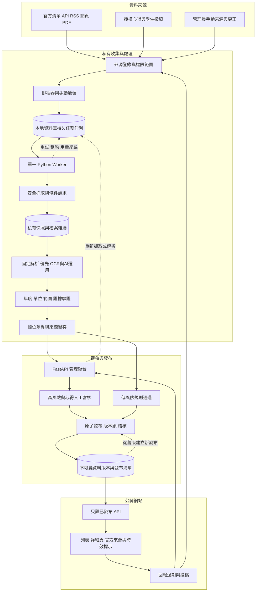

# Uniway 全臺交換資訊維護架構與實作規格

版本 1.1 本地伺服器版 · 2026 年 10 月 14 日 · 交付對象：產品負責人與實作 Agent

本文件說明 Uniway 如何從單一母校擴展到全臺大學，同時持續更新官方交換規則、國外學校基本資訊及學生心得。使用者已確認所有雲端服務都已關閉，現在全面使用本地伺服器。建議沿用本地既有 Python／FastAPI、資料庫及檔案儲存，加上一個獨立 worker、持久任務佇列與審核後台；不要求恢復任何雲端服務。先做到「找出真正變更、保留證據、避免錯誤發布」，再增加學校與自動化程度。

本次交付為設計文件與架構圖，沒有修改原專案、建立正式排程、部署服務或寫入正式資料庫。下方資料表、API、設定名稱皆為建議契約；實作 Agent 必須先檢查現有程式，再提出對應方案。

## 1 閱讀方式與第一版範圍

- 產品負責人：先讀第 2、3、12、15、16 節。
- 實作 Agent：完整閱讀，從第 16 節的 Phase 0 開始；第 18 節可直接複製作為任務提示。
- 架構圖：同資料夾的 `uniway-maintenance-architecture.svg` 可直接用瀏覽器開啟。第 3 節另有可編輯 Mermaid 與純文字版本。
- 第一版目標：臺大加 2 至 3 所有實際需求的母校；官方高風險資訊人工批准，低風險監控自動化。
- 第一版不做：全網自主探索、所有心得全文收錄、通用瀏覽器代理、向量資料庫、Redis／Celery／Kafka、每校一套獨立部署、AI 自動決定申請資格。
- 第一版可先不接付費模型。固定 HTML／PDF 解析器與人工補充足以建立可靠流程。

### 1.1 已知背景與待確認項目

最新且優先的部署事實是：使用者已關閉所有雲端服務，全面改用本地伺服器。`blizzard-new/abroad` 與 Python／FastAPI 是已知專案背景；歷史曾使用 Supabase，不能據此推定目前仍有任何託管 Supabase、Render、雲端資料庫或雲端 Storage。

2026 年 10 月 14 日的授權只讀盤點確認：

| 項目 | 已確認基線 |
| --- | --- |
| 主機 | KEVINSERVER，Windows Server 2025 Standard 24H2，build 26100.33438，時區 Asia/Taipei |
| 專案 | `C:\uniway\app`，abroad repo，main；盤點時 HEAD `11589e75`，工作目錄乾淨 |
| 執行環境 | Docker Desktop Linux containers，Engine 29.8.2，Compose project `uniway` |
| 本地 DB | `supabase/postgres:17.6.1.136`，不是託管雲端資料庫 |
| 本地 API／儲存 | PostgREST v14.12、Storage API v1.60.4；這是自架 Supabase 相關子集，不是完整 Supabase 服務 |
| 持久資料 | `uniway_db` 與 `uniway_storage` volumes；Storage 為本地 file backend |
| 當時健康 | app、db、rest、storage、gateway 健康；ca-export 正常結束 |
| 入口 | Windows Caddy 將 `app.uniway-tw.com` 代理到 `127.0.0.1:8000`，本機 health 成功 |
| 既有排程 | `UniWay-Caddy` 開機啟動；`UniWay-Backup` 每日 04:00 臺北時間；`UniWay-Health` 每 5 分鐘；最近已觀察的執行結果為成功 |

仍未證實：public DNS／外部 HTTPS、執行中 image 對應的 Git commit、36 個 migration 檔的實際套用狀態、爬蟲排程、Docker Desktop 無人登入時的開機恢復、備份是否異機及能否還原。既有 Google Drive 備份程式碼不能證明目前啟用；repo 中 cloud workflow／render.yaml 也不能證明雲端仍運作。

**重要部署限制：既有 `update.ps1` 包含備份、git 更新、保留舊 image、重建啟動，以及自動套用全部 migrations、處理 private bucket 和驗證。不得把它當普通重啟命令直接執行。既有 image rollback 只回復 app，不會回復 DB；DB 回復需要已驗證的備份／migration 計畫。**

近期臺大查核曾涉及約 288 個頁面與 92 個附件，並出現列表與詳細頁年份不同、URL 更換但 PDF 內容相同，以及名額仍更新中的情形。這些是設計測試情境，不應直接變成新系統的正式當期資料。對話中的「8 校、13 個年度名額單位、最多 26 人」也必須回到對應年度與來源重驗，不能把不同單位合併成一個數字。

Phase 0 應以以上實測基線繼續確認：主要資料表、學校識別碼、名額語意、舊資料授權、使用者權限、本地檔案目錄、容器／process 管理、現有排程、異機備份能力、秘密管理、供電／重啟恢復與可接受停機時間。

## 2 核心資料原則

### 2.1 三種資料分開管理

| 資料層 | 可共用的範圍 | 必須保留的情境 |
| --- | --- | --- |
| 學校與城市 | 同一交換校、校區、城市的基礎資訊 | 校區、來源及各欄位版本；費用仍須標日期與幣別 |
| 交換機會與正式規則 | 同一組母校、交換校、計畫、申請梯次 | 適用學年、交換學期、校區、學院／系所、學位層級、名額單位 |
| 學生經驗 | 可供相關目的地學生參考 | 經驗發生時間、母校、目的校／校區、學生身分、住宿／課程等主題 |

**學校相同，不代表交換條件相同。** 臺大與政大連到同一所國外學校，可以共用學校介紹，但不得共用母校配額、校內截止日或甄選資格。

**今天查到，不代表今年適用。** 抓取時間、來源更新時間、適用年度、人工核實時間分開保存。

**未知不是零。** 未列名額、未開放、資料缺失、解析失敗及確定零名額，是不同狀態。缺值不得自動補零；年份不得由目前日期猜出。

**心得不是規章。** 個人曾成功選課、分配到宿舍或花費某金額，不保證其他學生也符合。

### 2.2 交換機會識別

交換機會的唯一範圍為：母校 ID、交換校 ID、正式計畫 ID、申請梯次 ID、適用交換期間、校區範圍、院系範圍、學位層級範圍。`scope_key` 由排序後的標準 ID 產生，不能由展示名稱產生。

「全校適用」「未註明」「不適用」須為不同 enum，不共用 null。院系或校區有多值時使用關聯表及標準排序，不以含糊的自由文字拼接唯一鍵。

申請梯次可在 2026 年開放、對應 2027／28 學年。保留 `cycle_label_original`，另存標準起迄年份及 term。民國年轉換只在原文明示時進行，並保留原值與轉換規則。

## 3 完整架構圖

### 3.1 Mermaid 版本



投稿或回報指向來源登錄的箭頭表示「先登錄候選來源並審查」。陌生 URL 不會直接排入網路抓取。低風險規則通過在 MVP 只處理第 9 節明列項目，沒有讓 AI 自動發布正式資格的旁路。

### 3.2 純文字版本

1. 官方頁面／附件、已獲准來源、學生投稿，先進入來源登錄。
2. 排程器或管理員按鈕，把限定範圍任務寫入既有本地資料庫。
3. 單一 Python worker 領取有租約的任務，安全下載，留下抓取結果與私有證據。
4. 先比內容，再決定是否解析；固定規則優先，OCR／AI 只處理必要段落。
5. 驗證年度、母校、計畫、單位及證據，產生欄位差異與衝突。
6. 管理後台讓人審核高風險資訊；低風險狀態可依明確規則自動處理。
7. 在一個資料庫交易內，建立不可變版本、完整發布清單及稽核紀錄，再切換目前發布指標。
8. 公開 API 只讀已發布版本；列表與詳細頁使用相同發布 ID。用戶回報重新進入審核，不直接改公開值。

### 3.3 最小本地部署組合

- 既有前端與 FastAPI：增加管理 API／頁面，不要求重寫網站。
- 既有本地 Postgres 17.6：保存資料、任務、審核、發布清單、稽核與計數。直接採 Postgres jobs table，不安裝 pgmq／pg_cron 等未驗證 extension，也不恢復託管 Supabase。
- 一個本地 Python worker：與 Web 進程分開，可同伺服器部署，但限制 CPU、記憶體、開啟檔案數及每批工作量。
- 一個本地排程入口：沿用 Windows Task Scheduler 的管理方式，或在既有 Compose 中增加經批准的 scheduler／worker，二擇一。先盤點既有任務以避免重複；不假設已存在爬蟲排程。
- 沿用本地 Storage API／uniway_storage volume：原始快照、PDF 與解析產物按 content hash 去重，先驗證 bucket／檔案 ACL。若改用獨立私有目錄，需由實作計畫說明，不自行搬遷；目錄不得落在 Web static／public 下。
- 本地管理後台與健康狀態：預設綁定 loopback 或既有受保護內網入口，沿用現有認證。不得為了方便自動開 firewall port、公開管理介面或調整系統安全設定。

不要把整次爬取綁在 HTTP 請求，也不要把 FastAPI BackgroundTasks 當作持久排程與故障恢復保證。[FastAPI 文件](https://fastapi.tiangolo.com/tutorial/background-tasks/#caveat)

現在已確認可沿用 Postgres，使用其短交易與 SKIP LOCKED；無須為了本功能加一個新資料庫。後續若實測版本或環境改變，Agent 需回報差異，不照抄未匹配的 SQL。先讓一個 worker 跑穩，再按量測擴充。

### 3.4 本地部署確認矩陣

| 項目 | 目前決策 | 實作前要填的實際值 |
| --- | --- | --- |
| 執行位置 | KEVINSERVER Windows Server 2025 | repo 為 C:\uniway\app；確認實作分支 |
| Web | 沿用 Compose uniway／Windows Caddy | 核實 Python／FastAPI 版本及 image 與 commit 對應 |
| 資料庫 | 沿用本地 Postgres 17.6 | 實際 schema、grants／RLS、已套 migration |
| 私有檔案 | 既有 Storage API file backend | uniway_storage 的 ACL、容量、備份與私有 bucket |
| 排程 | 優先沿用 Task Scheduler 管理 | 新爬蟲／worker 任務名稱、避免重入；未確認已存在 |
| 重啟恢復 | 待演練 | Docker Desktop 無人登入開機、Compose restart、worker 依賴 |
| 管理存取 | 不新增公開入口 | 既有登入／內網路由、認證與授權位置 |
| 備份 | 已有每日 04:00 作業；可恢復性未知 | 檢查現有腳本，再由使用者確認異機加密目標與保留期 |
| 外部模型 | 預設停用 | 只有 opt-in 後才指定 provider、資料、預算 |

此矩陣可直接補入只讀盤點結果，沒有答案的格子留待確認，不影響先建立 fixtures 與設計契約。

### 3.5 供電 重啟 容量與備份

- 伺服器關機／斷電時沒有抓取；恢復後由排程器補到期工作，合併重複任務並限速。前端保留最後已發布資料與查核時間，不假装一直在線。
- worker 及 Web 分開 lifecycle；使用目前服務管理工具的 restart policy，不因爬取崩潰帶倒公開網站。健康檢查分成 process 存活、queue 最後成功、來源新鮮度，不能只測 HTTP 200。
- 先設磁碟低水位保護與配額。空間不足時停止新下載／昂貴解析，保護已發布資料及 DB，不能直接刪掉仍被引用的證據。
- DB 與私有檔案都要備份，建立可對齊的 backup manifest；檔案先耐久寫入再提交引用，DB 失敗留下的孤兒檔案可延後安全清理。
- 備份不能只在同一顆磁碟。由使用者指定獨立設備／NAS／離線媒體與加密／保留政策；若未指定，標記「異機備份未完成」而不是宣稱已受保護。不自行重開雲端備份。
- 建議 owner 先決定可接受的資料遺失窗口（RPO）及恢復時間（RTO），例如草案可為 24 小時／4 小時；這是待確認目標，必須經還原演練驗證，不能當現有能力。
- 備份密钥不和備份檔只放同一位置；實作不得讀出或傳送現有秘密。新增憑證／持久權限、網路／firewall 改動及新外部備份目的地須另行批准。

### 3.6 檢查既有備份與還原步驟

先只讀檢查 `UniWay-Backup` 對應腳本、最近輸出、備份格式、位置、保留期與錯誤處理。任務 return code 0 只代表該次工作回報成功，不證明內容完整或可還原。核查是否使用 pg_dump、受支援的 base backup 或停寫一致快照；直接複製正在寫入的 PostgreSQL volume 不能視為有效備份；不要先再建第二份備份排程。

1. 規劃一致性邊界：短暫阻擋新發布與檔案寫入／清理，或採經驗證的一致備份方案；標記 release ID、DB transaction／備份時間與所引用 blob hashes。
2. 建立 DB 備份與 private files manifest，確保每個已發布引用的 blob 已耐久保存，計算完整性 hash。現有備份如僅 DB，明確補出檔案缺口。
3. 在原機驗證備份可讀與 manifest 完整，再以使用者批准的加密方式送到指定獨立設備／離線媒體；記錄大小、位置別名、保留期與結果，不記密钥。
4. 在隔離環境還原 DB、檔案及必要設定，停用抓取與外部連線，重套 suppression 清單，驗證 release、引用、角色權限與代表性 API。
5. 記錄實測資料遺失窗口及恢復耗時，處理失敗後再重驗；完成才可宣稱 backup 可恢復。
6. 真正災難恢復前由 owner 確認目標時間點與可接受資料損失，停止正式寫入，再按演練程序恢復。既有 app image rollback 與資料發布回復都不能替代 DB／檔案災難恢復。

## 4 建議資料模型與不可變契約

以下是邏輯契約，Agent 可依既有 schema 合併實作，但不能省略關鍵語意。所有時間戳以 UTC 儲存；顯示時區由頁面明示，臺灣申請日期通常以 Asia/Taipei 呈現，來源另有時區時保留原時區。

### 4.1 核心實體

| 邏輯表 | 最小欄位與用途 |
| --- | --- |
| `institutions` | `id, country_code, canonical_name, institution_type`；共享學校識別，名稱異動有版本 |
| `institution_aliases` | `institution_id, alias, language, source_id`；去除異名，不用名稱自動合併不確定學校 |
| `campuses`、`academic_units` | 上層 institution、標準 ID、名稱及適用範圍；保留校區／院系差異 |
| `exchange_programs` | `id, home_id, program_type, official_label`；校級、院級或其他正式計畫分開 |
| `application_cycles` | `id, program_id, original_label, application_year, target_year_start/end, term_scope` |
| `exchange_offerings` | `id, home_id, host_id, program_id, cycle_id, scope_key`；穩定識別，不直接持有未審新值 |
| `offering_scopes` | offering 對校區、院系、學位層級；`all/explicit/unspecified/not_applicable` 語意分開 |

共享識別碼可不變；會展示的學校名稱、城市說明、連結等資料也須形成 revision。發布版本應引用固定 revision，不可即時 join 可變的學校資料，否則歷史發布會被悄悄改寫。

### 4.2 來源與證據

| 邏輯表 | 最小欄位與用途 |
| --- | --- |
| `sources` | `id, owner_institution_id, source_type, authority_scope, approved_domains, entry_url, terms_url, reuse_basis, enabled, policy_version` |
| `source_resources` | `id, source_id, normalized_url, original_url, resource_kind, discovered_from_id, expected_scope, etag, last_modified, next_due_at` |
| `fetch_attempts` | `resource_id, started/finished_at, status_code, outcome, redirect_chain, bytes, error_class, retry_after, validated_snapshot_id` |
| `content_blobs` | `id, raw_sha256, storage_key, mime, byte_count, retention_class`；位元組去重，私有儲存 |
| `snapshots` | `id, resource_id, blob_id, fetched_at, source_published_at, source_modified_at, content_language`；某來源某時點的內容 |
| `source_links` | `parent_snapshot_id, child_resource_id, link_text, relation_type, context_hash`；公告、詳細頁與附件的證據鏈 |
| `extraction_runs` | `id, blob_id/snapshot_id, parser_name/version, schema_version, model_version_optional, input_context_hash, status` |
| `field_assertions` | `id, entity_scope, field_path, typed_value, value_state, unit, effective_scope, evidence_id, extraction_run_id` |
| `evidence` | `id, snapshot_id, locator, short_excerpt, excerpt_hash, evidence_kind, access_class` |

來源不是只有一個網址。必須能回答「這個值是公告列表、交換校詳細頁，還是某個附件第幾頁給的」。PDF locator 使用頁碼與表格／列／儲存格識別；HTML 使用標題路徑與節點／文字定位，不能只留下不穩定 CSS selector。

文件原始快照只在已確認可保存的權限範圍內留存；授權不允許保存時，使用來源 URL、查核紀錄及可保存的最小證據，不默認長期鏡像全文。取得證據不足的欄位標記待核實。

### 4.3 審核與發布

| 邏輯表 | 最小欄位與用途 |
| --- | --- |
| `change_sets` | `id, entity_scope, base_release_id, candidate_version, evidence_set_hash, risk, status, created_at` |
| `change_items` | `change_set_id, field_path, before/after, before_state/after_state, supporting_assertions, conflicting_assertions, reason` |
| `review_decisions` | `change_set_id, candidate_version, reviewer_id, decision, reason, decided_at`；追加紀錄 |
| `entity_revisions` | `id, entity_type/id, payload_schema_version, payload, provenance_map, revision_hash, created_at`；已發布內容不可原地改寫 |
| `releases` | `id, previous_release_id, reason, published_by, published_at, status` |
| `release_members` | `release_id, entity_type, entity_id, revision_id`；每個 release 的完整 ID 清單，內容不重複複製 |
| `publication_head` | 單列 `current_release_id, lock_version`；短交易內鎖定切換 |
| `audit_events` | actor、action、target、from/to IDs、reason、timestamp、request_id；不要包含秘密或不必要個資 |

MVP 可用「完整 revision ID 清單」實作 release，不用複製全部快照。每次新 release 沿用未變更 revision，只替換本次批准者；可讀、可回復優先於過早優化。規模證明有必要後才評估增量 manifest。

### 4.4 維運與投稿

| 邏輯表 | 最小欄位與用途 |
| --- | --- |
| `jobs` | type、resource/snapshot/scope、payload、dedupe_key、status、priority、scheduled_at、attempts、lease_until、lease_token、worker_id、error_class |
| `job_effects` | `effect_key UNIQUE, job_id, lease_token, result_id, committed_at`；重試不產生第二份可見效果 |
| `usage_daily` | 日期、來源、步驟、請求／位元組／OCR 頁數／模型 tokens／執行秒數與估計費用 |
| `experiences` | 穩定 ID、作者顯示設定、母校／目的地／校區、身分、經驗期間、主題、授權狀態 |
| `experience_revisions` | 內容、審核狀態、來源與授權版本；公開摘要與私有聯絡資料分表 |
| `submissions`、`reports` | 投稿／過期回報、對應 published revision、理由、證據、狀態；不直接更新正式值 |
| `consent_records` | 作者、公開範圍、授權用途、同意文案版本、時間、撤回時間；限管理存取 |

### 4.5 欄位值契約

`value_state` 至少包括 `known`、`not_stated`、`not_applicable`、`conflicting`、`unverified`。抓取狀態另存，不塞進欄位值。

名額應支援：`amount`、`unit`、`period`、`min/max`、`shared_pool_id`、`original_text`、`conversion_rule_id`。例如年度名額單位、學期名額單位、人數、總 pool，各自保留。任何年度單位換算人數，必須有同一計畫與年度的官方換算證據，沒有就不推導。

截止日應支援：日期、是否含時間、來源時區、截止日類型（校內、提名、對方申請）、適用 cycle。沒有時間就不要補 23:59；展示「日期已知，確切時間未公告」。

金額應支援：amount/range、currency、period、price_date、費用包含項目及 `official/experience`。不得把心得中的個人月花費覆寫官方學費。

每個已發布關鍵欄位至少能回傳：`value, value_state, unit, effective_scope, evidence_refs, last_verified_at, freshness_status`。

## 5 來源權威與對應矩陣

### 5.1 依欄位判斷權威

| 欄位 | 通常優先查的來源 | 不能直接替代的資料 |
| --- | --- | --- |
| 母校配額、校內資格、校內截止 | 對應母校及計畫的當年度正式公告與明確修正 | 國外學校一般網站、其他母校名額、往年文件 |
| 對方提名／申請規則 | 對應交換校、校區、學院、年度的 incoming exchange 官方頁／fact sheet | 一般 degree admissions 頁 |
| 語言要求 | 同時保存母校門檻與對方要求；必要時呈現雙重條件 | 不能無條件取較大數字，因考試類型／豁免條件可能不同 |
| 住宿申請、課程限制 | 對應目的校及校區的當期正式頁 | 某位學生曾有的安排 |
| 生活感受與個人費用 | 有時間與情境的學生經驗 | 不能標成正式保證或普遍結論 |
| 城市與學校基本資訊 | 官方學校／城市來源與可授權來源 | 不確定名稱匹配或過時第三方介紹 |

「PDF 比 HTML 可信」或「最後抓到的頁面優先」都不是通用規則。正式修正通知可取代早期 PDF；需記錄 `supersedes` 關係與適用範圍。較新的網頁更新時間也不代表新的交換年度。

### 5.2 發布前逐欄核對矩陣

每個候選 assertion 都通過以下檢查，結果為 pass／fail／needs_review，附原因：

1. 身分：母校與交換校 ID 是否明確？同名學校有無混淆？
2. 計畫：校級／院級、incoming／outgoing 是否匹配？
3. 時間：申請梯次與交換年度是否在原文可確認？
4. 範圍：校區、院系、學位層級及例外條件是否保留？
5. 單位：人、年度單位、學期單位、pool、金額週期是否匹配？
6. 來源：是否來自核准來源，且該來源對此欄位有權威性？
7. 證據：是否能定位原句／表格列，解析是否完整？
8. 關聯：列表、詳細頁、附件是否互相支持，或存在年份／數字衝突？
9. 版本：是否明確修正／撤回早期內容？
10. 權利：是否可保存、摘要、公開引用，或僅能連結？

任何 fail 不得自動發布；關鍵欄位的 needs_review 進人工佇列。模型信心分數僅供排序，不能推翻上述檢查。

## 6 任務佇列與可靠執行

### 6.1 任務類型與狀態

任務類型：`discover`、`fetch`、`extract`、`validate`、`reconcile`、`recheck_health`、`reprocess`。發布由受保護的管理流程執行，不允許外部來源建立 publish 任務。

狀態：`queued → leased → succeeded`；暫時失敗進 `retry_wait → queued`；超出次數或永久失敗進 `dead_letter`；人工停用來源進 `cancelled`。來源失效不應刪掉歷史資料。

### 6.2 領取與租約

- 以既有 DB 的短交易原子領取到期任務。若為 Postgres，可使用 `FOR UPDATE SKIP LOCKED`；若為 SQLite，使用明確的寫入交易／條件更新與單 worker，驗證競爭時只領取一次。領取後立即提交，不把網路等待包在資料庫交易內。Postgres 官方說明 SKIP LOCKED 適合 queue-like table。[PostgreSQL SELECT](https://www.postgresql.org/docs/current/sql-select.html#SQL-FOR-UPDATE-SHARE)
- 建議起始租約 120 秒、每 30 秒 heartbeat、單任務明確 hard timeout；長 PDF 工作切成小段或設定獨立租約，不無限延長。
- 以資料庫時間判斷到期，每次領取產生遞增 `lease_token`（fencing token）。heartbeat、成功寫回、建立後續任務及重試更新，都在同一短交易／row lock 中檢查目前 token、status=leased 且 lease_until 大於 DB 現在時間；缺任一條件即拒絕。即使尚無新 worker 領取，已到期 worker 也不能寫入可見結果。
- worker 當機、租約到期後可再領取。這是至少一次執行，所有步驟要冪等；不能宣稱端到端 exactly-once。
- 下載等外部讀取可能重複，blob content-addressed 去重；DB 最終副作用使用唯一 `effect_key` 與當前 token，與任務完成紀錄同交易。

### 6.3 去重鍵

- 排程抓取：resource ID＋排程時間窗＋fetch policy version；相同待執行來源合併，不無限累積。
- 解析：blob hash＋parser version＋schema version＋必要上下文 hash。相同內容但解析器升版，允許重新解析。
- 欄位候選：entity scope＋field path＋typed value/state/unit＋effective scope＋evidence set；不因重試建立第二張相同審核卡。
- 同一 PDF 被不同學校頁面引用時，可共用原始解析結果，但母校、梯次及連結上下文必須各自驗證，不把 provenance 合併掉。
- 人工「立刻重查」可提高既有任務優先權；「強制無條件下載」必須明確選項並留下原因，也遵守來源限速。

### 6.4 失敗與恢復

- 網路逾時、暫時 DNS／5xx：指數退避加隨機延遲；建議 1、5、15、60 分鐘，最多 5 次，再 dead letter。
- 429：尊重有效 `Retry-After`，來源整體降速；不要換 IP 迴避。
- 401／403／登入牆／明確拒絕：停止此來源自動抓取，交管理員判斷；不繞過限制。
- 404／410：記錄資源失聯，查核允許範圍內的官方入口；不自動把交換機會改成停止。
- 解析器 schema 錯誤、欄位急劇掉落：停止候選發布，送測試與人工修復；不能重試成空資料。
- 經資料庫交易提交成功但回應遺失：重試以 `effect_key` 取回原結果，不能雙重發布。
- 停機恢復：先清理到期租約，再限速處理過期任務；合併重複 fetch，不一次打爆網站。

## 7 抓取與變更偵測

### 7.1 先小範圍發現再抓詳細內容

優先順序為已授權 API／feed、官方公告／名單、已知詳細頁、附件。RSS 或 sitemap 用來發現候選 URL；其更新時間不是學年度，也不是官方批准時間。[Sitemaps 規格](https://www.sitemaps.org/protocol.html)

依網站支援情況保存 ETag、Last-Modified，後續發出條件 GET；304 沿用先前驗證內容，更新成功查核紀錄，不建立虛假的新內容版本。沒有驗證 header 時下載後比 hash。[HTTP 條件請求](https://www.rfc-editor.org/rfc/rfc9110.html#section-13.1)

ETag 是伺服器的驗證值，不是我們的內容 hash。有些網站設定不準確，因此保留低頻無條件核對與人工強制核對能力。驗證 header 的異常要列入來源品質。

### 7.2 三層比較

1. `raw_sha256`：完全相同位元組只存一份；URL 改但內容相同不觸發 OCR／模型重跑。
2. `normalized_content_hash`：僅依來源專用規則去掉導航、瀏覽人數、追蹤碼等；正規化規則也有版本。PDF 文字順序／空白可做有限標準化，但保留表格結構及腳註。
3. `semantic_field_hash`：由排序後的 typed fields、狀態、單位、適用範圍與關鍵限制產生，判斷是否有對使用者有意義的改變。

不得用 AI 說「大致相同」作為唯一去重判斷。原始內容、解析結果及欄位差異都要能回看。來源本文相同但頁面旁的「適用年度」「校區」或附件連結文字有變，`input_context_hash` 仍會改變，必須重驗情境。

### 7.3 不產生噪音也不漏掉變更

- 導覽列換順序：記錄來源變動，但不產生交換條件審核卡。
- 附件 URL 加新 query、位元組相同：保留別名與新的引用關係，不重新解析全文。
- 同 URL 覆寫新 PDF：新 blob、新 snapshot，解析並比較。
- PDF 重新匯出使 raw hash 不同、文字與表格相同：標記技術變動，可免業務審核。
- 只有「不」或「僅限」改變：必須當成規則變動；避免過度清洗與近似比對吞掉否定詞。
- 缺少一整段、解析列數突然減少：視為異常，不推論學校全面取消。
- parser 更新：以既有快照重處理，標記 `parser_change`，與 `source_change` 區分。

## 8 逐欄協調與資料狀態

### 8.1 協調流程

先依 entity scope 與 effective scope 分組，再按欄位比較 assertions。值不同時保留所有證據；只有明確正式修正且範圍相同，才建立取代關係。多份來源一致可增加佐證，但來源數量不等於權威性。

不得以整列 upsert 覆蓋。新附件有更新名額、沒有語言門檻時，只提出名額變更；語言門檻維持原已核實值並保留其來源及時效。原欄位是否已被正式刪除，需要明確證據或人工確認。

母校最低門檻和對方接收門檻是兩項欄位；不同 cutoff 類型、不同校區配額與不同年度更不能互相覆蓋。共享配額 pool 不可對每個院系重複相加。

### 8.2 四條獨立狀態軸

| 狀態軸 | 範例 | 對公開頁面的影響 |
| --- | --- | --- |
| 來源健康 | healthy、temporary_error、blocked、missing | 顯示最後成功查核，不改正式數字 |
| 資料時效 | current、stale、year_unverified、superseded | 明示適用年度及可能過期；過期資訊不進預設可申請推薦 |
| 審核狀態 | pending、approved、rejected、conflicting | 未批准值不進公開 API；衝突可公開簡短警示及官方連結 |
| 機會生命週期 | announced、open、closed、withdrawn、unknown | 只有官方證據或有條件的日期規則才能更動 |

截止日期已過可自動把「目前可申請」顯示為已過截止，但僅限已核實日期、時區、截止類型及清楚的產品規則；不等於官方撤回。延期、補件、加開梯次仍需查核。

`last_checked_at` 表示最後一次嘗試；`last_successfully_checked_at` 表示成功取回／304；`last_verified_at` 表示欄位適用性經確認。前端不得只顯示最容易讓人誤以為最新的時間。

## 9 審核 發布與回復

### 9.1 風險分級

| 級別 | 範例 | MVP 處理 |
| --- | --- | --- |
| 高 | 名額、截止、資格、語言要求、費用、停招、適用年度、來源衝突、範圍異動 | 人工逐項批准；只讀證據不足不可發布 |
| 中 | 新心得、個人費用、宿舍經驗、重要課程限制描述 | 人工審核情境、授權、隱私與誤導風險 |
| 低 | 成功查核狀態、同內容 URL 別名、已驗證格式正規化、非展示計數 | 可以規則化自動處理 |

名稱、學校合併、校區重分配及對外連結變更可能影響識別與安全，不能一概算低風險。MVP 不啟用任何 AI 自動改正式規則的功能。

### 9.2 一張審核卡必備資訊

母校／目的校／計畫／年度、舊值、新值、單位、適用範圍、差異原因、原文與頁碼、官方連結、其他衝突證據、最後核實時間、是否由 parser 升版導致。動作為：批准選取欄位、退回、暫緩、要求重新抓取、標記來源問題。

部分批准後，未批准欄位保留原值與原 provenance；重建剩餘候選，不讓按鈕暗中接受全部欄位。人工修正也要註明來源與原因，無來源者只能標未核實。

### 9.3 併發控制與原子發布

1. 審核請求帶 `change_set_id`、`candidate_version`、`evidence_set_hash`、`base_release_id` 及 idempotency key。
2. 伺服器檢查 reviewer 權限、候選未被更新、證據未被撤回、當前發布內容未衝突。候選或基準變動回傳 409，要求重新看差異。
3. 批准只對指定候選版本有效；新的來源變更不得沿用舊批准。批准到發布之間若重要 evidence／policy／base 已變更，須重新核對。
4. 發布交易同時鎖 `publication_head` 與相關候選，重新確認 base、candidate version、選取欄位的批准、evidence／policy 版本及未撤回狀態，建立新的 entity revisions 及完整 release_members，寫 release／audit，再一次切換 head。任何一步失敗全部回滾。
5. 兩位管理員同時批准同一候選，只能產生一次有效發布；按鈕重複點擊回傳同一結果。不同候選若基準落後，MVP 回 409 重新基於最新 release 產生 diff，不默默 last-write-wins。
6. 公開 API 接受／回傳 `release_id`，列表連到詳細頁時帶同一 release。分頁 cursor、計數與快取 key 都含 release ID。保留舊 release 一段明確期間供已開啟頁面一致瀏覽。

共享學校／城市欄位的 revision 也包含在同一 release 清單。若別名修正影響很多頁，管理員需看到受影響範圍。

### 9.4 回復不是刪除歷史

「回復到上一版」會建立新的 release，指向選定舊 revisions，寫原因、操作者及來源 release；不改寫過去版本。支援只回復錯誤 entity，而非強迫撤回其他已正確更新的學校。回復同樣走受保護發布交易；發布時與讀取時套用目前 suppression／撤回清單，不可讓舊內容重新出現。發布後重新驗證公開 API 的 revision 與可見欄位。

涉及個資、侵權或來源撤回的移除，優先阻擋所有公開版本及快取中的該內容；必要時依法或依政策刪除私有原文，保留不含內容的稽核事件。不可把「不可變稽核」當成永久保存個資／侵權內容的理由。

## 10 排程與預算控制

### 10.1 建議起始頻率

| 來源類型 | 建議起始頻率 | 調整條件 |
| --- | --- | --- |
| 當期申請公告／配額清單 | 申請季每日；其餘每週 | 修正密集時可由管理員短期調到 6 小時；尊重網站限制 |
| 當期詳細頁與附件 | 清單異動觸發；另每週獨立核對 | 高風險來源於申請季每日檢查；避免只依附列表更新 |
| 已結束年度 | 每月或封存後停止例行抓取 | 保留手動查核與更正入口 |
| 學校／校區基本資料 | 每月 | 大改版、用戶回報或來源異常時提前 |
| 心得官方清單／授權 feed | 每週 | 依供稿與實際新增率調整 |
| 主動投稿／過期回報 | 立即入審核佇列 | 不必觸發全站爬取 |

`min_interval`、`max_interval`、`risk_class`、`application_window`、`last_meaningful_change_at` 決定 next_due。連續多次無實質變更可逐步延長，但高風險當期來源不得超過配置的最長查核間隔。頻率是建議起點，不能保證來源或公開資訊本身即時。

單一 domain 起始並發 1、請求間隔至少 2 秒、加入 jitter；依站方規則更保守調整。不同來源錯峰，允許管理員暫停單校、單來源或整個 worker。

### 10.2 硬上限先於昂貴處理

以下是可調安全預設，不是價格估算或站方許可：

- 單 HTML 最大 5 MiB；附件最大 25 MiB；PDF 最多處理 200 頁，超出轉人工，不靜默截斷為完整結果。
- 初始每天每 domain 最多 500 次請求，來源可設定更低；高風險獨立查核優先，低價值工作延後。
- 每批最多 100 個來源資源；worker 執行逾時與最大記憶體可配置。
- 外部 OCR／LLM 預設關閉，先用本地文字解析與既有、已批准的離線 OCR。若希望用本地模型，也先查可用硬體及資源限制，不自動下載大型模型。只有使用者明確選擇外部服務並同意 provider、傳輸資料範圍與預算後，才啟用外部模型／OCR。
- 要求金額上限的功能在未輸入預算／有效費率時保持關閉。估計用量＋已提交未結算工作須保留預算，避免並行任務突破上限。
- 達 80% 發管理後台告警；達 100% 暫停付費工作，保留免費監控及人工審核。硬上限仍需 provider 端限制輔助，不能承諾完全沒有帳單延遲。
- 費率表帶查核日期與來源，不把本文件中的任何數字當作 電費／設備／外部模型現價。

成本儀表板分開顯示：本地網路下載、磁碟與異機備份、CPU／記憶體、離線 OCR、worker 時間、人工審核時間，以及另批准後的外部模型費用。關鍵指標是「每個有用變更的成本」及「每新增一所母校增加的維護時間」。

### 10.3 快照保存

建議未變動的重複抓取只留 metadata；相同 blob 只存一份。除權利／個資限制外，可先保留最近 90 天一般抓取紀錄與證據；與當期或歷史已發布規則相關的必要證據按已核准政策保留。保存期須由產品負責人確認，不能把建議直接當永久政策。

清理前檢查 revision/evidence 引用，採可預覽的清單；不得因一般到期清理破壞仍公開資料的可追溯性。若證據因撤回而必須移除，對應欄位重新標記及審核。

## 11 安全與資料存取

### 11.1 網路抓取安全

所有新增 URL 先 canonicalize，僅允許核准 scheme／domain／port，移除 URL 內的帳密，不接受 `file:`、`data:`、localhost 或內網資源。只允許 HTTPS 443 為預設，例外須顯式配置。

DNS 解析及每一跳 redirect 都檢查 IPv4／IPv6，拒絕 loopback、private、link-local、multicast、metadata endpoints 與非公網地址；避免 DNS rebinding，連線目標須與已驗證 IP 綁定且保留 TLS hostname 驗證。redirect 不能跳到未核准 host；不自動跟隨任意附件 host。不要把只檢查字串 hostname 當成 SSRF 防護。[OWASP SSRF 防護](https://cheatsheetseries.owasp.org/cheatsheets/Server_Side_Request_Forgery_Prevention_Cheat_Sheet.html)

抓取器不得帶管理員 cookies、token 或雲端 credentials。對非公網來源、SSO、CAPTCHA、來源拒絕進人工流程，不繞過。錯誤 URL 及 logs 需遮掉敏感 query parameters。

下載時串流限制位元組、時間、redirect 次數；驗證 MIME 與檔頭，不信副檔名。PDF／文件解析在受限 process／container 執行：非管理權限、無網路、無 secrets、唯讀輸入、獨立暫存、CPU／記憶體／時間硬上限；不執行巨集、JavaScript 或附件內嵌程式；解壓縮設大小限制。遠端 HTML 在後台顯示前 sanitize，不直接 iframe 執行。

### 11.2 模型輸入安全

外部網站、PDF、心得與投稿均視為資料，不是系統指令。抽取模型只輸出 schema 限定 JSON，沒有發布、執行 shell、讀取秘密或任意網路工具。原文出現「忽略前述指令」不得改變工作流程。

預設所有抽取留在本地。只有使用者明確 opt-in 外部 provider 與資料用途後，才傳必要段落與已核准資料；不要把投稿聯絡方式、證件或整個私有資料庫送出。模型輸出不直接組 SQL、HTML 或 URL 請求，先型別驗證及 escaping。

### 11.3 資料庫 授權與角色

以下的基本存取限制適用所有本地 DB。若引擎不支援 RLS，必須由受保護後端與資料庫最小權限／檔案權限建立等效邊界，並測試所有可達路徑；不要假裝 SQLite 等資料庫具有 Postgres RLS。

- 原始來源、jobs、review、audit、投稿聯絡／同意資料為私有；公開 API 只回傳已發布投影。
- 管理 API 每次驗證身份、角色與母校 scope；使用 cookie session 時檢查 CSRF，設 Secure／HttpOnly／SameSite。隱藏 /admin 不是授權。Caddy 只代理已批准路由，不因本地部署就把 DB／Storage 管理埠公開。
- 資料庫本身不為此功能新增公網監聽。前端不可直接取得 DB 連線密碼，沿用現有受認證後端存取。
- 匿名訪客不能直接寫入 ingestion／review／publication。投稿走受限制 API，含 rate limit、validation、anti-spam 及最小欄位。
- 投稿者只能讀／改自己的未發布稿，不能設定 approved、reviewer 或 publication 欄位；UPDATE 同時檢查原 row 與新 row 的 ownership。
- reviewer 僅審授權範圍；publisher 可發布核准候選；worker 只寫收集候選，不持有公開發布權。
- 權限來源使用受信任角色資料，不使用可被一般用戶自行修改的 profile 欄位。
- secrets 留在既有安全機制，不進前端 bundle、logs、Markdown 或 git；禁止全部流程預設共用 DB 超級使用者。
- publication 使用真實 DB transaction，不能以多次獨立 HTTP 寫入假裝原子交易。
- migration 必須版本化，在隔離測試 DB 驗證後才另獲准套正式環境；本文件不授權改動正式存取權限。

**只有實際盤點確認使用 Postgres／自架 Supabase 時，才適用的額外檢查：**

- exposed schema 內資料表檢查 grants 與 RLS；raw／review／private submission 不應暴露到 public Data API。
- 如果前端可直接存取自架 Supabase，DB 政策仍需保護公開資料，不可只依 FastAPI 的 WHERE 條件。
- service-role／secret key 可能繞過 RLS，只能留安全後端並施加獨立授權。
- views 查核執行者權限；Postgres 15+ 可考慮 security_invoker，或以私有 schema／受控 API 隔離。
- 必要的 SECURITY DEFINER function 固定安全 search_path、最小 owner 權限、明確身份檢查並撤除 PUBLIC execute；不能為解 permission denied 任意放寬。

這些是條件式安全參考，不要求恢復託管 Supabase。[Supabase RLS 文件](https://supabase.com/docs/guides/database/postgres/row-level-security)

### 11.4 本地檔案與稽核

快照目錄／既有自架 bucket 預設私有；管理員透過受認證且檢查權限的下載 API 讀取，公開頁顯示官方來源 URL。API 不接受任意路徑，防止 path traversal／symlink 越界，不洩漏伺服器絕對路徑或私有 storage key。內容 hash 可跨來源去重，但存取授權以來源／evidence reference 判斷，不能因 hash 相同而擴大閱讀權限。

稽核至少記錄設定異動、來源啟停、人工重跑、批准、拒絕、發布、回復、個資移除及角色變更。正式秘密不得進紀錄；IP／用戶識別留存須有必要性及期限。

## 12 心得 收錄與社群更新

### 12.1 四種來源

1. 自願投稿：作者同意公開、摘要／翻譯用途、署名選擇及撤回方式。
2. 學校公開心得：先看著作權／授權及內容是否含個資；不是因在官方網站就自動可全文再利用。
3. 外部部落格／平台：優先官方 API、允許的 feed、作者授權及索引連結；依平台條款處理，不跨登入牆抓取。
4. 合作供稿：與國際處、交換社群或校園學生合作，定義提交格式、更新責任及權利範圍。

遵守 robots、條款與站方限速，但 robots 本身不是存取／再利用授權。公開可讀、AI 能摘要或有標出處，都不能單獨證明大量保存或重發合法。[RFC 9309](https://www.rfc-editor.org/rfc/rfc9309.html#section-1)、[智慧財產局對重製與連結的說明](https://www.tipo.gov.tw/tw/copyright/692-12536.html)

### 12.2 投稿表單最小欄位

- 母校可選、目的學校／校區、交換／就讀期間。
- 身分：交換生、當地學位生、國際學位生或其他；避免由國籍推斷身分。
- 主題：住宿、修課、生活費、交通、行政流程、生活感受。
- 經驗正文、金額及幣別／期間（若有）、是否願意提供來源連結。
- 公開名稱或匿名選擇；私有聯絡信箱為選填或依必要驗證流程另存。
- 明確同意勾選，說明公開範圍、摘要／翻譯是否允許、授權不是永久不可撤回的預設。
- 不索取護照、學號、成績單、住宿精確地址或第三人個資作為一般投稿必填。

MVP 建議只接受文字與官方／作者連結；圖片／PDF 投稿等檔案上傳放到有掃描、移除 EXIF、權利確認與大小限制後的下一階段。

### 12.3 審核規則

檢查經驗時間、情境、可識別個資、來源權利、惡意廣告、重複／抄襲與對第三人的嚴重指控。不得把審核通過標示為「全部內容已證實」。譯文與 AI 摘要要標記，原文連結及作者意圖保留；有重要歧義就不自動翻譯成事實。

公開頁顯示「2025 秋季／某校某校區／交換生經驗」，費用與校規分别呈現。新經驗可補充舊經驗，不能默默把歷史時間更新成今年。可用樣本數與期間呈現多元經驗，但少量投稿不包裝成統計結論。

### 12.4 更正 撤回與來源退出

每篇與每個正式欄位都有「回報過期／錯誤」按鈕，帶上當時 revision，避免回報對錯版本。作者可要求修改、匿名或撤回；來源要求停止收錄時停用新抓取、處理公開摘要／快取／私有副本，按權利與保留義務作必要處理。

刪除流程要覆蓋主資料、搜尋索引、公開快取、衍生摘要與可控副本；備份依已公告保留周期到期刪除，restore 後重套 suppression 名單。保存不含正文的移除事件。實際隱私告知、授權文案及跨境資料處理規則需在推出前由適任人員審查，本文件不替代法律判斷。

## 13 管理後台與 API 契約

### 13.1 六個主要畫面

1. 今日工作：待審高風險、即將截止而未核實、來源故障、預算上限；預設按影響與時效排序，並顯示伺服器／磁碟／備份狀態。
2. 變更審核：並排舊／新值、證據與 scope，能逐欄批准。
3. 來源管理：母校、官方入口、允許 domain、類型、權利、解析器、頻率、健康、手動重查。
4. 學校與計畫：共用 entity、母校 offering、年度、別名及待合併警告。
5. 心得與回報：投稿審核、授權與匿名設定、更正／撤回處理。
6. 發布與維運：release 歷史、差異、回復、失敗任務、用量及 audit。

### 13.2 角色與責任

| 角色 | 可做 | 不可做 |
| --- | --- | --- |
| 訪客 | 讀已發布資料、依表單投稿／回報 | 讀私有證據或修改正式值 |
| 投稿者 | 管理自己的稿件與公開偏好 | 自行批准／任意改作者與權限 |
| 編輯／reviewer | 核對證據、處理指定母校候選與心得 | 更動系統秘密、擴大自身權限 |
| 發布者／owner | 發布、回復、來源政策及預算配置 | 直接繞過必需的證據檢查 |
| worker | 抓取、解析、驗證、產生候選 | 發布高風險正式規則或操作管理員帳號 |

一人團隊可以由同一人兼 reviewer 與 publisher；紀錄仍須保留兩種動作，未來才能拆分。不要為了形式強制每筆雙人審核。

### 13.3 API 範例契約

以下是路由方向，不要求覆蓋現有 URL；所有管理動作有 role check、request ID、idempotency key。

| 路由 | 輸入重點 | 結果與限制 |
| --- | --- | --- |
| `GET /admin/changes` | risk、school、cycle、status | 候選分頁，含 candidate_version |
| `GET /admin/changes/{id}` | 已授權 ID | old/new、evidence、base release、衝突 |
| `POST /admin/changes/{id}/review` | version、evidence hash、decision、selected fields、reason | 過期回 409；不暗中批准其他欄位 |
| `POST /admin/publications` | approved change IDs、base release、idempotency key | 原子發布；返回新 release ID |
| `POST /admin/publications/rollback` | target revisions、current release、reason | 建立新 release，不刪歷史 |
| `POST /admin/sources/{id}/refresh` | fetch/reprocess、reason | 202＋job ID；不接受任意未核准 URL |
| `GET /admin/jobs/{id}` | job ID | 狀態、錯誤類型與下一次重試 |
| `GET /offerings` | home、cycle、filters、release ID | 只讀發布資料，返回 release ID、coverage |
| `GET /offerings/{id}` | release ID | 同一版本明細與來源；未知欄位明確標示 |
| `POST /reports` | entity/revision、category、text | rate limited，回報可追蹤，不直接修改 |
| `POST /experience-submissions` | scope、text、consent | 建立 pending；作者資訊隔離 |

Public API 的 filters／counts 必須只對相同 release 的有效 scope 計算；不同年度、人數與年度名額單位不得加總為同一排行榜。

## 14 觀測與異常操作

後台至少顯示：來源最後成功時間、待處理高風險變更最長等待、當期關键欄位逾期比例、抓取／解析失敗率、304／hash 命中率、dead letter、每校審核分鐘數、下載量、OCR／模型用量及剩餘預算。

告警以事件去重：同一來源同一錯誤合併，不每次重試寄一封；恢復時關閉。一般故障進後台摘要，接近截止的關鍵資訊衝突優先。外部通知管道由 owner 設定，不預設寄信或對學生發通知。

操作手冊：

- 來源改版：暫停該解析器自動候選，保留舊已核實資料與時效警示，新增 fixture，修正後以私有 snapshot 重跑，再審核。
- 發布錯誤：記錄錯誤 release／entity，阻止進一步錯誤發布，從舊 revision 建立回復 release，驗證列表／詳細頁／快取，再修正來源流程。
- worker 停擺：確認本地供電、process／資料庫連線／租約，用受保護的健康資訊診斷；恢復後限速排空，不清空 queue 假裝正常。
- 預算用完：停付費解析，維持基本查核與 pending；不能悄悄換更貴模型。
- 漏掉年度更新：新 cycle 標未完成，舊 cycle 保留歷史；不把舊值複製為新年度 current。

## 15 產品負責人怎麼用

### 15.1 第一次啟用

1. 指定先服務的母校與計畫；先做臺大及 2 至 3 所需求明確的學校。
2. 把官方入口、目前已知年度、授權／條款連結交給系統；不需要逐頁手工建立全部欄位。
3. 確認各校當期定義、名額單位、人工審核人、來源查核頻率與預算。付費解析預設關閉。
4. 先跑 dry-run，只看「抓到了什麼」「會改哪些值」「有何衝突」；對照官方原文。
5. 正式啟用前確認第 17 節測試與備份／回復演練通過，再批准切換公開讀取。

### 15.2 每天的操作

- 打開「今日工作」，先處理截止日前的名額／資格／停招變更。
- 看一張卡的母校、年度、舊新值、來源原句；確定才按批准。看不懂單位就暫緩，不猜。
- 來源故障只確認是否暫時問題；系统保留舊值，必要時標可能過期，不必人工重建整站。
- 處理新的心得與過期回報；確认授權、隱私及情境。
- 發布後抽查本次受影響的列表、詳細頁與官方連結。

目標是讓日常工作集中在有意義的差異，不保證固定「每天只要幾分鐘」。先實測每週工時，再决定擴校速度。

### 15.3 每週的操作

檢查未核實／過期資料、故障來源、dead letter、變更誤報率、費用與投稿品質。對照各校當期官方清單，確認沒有漏掉新校、附件或例外條件。查看新增一所母校究竟增加多少人工工作。

### 15.4 新增一所母校

先建立母校與正式計畫 → 登錄官方入口與 domain → 定義 cycle／scope／單位 → 選可共用的 parser adapter 或新增小型 adapter → dry-run → 人工比對代表案例 → 加 fixtures → 驗收 → 啟用例行檢查。國外交換校可重用已確認 institution ID，但新母校 offering 必須重新建立與核實。

### 15.5 心得如何持續增加

在學校頁與交換規劃完成後提供自願分享入口；先請學生補具體問題，例如宿舍價格期間、選課限制與實際流程。可邀请社群或學校合作供稿，但對外聯繫與資料分享另行獲准。不要把「持續抓更多文章」當成唯一成長來源。

## 16 分階段實作與遷移

### Phase 0 檢查現況與差距

讀取授權 repo 的 AGENTS／README／相關本地 skill、部署設定、migration、API／爬蟲／測試；盤點本地 OS、process／container、DB 引擎、實際 schema、資料來源、現有 jobs、權限、學校識別、前端讀取與異機備份。只回報環境變數名稱，不輸出值。

交付：現況圖、資料流程、欄位 mapping、待確認問題、最小改動清單、測試計畫、成本配置選項。若沒有授權 repo／環境，先提供需讀取的清單，不猜現況。

### Phase 1 資料正確性骨架

建立可版本化的 entity scope、來源／快照／assertion、來源證據、欄位型別及狀態。保留既有主鍵或做明確 old→new ID mapping，不先大規模刪欄位。

先匯入到 shadow tables／隔離測試資料庫，舊資料標 `legacy_unverified` 並保存來源現況；不能全部設為 current。把單位未知、年份缺失及同名學校放待核實，不擅自修正。

交付：migration 草案、映射報告、fixtures、對照差異；正式資料庫不寫入。

### Phase 2 增量監控與審核

加入單 worker／DB queue、安全抓取、hash 去重、固定解析器、dry-run reconciliation、管理審核卡。臺大及 2 至 3 校先 shadow run，輸出候選但不改公開值。

以至少一個完整例行查核週期的觀察及全部驗收案例通過作為進入下一階段條件；不要只以「跑了幾天沒報錯」判定成功。

### Phase 3 原子發布與公開切換

加 release manifest、revision 固定、RLS、API version pinning、回復功能與 audit。先做 staging 回復演練及資料對帳，備份可恢復性確認後，另獲 owner 批准才套正式 migration、部署、啟用正式排程及切換讀取。

切換採 feature flag 或相容讀取層；短期保留舊讀取路徑可回退，不雙寫兩套無一致性保證的正式資料。以行數、主鍵、來源覆蓋、年度／單位及 public API 結果對帳；未對齊的資料明示不完整。

### Phase 4 投稿與擴校

上线文字投稿、回報、更正撤回與 moderation。新增學校以 adapter 設定及 fixtures 為主，共用可信的交換校資料。當 queue 等待、CPU、規模測量顯示瓶頸，才考慮增加 worker 或資料庫佇列能力；不按想像先加基礎設施。

從 3 至 5 校擴到 10 至 20 校再到全臺，是產品里程碑，不是單次上線承諾。每校清楚標「完整當期」「部分欄位」「僅官方入口」「待核實」覆蓋程度。

## 17 可執行驗收案例

以下須使用可重現 fixtures／staging，測試報告逐項列 passed、failed、not run；不得把未執行當通過。

| ID | 測試情境 | 必須觀察到的結果 |
| --- | --- | --- |
| T01 | 相同 URL 回 304 | 不解析，不新增內容版本；更新成功查核紀錄，保留原 snapshot 關聯 |
| T02 | URL 改但 PDF 位元組相同 | 一份 blob、不重複 OCR；保留兩個來源／引用上下文 |
| T03 | 同 URL 覆寫不同名額 PDF | 新 snapshot，正確欄位 diff，進高風險待審 |
| T04 | 列表年度與附件年度不同 | 產生 conflict；不依抓取順序覆蓋，不自動設 current |
| T05 | 臺大與另一母校同 host | 共用 host ID，配額／資格與來源仍完全隔離 |
| T06 | 年度單位與最多人數 | 正確保留兩種單位，沒有憑空換算或總數倍增 |
| T07 | shared pool 跨院系 | 彙總不重複計算；各院系頁明示共享 |
| T08 | 404、429、逾時、403 | 各自正確退避／停止；不刪資料、不填零、不繞過拒絕 |
| T09 | worker 抓取後當機 | 租約到期重試；blob／候選不重複 |
| T10 | 舊 worker 租約過期後晚回 | 過期 token 的狀態與候選寫入全部被拒絕 |
| T11 | 同內容 parser 升版 | 重跑解析，標 parser_change；不能當成官網新公告 |
| T12 | 只有瀏覽人數／導航改變 | 不產生業務審核卡；抓取紀錄仍存在 |
| T13 | 原文否定詞／腳註改變 | 語意變更被偵測，不能被 normalization 清掉 |
| T14 | 審核時新證據到達 | candidate version／evidence hash 改，舊批准失效 |
| T15 | 兩位 reviewer 同時發布 | 一次成功，另一個 409 或相同冪等結果；不遺失更新 |
| T16 | 發布交易中途失敗 | head 不變，沒有半更新列表或失配 release_members |
| T17 | 列表到詳細頁期間又發布 | 指定 release ID 時數字、來源與校名一致 |
| T18 | 回復單一錯誤學校 | 建立新 release，其他正確改動保留，audit 可追蹤 |
| T19 | 未登入／一般登入查 private 表 | 被拒絕；不能看到投稿信箱、draft、storage 內容或 worker payload |
| T20 | 投稿者偽造 approved／owner | server 忽略或拒絕，不可提升權限 |
| T21 | URL 指向內網、metadata、redirect／DNS rebinding | 網路請求在連線前被阻擋；不得下載內部內容 |
| T22 | PDF 過大／解析崩潰／壓縮炸彈 | 工作受限並報錯，不拖垮 web 或當成完整空資料 |
| T23 | 外部內容包含惡意指令 | 僅當資料抽取，不執行工具、不讀秘密、不自行發布 |
| T24 | 預算達上限與併發提交 | 付費工作被阻擋／排隊，保留免費查核與 pending |
| T25 | 作者撤回、來源退出 | 公開頁、舊公開版本、快取及摘要同步抑制，留下最小 audit |
| T26 | 2023 心得標 2026 更新抓取 | 經驗仍標 2023，不改成當期正式規則 |
| T27 | 來源已核實值在新文未出現 | 不以 null 清空；產生缺漏／待確認而非無聲覆寫 |
| T28 | 舊版共享校名被新版本修正 | 查舊 release 仍顯示該 release 固定 revision，沒有 live join 漂移 |
| T29 | 文章超出授權／保存期 | 依規則不收全文或清理；不可因技術可抓就繼續 |
| T30 | 舊資料遷移及回退 | 主鍵 mapping、來源、scope、單位對帳；可切回已驗證舊讀取路徑 |
| T31 | 本地斷電／重啟／停機補跑 | worker 恢復，到期任務合併限速；公開查核時間不虛報 |
| T32 | 磁碟接近上限 | 停止新下載，不刪被引用證據；公開資料與 DB 可用 |
| T33 | 異機加密備份還原 | 在隔離環境還原 DB＋檔案 manifest，驗證 reference 與 release；記錄實測 RPO／RTO |
| T34 | 本地部署防雲端依賴 | 關閉外部模型時核心流程可運作；沒有偷偷要求託管 DB／Storage |
| T35 | 管理後台與檔案入口 | 未新增公網管理埠；匿名不得讀本地文件，path traversal／symlink 越界被阻擋 |

### 17.1 首版上線門檻

- 所有高風險正式欄位具備來源、定位證據、適用 scope／cycle，否則標未核實且不進預設可申請推薦。
- 未批准候選公開洩漏為 0；權限／SSRF／並發／回復核心案例全部通過。
- 對「相同內容重試」fixture，新增付費 OCR／模型呼叫為 0，業務候選重複為 0。
- 新校 onboarding 可用設定／小型 adapter 完成，不複製整個站點；記錄實際工時。
- 設定每校當期查核 SLA 與 reviewer 容量，過期不隱藏；critical 待審超過 owner 設定時限會出現在今日工作。
- owner 能完成來源新增、重查、審核、發布及回復演練。
- 在相同 fixture／測量環境下比較全量與增量流程的請求、解析、模型與人工時間；報告實測比例，不預先承諾省 90% 或固定月費。

## 18 可直接交給實作 Agent 的任務提示

將以下內容與本文件、SVG 一起交給 Agent。第一次只做 Phase 0；看完結果再給下一段。

### 提示 A 先檢查與規劃

```text
請以附件《Uniway 全臺交換資訊維護架構與實作規格》為目標，先做 Phase 0。

背景：使用者已關閉所有雲端服務，Uniway 全面改用本地伺服器。專案參考為 blizzard-new/abroad，已知 Python／FastAPI；已只讀確認 KEVINSERVER Windows Server 2025、Docker Desktop Linux Compose uniway、本地 Postgres 17.6、PostgREST 14.12、Storage API 1.60.4 及 Windows Task Scheduler；細節見規格 1.1，仍需確認 schema、實際 migrations、image 對應與備份還原能力。不要恢復 Render／託管 Supabase，沿用已存在本地 Postgres 與 Storage；不得直接執行會套用全部 migrations 的 update.ps1。

請先讀取授權 repo 的 AGENTS、README、相關 skills、migration、爬蟲、API、前端讀取及部署設定。只做 read-only 調查，不執行正式 migration、不部署、不開正式排程、不發外部訊息、不輸出任何 secret。

請交付：
1. 已驗證的現況與檔案位置，以及未知／阻礙。
2. 此規格對應現有程式的最小修改方案，指出需保留的既有功能。
3. 資料 migration mapping，特別是母校＋目的校＋計畫＋年度＋校區／院系、名額單位、來源證據。
4. MVP 工作拆分、測試策略、staging／回退方式與需要我決定的事項。
5. 建議第一批母校與本地資源與備份成本項目；不得猜供應商現價。

本輪停在規劃報告，等我批准實作範圍。若可自行從現有程式確認，就先查，不要把所有問題丟回給我。
```

### 提示 B 在明確批准後實作 MVP

```text
我批准你依已審閱的 Phase 0 計畫，在指定開發分支及隔離測試環境實作 Phase 1 和 Phase 2。請沿用現有專案結構，採單一 Python worker＋現有本地 Postgres jobs table 的持久佇列，不額外引入不必要的 Redis、Celery 或新付費服務。

必須完成：來源／scope／cycle／單位契約、私有快照與證據、租約 fencing 與冪等、條件請求與 hash delta、安全抓取、逐欄候選、dry-run 管理審核、關鍵 fixtures 及測試。高風險正式值不能自動發布；先用本地解析，外部 AI／OCR 預設停用。不得自行下載大型模型、改 firewall／公開埠、開新雲端服務或安裝未批准服務。

每階段回報實際改動檔案、migration 草案、測試 passed／failed／not run、已知風險與下一步。沒有證據的舊資料標未核實，禁止憑猜測填入新年度或換算人數。

未經我另外批准，不得寫正式資料庫、部署正式服務、啟用正式排程、合併分支、推送未授權遠端、修改存取權限、建立持久憑證或開啟付費服務。需要這些動作時，把目標、影響、費用與回退方法列出再詢問。
```

### 提示 C 發布前驗收

```text
請依規格第 17 節在隔離 staging 完成發布、權限、併發、回復及遷移驗收，提供逐項結果與可重現方式。確認列表與詳細頁固定 release、未審資料不外洩、舊 worker 無法晚寫、未知名額不變零、來源故障不變停招。

請提出正式切換步驟、備份恢復驗證、觀察指標及回退條件。本輪只準備與測試，不執行正式切換。待我確認本地正式環境、時間、備份目標、資源預算及授權後，才可進行已批准的正式動作。
```

提示本身須由專案負責人實际發給實作 Agent 才形成該次任務範圍；文件中的範例不能當成已授予正式環境操作許可。

## 19 已查核的主要參考

以下技術來源查核日為 2026 年 10 月 14 日。功能與版本可能變動，實作時再對照專案鎖定版本；法務相關內容只支持風險提醒，不構成對特定抓取／再利用行為的合法性保證。

- HTTP validators／條件請求／304：[RFC 9110 第 13 節](https://www.rfc-editor.org/rfc/rfc9110.html#section-13)
- robots 規則不構成存取授權：[RFC 9309](https://www.rfc-editor.org/rfc/rfc9309.html#section-1)
- Sitemap 更新時間與增量探索：[Sitemaps Protocol](https://www.sitemaps.org/protocol.html)
- FastAPI 背景任務適用範圍：[Background Tasks Caveat](https://fastapi.tiangolo.com/tutorial/background-tasks/#caveat)
- Postgres 鎖與 queue-like 使用：[SELECT Locking Clause](https://www.postgresql.org/docs/current/sql-select.html#SQL-FOR-UPDATE-SHARE)
- 條件式參考，僅已使用自架 Supabase 時評估，不是本地 MVP 必需依賴。定時工作：[Cron](https://supabase.com/docs/guides/cron)
- 同上，可選佇列：[Queues](https://supabase.com/docs/guides/queues)、[PGMQ](https://supabase.com/docs/guides/queues/pgmq)
- 同上，權限與公開資料：[Row Level Security](https://supabase.com/docs/guides/database/postgres/row-level-security)
- 若實際使用該產品，追蹤變動：[Supabase Changelog](https://supabase.com/changelog)
- 安全抓取的 SSRF 防護：[OWASP SSRF Prevention Cheat Sheet](https://cheatsheetseries.owasp.org/cheatsheets/Server_Side_Request_Forgery_Prevention_Cheat_Sheet.html)
- 重製／公開傳輸與超連結區分：[智慧財產局電子郵件 950801](https://www.tipo.gov.tw/tw/copyright/692-12536.html)

本架構中的排程數字、預算限制、資料表與流程為 Uniway 的建議設計，並非上述來源直接指定，也不是已在專案完成的功能。
