# UniWay 全站 UX 稽核與「我的申請」重設計規劃（第一階段）

日期：2026-11-01　範圍：全站盤點，深入「我的申請」與「準備與時程」　狀態：**只有調查與方案，沒有修改任何正式功能**

這份報告配合三樣東西一起看：

| 檔案 | 內容 |
| --- | --- |
| [`mockups/my-application.html`](mockups/my-application.html) | 新版工作臺設計稿（桌機、手機、建立計畫、回饋元件），用瀏覽器直接開 |
| [`flow-report.html`](flow-report.html) | 新版 User Flow 與各流程的 anti-pattern 檢查 |
| [`../staging-local-test.md`](../staging-local-test.md) | 本機「測試版」使用說明（你要的離線版） |

---

## 0. 摘要

1. **你覺得「準備與時程」死版，原因不只是外觀。** 它是另一套獨立的任務系統：建好「我的申請」計畫後，這一頁仍是空的（UX-03）。真正有用的功能（依期限倒排、每週可投入時數、任務前後關係）都收在折疊區塊裡，第一眼只看到一串空白卡片（UX-04）。
2. **最需要先修的是資料正確性，不是畫面。** 任何「確認」類任務都能一鍵完成，包含頁面上明寫「無法判斷」的那一項，而且會算進進度（UX-01）。建立計畫時，民國與西元年份填反也能成功，還會悄悄產生一份短很多的清單（UX-02）。
3. **現有的好設計要保留：** 自動存草稿、跨分頁衝突比對、離開前警告、「個人準備不代表校方受理或錄取」的說明、只倒數有來源的期限。新版是重新組織，不是推翻。
4. **新版方向：** 把「我的申請」與「準備與時程」合成一個工作臺，三個檢視：**今天**（現在做哪一件事＋待辦）、**計畫**（多所學校並排）、**時程**（期限與每週時間）。只有一個視覺重點：「現在做這件事」。不做連勝、經驗值、排行榜。
5. **測試版已經能用**（`python scripts/staging.py up --pr 211`）。之後的改動先在測試版看，確認後才合併；新介面建議加功能旗標，合併不等於上線。

### 需要你決定的事（詳見第 10 節）

1. 「我的申請」與「準備與時程」是否合併成一個入口？（建議：合併，舊網址保留轉址）
2. 新介面是否先加功能旗標，合併後預設關閉？（建議：是）
3. 第一批先做「止血」項目（UX-01、UX-02 等，不改版面），還是直接做工作臺？（建議：先止血，約 3–4 天）
4. 斷線時未同步的內容目前只留在分頁記憶體（為了共用電腦隱私）。要不要改存到本機，換取「關掉分頁也不會遺失」？（UX-19，需要你拍板）
5. 這份調查沒有真人使用者資料。是否需要安排 5 位學生做可用性測試？（建議：工作臺做出可操作原型後再測）

---

## 1. 方法與限制

### 使用的 Skills

| Skill | 狀態 | 怎麼用 |
| --- | --- | --- |
| `web-app-ux-auditor` | **未安裝，沒有使用** | 專案裡沒有這個 skill。下面的稽核是我用其他 skill 加上直接操作網站完成的，不是它的輸出 |
| `flow-onboarding`、`flow-navigation`、`flow-forms`、`flow-empty-states`、`flow-errors` | 已載入並套用 | 對照各 skill 的 anti-pattern 表（見 `flow-report.html`） |
| `userflow` | 已載入 | 選用上述 flow skill 並產出 `flow-report.html` |
| `ui-ux-pro-max` | 已載入，**搜尋腳本未執行** | 採用它的優先順序（無障礙、觸控、導覽、表單）當檢查表。專案已有 UniWay 品牌設計系統，所以沒有另外產生新的設計系統 |
| `web-design-guidelines` | 已載入並套用 | 取得最新 Vercel 規範後，對「我的申請」「準備與時程」相關檔案做檢查（第 3 節標示 `W`） |
| `webapp-testing` | 已載入並套用 | 用 Playwright 在隔離的本機伺服器上實際操作 |
| `frontend-design` | 已載入並套用 | 設計稿的視覺原則：只放一個視覺重點、沿用品牌、避免範本感 |

### 怎麼觀察

- 用 Playwright（Chromium）操作**本機隔離伺服器**：資料夾是暫存的，帳號是虛構的（`*@example.com`、`*@staging.test`），沒有連到 Supabase，也沒有讀取任何正式資料。
- 桌機 1440×900；手機 390×844（觸控模擬）。
- 學校目錄使用專案內建與測試用固定資料，所以學校名稱、名額可能和正式站不同。**這份調查不判斷任何學校資料是否正確。**
- 每個問題都標示來源：**已觀察**（我實際操作看到）、**程式碼**（從原始碼確認）、**待驗證**（合理推測，還沒有證據）。

### 沒有做到的

- 沒有真人測試，沒有正式站的分析數據，沒有實機（iPhone、Android）測試，沒有螢幕閱讀器測試。
- 沒有測 Google 登入流程（本機用 Email 登入）。
- 沒有量正式站速度。Render 設定是 `plan: free`，閒置 15 分鐘會休眠（`render.yaml`），所以首次造訪可能要等約一分鐘。這是設定推論，**待驗證**。
- 現有 e2e 測試（`tests/e2e/test_application_*.py`、`test_my_application_entry.py`）已涵蓋登入過期續接、離線草稿、衝突比對等，我沒有重跑。

---

## 2. 現有頁面與操作流程盤點

### 2.1 網址（hash 路由）與入口

| 區塊 | 路由 | 入口 | 備註 |
| --- | --- | --- | --- |
| 首頁／探索 | `#home`、`#partners`（學校搜尋）、`#forum`、`#feedback`、`/guides` | 側欄／頂端導覽 | 公開可瀏覽 |
| **我的申請** | `#my-application`（`?plan=&view=progress｜map｜level&level=`） | 導覽「我的申請」 | 需先選就讀學校並登入 |
| **準備與時程** | `#overview` | 導覽「準備與時程」；「我的申請」頁右下連結 | 同一個畫面還有 6 個頁籤：我的申請、準備與時程、日曆、官方期限、預算、補助 |
| 選校工具 | `#advisor`（選校規劃）、`#favorites`（候選）、`#eligibility`（資格） | 準備與時程裡的折疊區、任務頁的工具列 | |
| 文件 | `#application-center`、`#application-form=`、`#document-check`、`#documents`、`#writing-assistant` | 任務頁工具列、準備與時程底部卡片 | |
| 日曆與期限 | `#calendar`、`#deadlines`、`#scholarships`、`#budget` | 「準備與時程」頁籤 | |

### 2.2 「我的申請」現況

資料：伺服器帳號資料（`/account/application-paths`），含版本號衝突檢查；前端 `application-path.js`（約 500 行）。

```
#my-application
├─ 沒有計畫 → 空白狀態：[找適合的學校] [我已有目標]
├─ 有計畫
│  ├─ 頁首：已同步 · 重新載入 · 封存計畫 · 新增計畫
│  ├─ 計畫選單 + 進度「0 / 43 項」 + 分頁（準備清單｜申請路徑）
│  ├─ 「接下來」卡片（一個任務）＋「官方日期待確認」卡片
│  ├─ 準備清單：23 個階段分組、共 43 項（可篩選）
│  └─ 申請路徑：由下往上的地圖（Duolingo 式）
└─ 單一任務頁：說明、輸入、儲存草稿、確認內容、工具列（資格、文件…）
```

「接下來」的選擇規則（`next()`，`application-path.js:86`）：有未儲存草稿 → 14 天內已確認期限 → 進行中的草稿 → 第一個可開始的項目。規則合理，問題在呈現與完成條件（見第 3 節）。

### 2.3 三套互不相連的「任務」

| 系統 | 資料 | 在哪裡顯示 | 完成後 |
| --- | --- | --- | --- |
| A. 申請計畫關卡 | 伺服器 `application-paths` steps（43 項） | 「我的申請」 | 計入「準備完成 n / 43」 |
| B. 志願準備任務 | `UniWayMultiPlan.workRows`（依「志願」產生）與 `state.preparationTasks` | 「準備與時程」的「我的志願與共用準備」 | 另一套完成記錄 |
| C. 個人日曆待辦 | `state.calendarEvents` | 「準備與時程」列表、日曆 | 不計入 A 或 B |

`platform-tracker.js:22`（`taskRows`）只讀 B 和 C。所以只建了計畫（A）、沒加志願（B）的學生，在「準備與時程」只會看到「繼續上方的申請計畫」的空白提示（`platform-tracker.js:83`、截圖 `obs-04`）。「計畫」與「志願」是兩個詞，也是兩份資料。

### 2.4 全站導覽

- 桌機側欄 7 個圖示，**沒有文字標籤**，靠 tooltip（`obs-01`）。
- 「我的申請」「準備與時程」同時出現在：側欄、頁內分頁、「我的申請」右下連結、任務頁工具列。至少 6 種名稱描述同一類事：我的申請、準備與時程、我的申請計畫、準備清單、申請路徑、我的申請日曆。

---

## 3. UX 問題清單

分級標準：**Critical** 會造成錯誤資料或誤導決策；**High** 擋住核心任務或讓人走進死路；**Medium** 增加負擔但有辦法完成；**Low** 小瑕疵。
來源：**已觀察**／**程式碼**／**待驗證**。`W` 表示違反 Vercel Web Interface Guidelines 條文（只有 UX-08、UX-17）。截圖在 [`screenshots/`](screenshots/)。

### Critical

| ID | 問題 | 證據與重現 | 影響情境 |
| --- | --- | --- | --- |
| **UX-01** | 「確認」類任務一鍵就能完成，即使頁面寫著條件不符，並且計入進度 | **已觀察**：建立計畫後開「學院／學系範圍」，頁面寫「尚未提供學院或學系，無法套用合作校範圍。」，按「確認內容」→ 進度從 0 變成 1 / 43。「當期名額」同樣一鍵完成。規則文字來自 `application_rules.py:495`；前端 `application-path.js:228` 直接 `data.confirmed=true`，後端只檢查前置關係（`application_path.py:267`），沒有擋「條件不符」。截圖 `obs-06` | A、B、C、D |

為什麼是 Critical：進度數字會讓學生以為已經確認過資格，但實際上什麼都沒確認。這和頁面強調的「個人準備不代表校方受理」是兩回事：這裡是**準備本身被灌水**。

### High

| ID | 問題 | 證據與重現 | 影響情境 |
| --- | --- | --- | --- |
| **UX-02** | 建立計畫要手動輸入兩個年份（民國學年度、西元出國年），互換也能成功，還悄悄換成較短清單 | **已觀察**：學年度填 `2027`、出國年填 `116` → 建立成功、沒有警告，計畫從 23 階段／54 個關卡（其中 43 項計入進度）變成 13 階段／20 個關卡。程式碼：`#create-year`、`#create-departure` 是自由文字欄，只有 `required`（`application-path.js:415`、模板 `application-path-template.js`）。截圖 `obs-08` | A |
| **UX-03** | 「準備與時程」不讀「我的申請」的計畫與進度；三處各自記錄完成 | **已觀察**：B 帳號有計畫與 4 項進度，「準備與時程」仍顯示「繼續上方的申請計畫／新增待辦」空白。**程式碼**：`platform-tracker.js:22`、`:83`；第 2.3 節。截圖 `obs-04` | B、C |
| **UX-04** | 「準備與時程」的好功能被藏起來，第一眼沒有「今天／本週要做什麼」 | **已觀察**：頁面由空白任務區＋4 個折疊或近乎空白的區塊組成（目標與條件、預留天數、進階時間安排、文件卡）。排程預覽、每週可投入時數、任務前後關係在「進階時間安排」裡（`index.html:826`、`:842`）。截圖 `obs-04`、`obs-05` | B、C、D |
| **UX-05** | 官方日期未確認時，期限卡是死路 | **已觀察＋程式碼**：只顯示「官方日期待確認／請核對當期官方公告。」沒有連結、沒有來源、沒有「我查到了」入口（`application-path.js:212`，沒有 `due` 時不輸出連結）。不倒數沒有來源的日期是對的，但學生不知道該去哪裡查、查到後填在哪裡。截圖 `obs-02` | A、B、C |

### Medium

| ID | 問題 | 證據 | 影響 |
| --- | --- | --- | --- |
| **UX-06** | 「我的申請」頁首堆了很多管理動作：重新載入、封存計畫、新增計畫與計畫選單、兩個分頁，才輪到「下一步」。手機上「封存計畫」與「新增計畫」同樣大小並排 | **已觀察** `obs-02`、`obs-03`。重新載入在一個已自動同步的頁面上沒有必要 | B、C、D |
| **UX-07** | 清單把 43 項等權重全攤開，分母 43 一開始就很大；「釐清申請條件」8 項長得一樣（多為閱讀確認） | **已觀察** `obs-02`。43 項是否讓人卻步屬**待驗證**（H3） | A、B |
| **UX-08** | 網路失敗時顯示瀏覽器原始訊息「Failed to fetch；內容仍保留在此分頁。」；狀態只在小字 | **已觀察**：離線時在寫作任務輸入，顯示「尚未儲存，請重試」與英文原始訊息；恢復連線後自動儲存成功（這部分做得好）。`app.js:1783` `fetchJson` 重新拋出原始錯誤；`application-path.js:258`。截圖 `obs-10`。手機鍵盤開啟時是否看得到提示屬**待驗證** | B、D |
| **UX-09** | 封存用瀏覽器內建 `confirm()` 視窗，沒有復原；按鈕又緊鄰「新增計畫」 | **已觀察**（Playwright 捕捉到 `confirm` 對話）、`application-path.js:391`。`flow-errors`：能復原的動作應該用「撤銷」取代確認視窗；原生視窗不能排版、也不屬於品牌介面 | B、C |
| **UX-10** | 命名與入口重複：同一件事至少 6 個名稱、4 個入口；側欄只有圖示 | 第 2.4 節。圖示是否難辨識屬**待驗證**（H2） | A–D |
| **UX-11** | 任務頁版面：「準備狀態」與「輸入後自動儲存」文字貼著卡片邊緣、狀態列下方大片空白；確認題的結論用和主要按鈕一樣的深色實心樣式，看起來像按鈕 | **已觀察** `obs-06`；`.choice-box`（`application-path.js:265`） | A–D |
| **UX-12** | 完成回饋太小：只顯示「已完成這項準備」＋「下一項」，沒有顯示進度怎麼變、不能撤銷；提示條蓋在卡片上 | **已觀察** `obs-07`。階段完成才有名稱回饋（`successLabel`） | B、D |
| **UX-13** | 樣式分叉：`application-path.css` 48 KB，238 個寫死色碼、0 個 `--uw-*` 變數、字型 `system-ui`；靠 `midnight-theme.css`、`ux-task-first.css`、`application-level-tools.css` 三層覆蓋才像品牌。「準備與時程」樣式在 `platform-redesign.css`（131 KB） | **程式碼**。這是「死版」「不一致」的工程原因，也讓改版容易互相打架 | 全部 |
| **UX-14** | 「新增任務」會離開頁面，跳到日曆再開面板 | **程式碼** `platform-tracker.js:159`。打斷「記一件事」這種幾秒鐘的操作 | B、D |
| **UX-19** | 尚未同步的內容只存在分頁記憶體；斷線時關掉分頁就會遺失 | **程式碼**：`application-path.js:1-5`（註解：「Unsynced content stays in this tab only」）、`drafts` 是 `Map`，離開時只有 `beforeunload` 警告。這是為了共用電腦的隱私所做的取捨（登出後 15 分鐘清除）。`flow-errors`：排隊中的寫入應該能撐過關閉分頁。是否改存本機（需處理隱私與加密）屬產品決定 | B、D |

### Low

| ID | 問題 | 證據 |
| --- | --- | --- |
| UX-15 | 每次載入對一般學生送出 `/admin/community/session`，回 403，主控台出現錯誤 | **已觀察**（每個頁面 3–4 次）、`community-moderation.js:28` |
| UX-16 | 「C」「F」快速鍵標籤在觸控裝置也顯示；按 C 會直接跳離頁面 | `index.html:781`、`platform-tracker.js:196` |
| UX-17 | `transition: all`，違反規範 `W` | `application-workspace.css:223` |
| UX-18 | 手機上計畫選單文字被截斷（「…2027 上…」），任務頁校名換三行 | **已觀察** `obs-03`、`obs-06` |

### 待驗證的假設

| ID | 假設 | 怎麼驗證 |
| --- | --- | --- |
| H1 | 免費方案冷啟動讓第一次造訪的學生流失 | 看正式站分析的首頁載入時間與跳出率 |
| H2 | 只有圖示的側欄讓人分不清「我的申請」與「準備與時程」 | 5 秒測試＋第一次點擊測試，各 5 人 |
| H3 | 43 項清單讓學生卻步 | 分析 `plan_create_result` 之後的 7 日完成率；訪談 |
| H4 | 手機「準備與時程」頁首與導覽列重疊（整頁截圖 `obs-05` 看到，但可能是整頁截圖的假象） | 實機或模擬器捲動後截圖 |
| H5 | 學生分不清「計畫」與「志願」 | 詞彙測試 |
| H6 | 「閱讀確認」類關卡其實可由系統用已填條件自動判斷 | 對照 `application_rules.py` 的判斷與學生資料 |

### 值得保留的設計

| 項目 | 位置 |
| --- | --- |
| 輸入 0.9 秒後自動存草稿；離線時內容留在頁面，連線後自動儲存 | `application-path.js:24`、已觀察 |
| 跨分頁衝突時並排比對再儲存 | `conflict-reload` |
| 離開頁面前警告（有未儲存內容時） | `beforeunload` |
| 登入過期後，原帳號重新登入並續接草稿 | `resumeOAuth` |
| 「個人準備不代表校方受理或錄取」「UniWay 不代送申請」「校方通知由你自行記錄」 | 模板與任務頁 |
| 只倒數有來源且已確認的期限 | `confirmedDeadline` |
| 跳到主要內容連結、按鈕與連結最小高度 44px、尊重減少動態 | `index.html`、`application-path.css:11`、`:439` |

---

## 4. 使用者情境

### A. 第一次使用、還沒選學校

| 步驟 | 現況（已觀察） | 困難 | 機會 |
| --- | --- | --- | --- |
| 1 進站、選就讀學校 | 彈出「你目前就讀哪一所台灣大學？」，選定 3 天內不能更換 | 還沒看到價值就要做不可逆的選擇 | 先讓人瀏覽，需要儲存時再問 |
| 2 登入 | Google | | |
| 3 點「我的申請」 | 空白：「從你的交換目標開始」＋[找適合的學校]／[我已有目標] | 沒說選了之後會得到什麼 | 預覽三件事：現在做哪一件、有來源的期限、文件備齊度 |
| 4 「我已有目標」 | 表單：校、學年度（民國）、梯次、出國年（西元）、學期、學籍資料… | 兩個年份、不知道「梯次」是什麼；填錯不會被擋（UX-02） | 3 個問題：目標學校、出發學期、（可選）學院學系；年份系統換算 |
| 5 建立 | 43 項清單，第一項「當期名額」 | 一次看到全部 | 先只露出「現在這件事」與目前階段 |
| 6 去「準備與時程」 | 「還沒有志願」 | 同一件事換了說法（志願 vs 計畫）（UX-03） | 合成一個工作臺 |

### B. 已有目標學校、準備申請文件

步驟：我的申請 → 開始準備 → 任務頁 → 確認或填寫 → 下一項。操作很短（2–3 次點擊），這是現有設計的強項。

困難：條件不符也能完成（UX-01）；官方期限卡沒有行動（UX-05）；文件工具在任務頁下方的工具列，需要「載入本計畫的文件工具」（`path-context-gate`）才能用，換一個步驟；「準備與時程」看不到自己的進度（UX-03）。
機會：文件備齊度放到工作臺右側；任務頁只留一個主要動作。

### C. 同時考慮多所學校

現況（已觀察）：兩份計畫可用下拉切換，各自一份獨立清單（43 與 32 項）；沒有並排比較；期限、缺件要分別進入。

困難：共同要準備的文件（英文成績、護照、成績單）在兩份計畫各算一次；沒有「哪所比較急」的視圖。
機會：「計畫」檢視並排比較下個期限、缺件、預估剩餘時間；共用文件只需備妥一次（第 6 節）。

### D. 手機快速處理待辦

現況（已觀察，390×844 模擬）：「下一步」卡片在第一屏；整頁清單長約 3,200px；「封存計畫」與「新增計畫」並排；離線輸入有提示但是英文原始訊息；快速新增待辦會跳去日曆。
困難：單手可及的位置沒有主要動作；記一件小事要換頁。
機會：底部固定的新增待辦輸入；任務用底部面板開啟，不離開清單位置。

---

## 5. 新版資訊架構與 User Flow

### 5.1 資訊架構

```
我的申請（單一入口；舊網址 #my-application、#overview 都導到這裡）
├─ 今天  （預設）現在做這件事 · 下一個已確認期限 · 階段進度 · 我的待辦 · 文件備齊度 · 本週時間 · 校方通知（自行記錄）
├─ 計畫  多份計畫並排比較（只有 1 份時顯示該計畫的階段與完整清單）
└─ 時程  期限與個人任務的時間軸 · 每週可投入時間 · 日曆（沿用現有日曆）
⋯ 選單   新增計畫 · 封存／復原計畫 · 重新載入
任務頁   開啟方式：桌機右側面板，手機底部面板；仍有可分享的網址（?plan=&level=）
```

側欄：保留，**加上文字標籤**（圖示＋短標籤）。「準備與時程」不再是獨立項目。

### 5.2 主要流程

**第一次使用 → 第一個任務**（目標：不超過 6 個動作，0 個需要打字的年份欄）

```
側欄「我的申請」
  → 空白狀態（預覽三件事）
  → [選擇交換學校] （就地開啟學校選擇，不換頁）
  → 選出發學期（2027 秋／2028 春／…；系統換算學年度並顯示）
  → [建立計畫]
  → 今天：「現在做這件事」卡片
  → [開始] → 任務面板
```

**每日使用**

```
打開「我的申請 · 今天」
  → 看到：現在做這件事／下一個期限／今天的待辦
  → 勾選待辦（可撤銷）｜新增待辦（底部輸入，不離頁）｜開始主要任務
  → 完成 → 回饋：進度怎麼變 + 下一件 + 撤銷 6 秒
```

**中途離開與續接**

```
輸入中離開（關分頁／登入過期／斷線）
  → 已同步的草稿在伺服器；尚未同步的內容只留在原分頁的記憶體（沿用現有機制，見 UX-19）
  → 回來：「今天」顯示「接著做：寫一段申請動機（草稿・2 小時前）」
```

### 5.3 「完成」的兩種語意（不能混淆）

| 類型 | 誰決定 | 樣式 | 文字 |
| --- | --- | --- | --- |
| 個人準備進度 | 學生自己，或系統在條件確實滿足時 | 實心圓＋勾（綠）、進度條 | 「準備進度 3 / 43」 |
| 校方通知／結果 | 學生手動記錄，UniWay 不核實 | **虛線框**，永遠不進進度條 | 「校方通知（由你自行記錄）」 |

---

## 6. 「我的申請」重設計方案

### 6.1 對照你的設計原則

| 原則 | 做法 | 對應問題 |
| --- | --- | --- |
| Task-first | 預設「今天」，最大的元素是「現在做這件事」；其他都是輔助 | UX-04、UX-06 |
| Progressive disclosure | 預設只露出目前階段與 5 項內待辦；其餘折疊（「之後的 12 項」）；完整 43 項在「計畫」檢視 | UX-07 |
| Clear progress | 6 個大階段的進度條（方向、條件、文件、校內申請、合作校、行前與返國）＋「n / 43」＋「這怎麼計算？」 | UX-07、UX-12 |
| Error prevention | 條件不符時不顯示「確認」，改給「補填」動作；年份改為單一「出發學期」；封存與勾選都可撤銷，移除 `confirm()` | UX-01、02、09 |
| Save and resume | 沿用現有自動存檔；首頁顯示「接著做：…（草稿）」；離線橫幅說明內容還留在這個分頁；是否改存到本機要你決定（UX-19） | UX-08、19 |
| Actionable feedback | 完成後顯示進度變化＋下一件＋撤銷；階段完成才慶祝一次 | UX-12 |
| Mobile-first | 底部固定新增待辦；任務用底部面板；單欄；主要動作整寬 | UX-06、14、18 |

### 6.2 你問的幾種機制，建議怎麼用

| 機制 | 建議 | 理由 |
| --- | --- | --- |
| 任務路徑（地圖） | **保留，降為次要**：放在「計畫」檢視的選用視圖，不再是預設，也不是第一屏的一大塊 | 現有地圖有 43 個節點、在頁面裡再捲動一次、標籤被切到（`obs-09`），不適合日常；當作「看全貌」可以 |
| 分階段 Checklist | **採用**，但只展開目前階段；每項 ≤ 5 分鐘的小任務標示預估時間 | 避免一次攤開 43 項 |
| 申請進度卡 | **採用**（「計畫」檢視；每份計畫一張） | 情境 C 需要並排 |
| 截止日提醒 | **採用**，只針對已確認、有來源的期限；站內通知中心＋日曆，使用者自己選要不要提醒 | 沿用現有 `confirmedDeadline` 與通知中心，不新增推播管道 |
| 個人化下一步 | **採用規則式**：草稿 → 14 天內期限 → 因缺件卡住的項目 → 順序。每次都說明「為什麼是這件」 | 專案目前不接 AI（README），規則式也比較可解釋 |
| 遊戲化 | **不做**連勝、經驗值、排行榜。只有「階段完成」時一次簡短回饋，並尊重減少動態 | 你要求不增加額外步驟；遊戲化會把準備進度誤讀成校方進度 |

### 6.3 「現在做這件事」的選擇規則（沿用並說明）

1. 有未儲存或進行中的草稿 → 「接著做」。
2. 14 天內已確認的官方期限所屬任務。
3. 被缺件阻擋的任務 → 顯示「先補填」並把補填當成現在這件事。
4. 依階段順序的第一個可開始項目。

卡片永遠顯示一句理由（例：「官方期限在 19 天後」「上次寫到一半」）。

### 6.4 任務型態與完成條件（修 UX-01）

| 型態 | 完成條件 |
| --- | --- |
| 閱讀確認（例：當期名額） | 顯示依據（來源連結＋系統判斷結果）；學生按「我已確認」才完成；**系統判斷為「條件不符」或「資料不足」時，不提供完成，只提供補填或到官方公告** |
| 填寫（例：申請動機） | 有內容並按完成；草稿自動存 |
| 文件 | 連結文件庫或標記自行保管；日期與份數 |
| 校方通知 | 只記錄，不計入進度 |

後端也要擋：`application_path.py` 的步驟儲存目前只檢查前置關係（`:267`），應在伺服器端拒絕「條件不符」的確認，避免只靠前端。

### 6.5 建立計畫（修 UX-02）

3 個問題：目標學校（可搜尋）、預計出發學期（選項：最近 4 個學期＋「還沒決定」）、學院／學系（從選校條件帶入，可修改）。系統換算並**顯示**對應的民國學年度，讓使用者核對。後端同時驗證年份範圍，拒絕明顯錯誤的組合。

### 6.6 「準備與時程」變成個人工作臺

| 現有能力（已存在，但被藏起來） | 新位置 |
| --- | --- |
| 依官方期限倒排準備天數（`planning-workspace`） | 「時程」檢視，預設展開 |
| 每週可投入時數、可準備的星期、重新安排 | 「今天」右側「這週的時間」，點開調整 |
| 任務工時、前置任務、等待原因 | 任務面板的「進階」 |
| 目標學校與條件、志願順序 | 「計畫」檢視；志願與計畫合併為「計畫」 |
| 個人日曆待辦 | 與申請任務同一份清單；「我加的」標籤；就地新增 |
| 文件備齊度 | 「今天」右側 |

不做的事：不另外做第三套資料。工作臺只讀同一份計畫資料；個人待辦先存在現有日曆事件，之後再評估併入計畫資料。

### 6.7 視覺方向

沿用 UniWay：深藍 `#23324a`、淺灰底 `#f3f5f8`、珊瑚 `#be4c48`（只用在緊急）、Poppins＋思源黑體。**只在一個地方放重量**：「現在做這件事」的深藍卡，右側有一條很淡的路徑（呼應原本的地圖，但不佔空間）。其餘是平的清單與細線，沒有一格一格的卡片牆。

---

## 7. 桌機與手機畫面規劃

完整設計稿：[`mockups/my-application.html`](mockups/my-application.html)（用瀏覽器開；字型與色票直接讀專案裡的檔案）。所有日期與數字都是虛構的。

| 畫面 | 圖 |
| --- | --- |
| 1 桌機：今天（情境 B） | 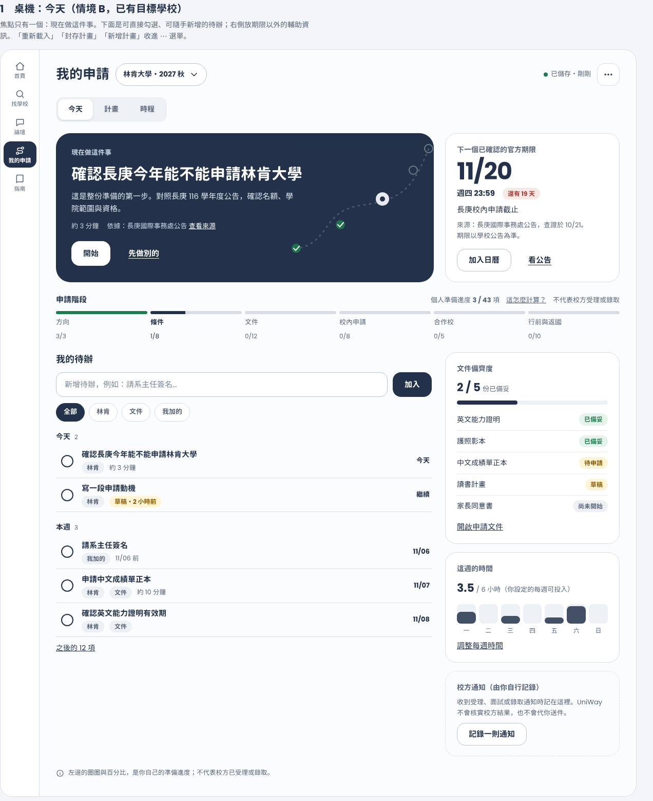 |
| 2 桌機：計畫（情境 C） | 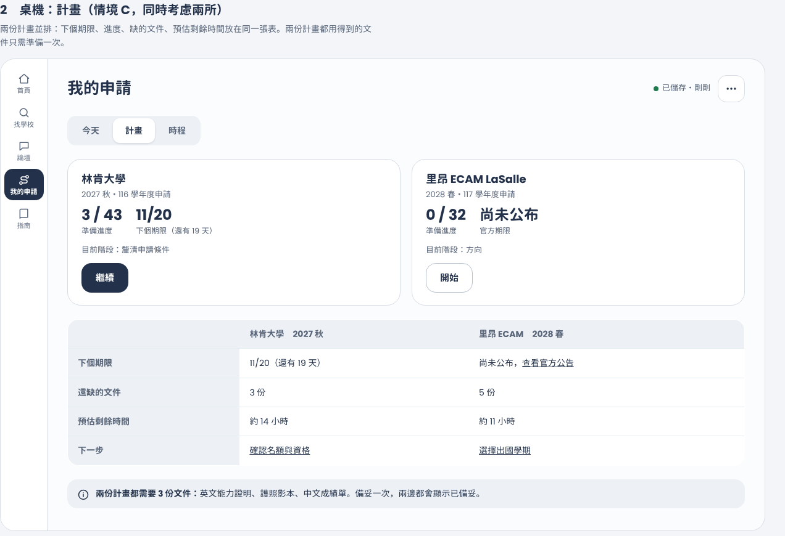 |
| 3 手機：今天／任務面板（條件不符）／第一次使用 | 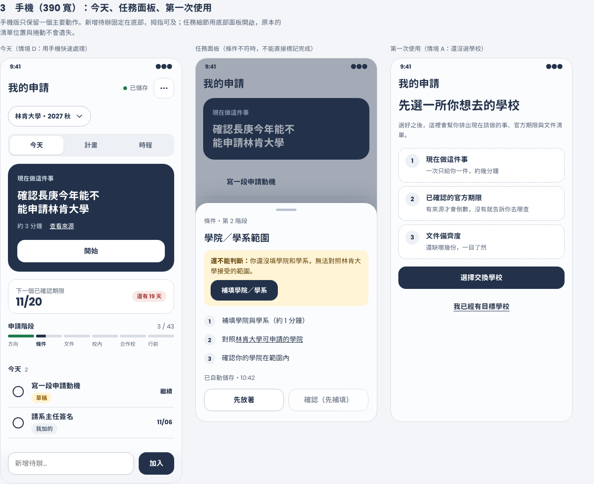 |
| 4 建立計畫 | 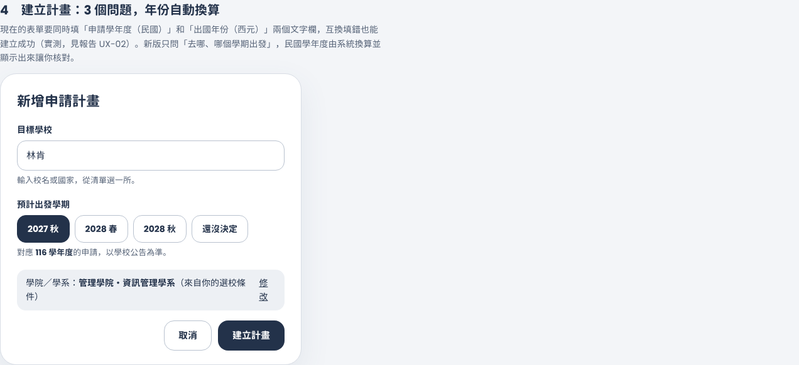 |
| 5 回饋與錯誤元件 | 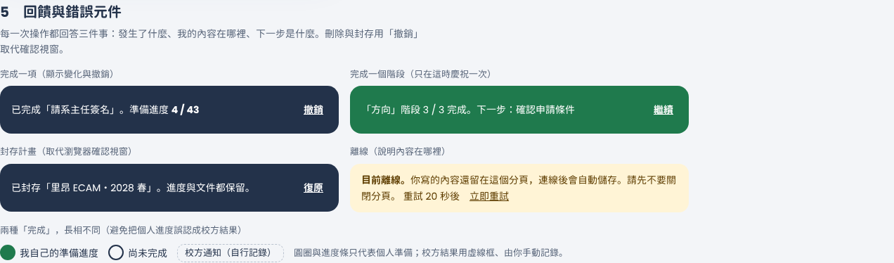 |

### 現況對照（已觀察）

| | 桌機 | 手機 |
| --- | --- | --- |
| 首次使用空白狀態 | 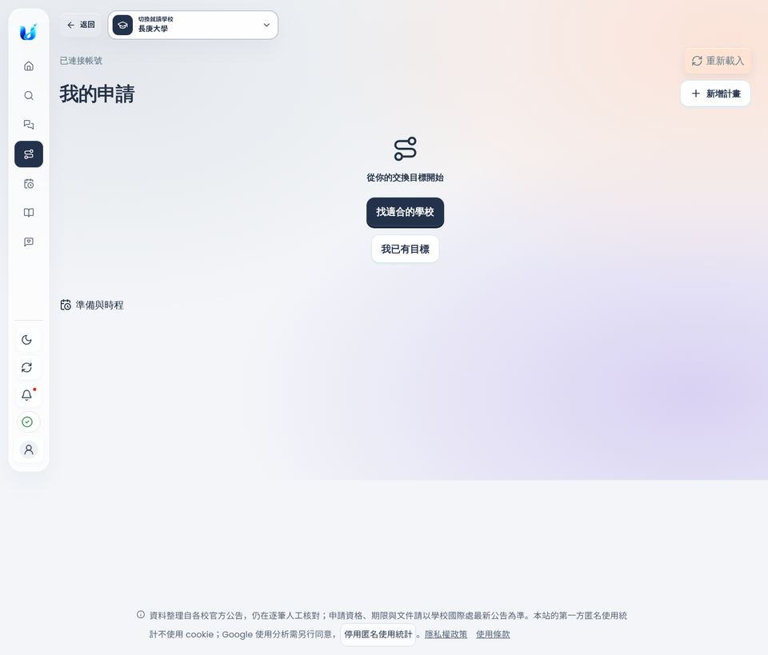 | |
| 準備清單 | 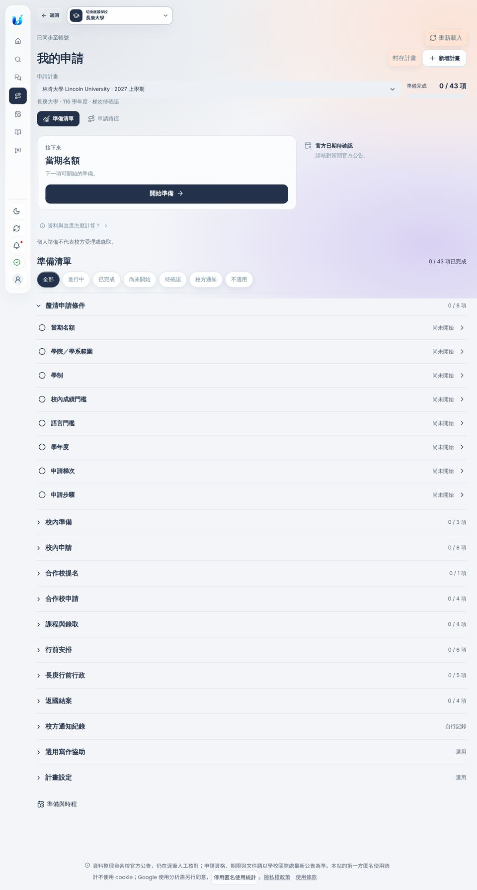 | 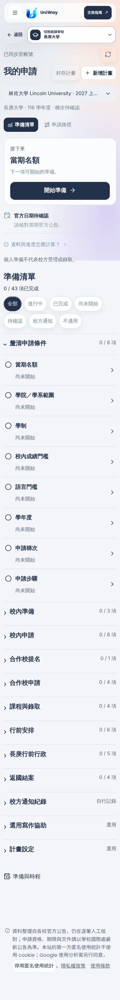 |
| 準備與時程（空白任務區） | 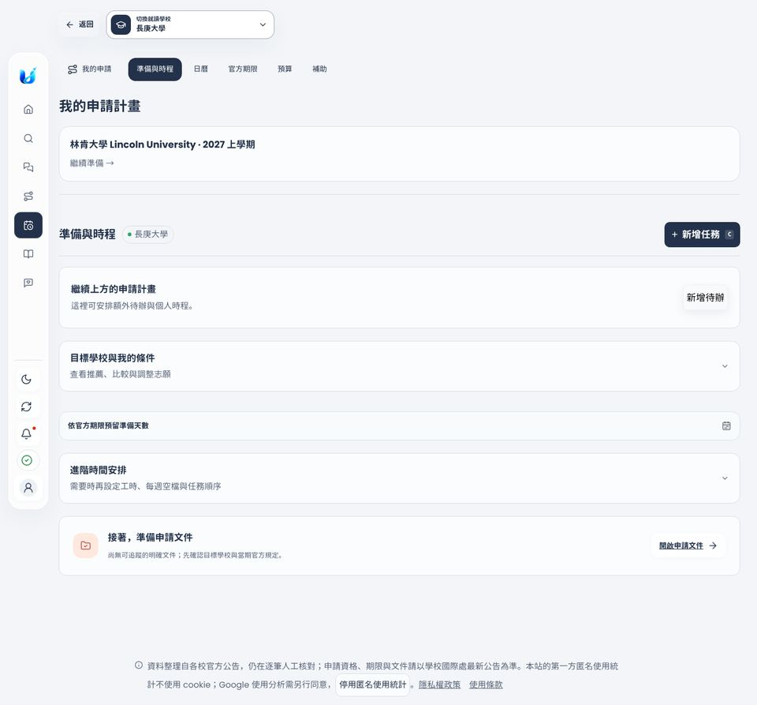 | 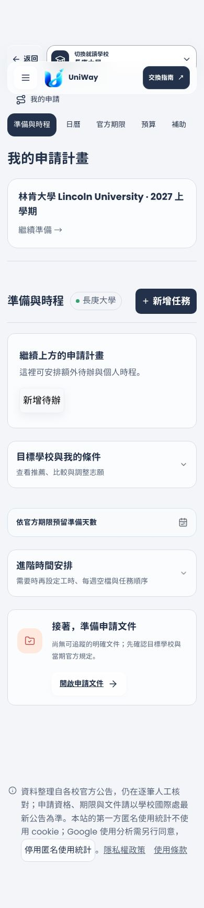 |
| 任務頁 | | 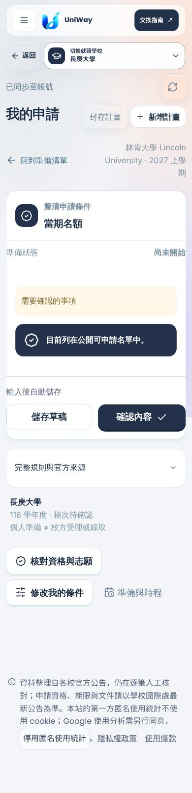 |

---

## 8. 改善優先順序

每項都標示涉及檔案、風險，並建議合併前先在測試版確認。

### 階段 1：止血（不改版面，粗估 3–4 天）

| 序 | 項目 | 修的問題 | 涉及 | 風險 |
| --- | --- | --- | --- | --- |
| 1 | 條件不符時不能確認；後端同步擋 | UX-01 | `application-path.js`、`application_path.py`、`application_rules.py` | 現有測試與進度數字會變；需要資料說明 |
| 2 | 建立計畫：單一出發學期、後端驗證年份 | UX-02 | `application-path-template.js`、`application-path.js`、`application_path.py` | 既有 e2e 會填兩個年份欄，需要改 |
| 3 | 封存改成可復原的提示；原始錯誤訊息改成中文；移除 `/admin/community/session` 的一般使用者請求；`transition: all` | UX-08、09、15、17 | `application-path.js`、`app.js`、`community-moderation.js` | 低 |
| 4 | 期限卡：沒有已確認期限時顯示來源連結與「我查到了」 | UX-05 | `application-path.js` | 需要資料欄位（來源網址已有 `source_urls`） |

### 階段 2：工作臺（粗估 2 週，加功能旗標）

| 序 | 項目 | 修的問題 |
| --- | --- | --- |
| 5 | 合併入口，工作臺「今天」；任務面板；就地新增待辦 | UX-03、04、06、14 |
| 6 | 「計畫」檢視並排比較、共用文件 | 情境 C |
| 7 | 「時程」檢視（沿用現有倒排與每週時數） | UX-04 |
| 8 | 側欄加文字標籤；命名統一 | UX-10 |

### 階段 3：回饋與提醒（粗估 1 週）

完成回饋（進度變化＋撤銷＋階段慶祝）、期限提醒（沿用通知中心）、離線橫幅。

### 階段 4：樣式整併（持續）

新介面用單一、使用 `--uw-*` 變數的樣式檔；舊樣式在新介面全面啟用後逐步移除（UX-13）。

### 注意事項

- **測試**：`tests/e2e/test_application_*.py`、`test_my_application_entry.py` 依賴現有元素 ID（如 `#next-link`、`#overall-caption`、`#level-input`）。新介面要保留這些 ID 或同步改測試；階段 1 幾乎不動。
- **舊網址**：`#my-application?...`、`#overview` 一律保留並導向新介面。
- **App 同步**：README 規定 Web 先確認、再同步 Flutter；這份規劃只含 Web。
- **功能旗標**：階段 2 預設關閉，測試版開啟。這樣合併到 `main` 不會改變正式站。

---

## 9. 驗收指標與測試情境

### 9.1 目前基準（本次實測）

| 指標 | 現況 | 目標 |
| --- | --- | --- |
| 建立計畫要手打的年份欄位數 | 2 | 0 |
| 從側欄到「已開始第一個任務」的動作數（情境 A） | 8（含 2 個要打字的欄位） | ≤ 6 |
| 回訪者從側欄到「已開始任務」的點擊數（情境 B） | 2 | ≤ 2（不退步） |
| 「我的申請」頁內，「下一步」卡片之前的可操作控制項（桌機） | 6（重新載入、封存、新增、計畫選單、2 個分頁） | ≤ 2 |
| 條件不符卻能完成的任務數 | 至少 2（當期名額、學院／學系） | 0 |
| 年份填反仍建立成功 | 是 | 否，並提示 |
| 建了計畫後「準備與時程」顯示該計畫任務 | 否（0 項） | 是（至少顯示下 5 項） |
| 一般學生每次載入的 403 主控台錯誤 | 3–4 | 0 |
| 瀏覽器內建 `confirm()` 數量 | 1（封存） | 0（改為可復原提示） |
| 完成一項後顯示進度變化與撤銷 | 否 | 是 |

### 9.2 行為指標（需要分析資料；數值待基準確認，不預先編造）

現有事件：`plan_create_result`、`draft_save_result`、`draft_resume_result`（`application-path.js`）。建議新增（事件名稱草案）：`workbench_view`、`task_start`、`task_complete`（含 `blocked=false` 驗證）、`task_undo`、`deadline_source_open`、`quick_add_submit`。

| 指標 | 定義 | 目標 |
| --- | --- | --- |
| 首次價值時間 | 建立計畫到第一次 `task_complete` 的中位數 | 先量基準，再設下降目標 |
| 7 日回訪完成率 | 建立計畫後 7 日內再完成 ≥ 1 項的比例 | 先量基準 |
| 草稿續接率 | `draft_resume_result` 後 24 小時內完成該項 | 先量基準 |
| 撤銷率 | `task_undo` / `task_complete` | 過低可能代表視窗太短，過高代表誤觸（待觀察） |

### 9.3 自動化測試情境（Playwright，隔離測試資料）

| 編號 | 情境 | 通過條件 |
| --- | --- | --- |
| T1 | 阻擋條件下嘗試完成「學院／學系」 | 看不到「確認」，進度不變；直接打 API 也被拒絕 |
| T2 | 建立計畫時選「2027 秋」 | 顯示 116 學年度；無法送出互換年份 |
| T3 | 建立計畫後打開今天 | 顯示現在做這件事；不需要捲動就看到主要動作（390×844 與 1440×900） |
| T4 | 勾選待辦後撤銷 | 進度還原；6 秒後撤銷消失 |
| T5 | 離線輸入再恢復 | 顯示中文離線橫幅；恢復後自動儲存 |
| T6 | 封存計畫 | 沒有 `confirm()`；可復原 |
| T7 | 兩份計畫並排 | 期限、缺件、剩餘時間一致；共用文件只算一次 |
| T8 | 舊網址 `#overview`、`#my-application?plan=…` | 都進到新介面對應檢視 |
| T9 | 鍵盤：Tab 依視覺順序，焦點可見；跳到主要內容 | 全部可操作 |
| T10 | 減少動態偏好 | 無非必要動畫 |

### 9.4 真人測試（建議）

- 對象：5 位台灣大學生，涵蓋 A–D（至少 1 位只用手機）。
- 任務：「找出你現在該做的事」「記一件你自己的待辦」「比較兩所學校哪一所比較急」「離開再回來，接著做」。
- 觀察：第一次點擊是否正確、是否把進度當成校方結果、卡住的位置。
- 另做 5 秒測試與第一次點擊測試驗證 H2、H5。

---

## 10. 測試版（離線版）與部署流程

### 現況

- `render.yaml`：`branch: main`、`autoDeployTrigger: commit`。**任何合併到 `main` 的內容都會自動部署到正式站**。
- `.github/workflows` 裡沒有自動合併的設定。如果你看到「開了 PR 就被合併」，來源可能是 GitHub 的 auto-merge 設定或其他整合，需要到 repo 的 Settings 查；從這個環境看不到。
- 本次 PR（[#211](https://github.com/blizzard-new/abroad/pull/211)）是 draft，沒有啟用自動合併。

### 已提供的測試版

`scripts/staging.py`：把某個 PR／分支／正式版（`origin/main`）的程式碼抓到你的電腦，用虛構資料跑起來，頁面底部有「測試版」標籤。

```bash
python scripts/staging.py up --pr 211
```

- 完全隔離：程式會先移除終端機裡所有 `EXCHANGE_*`、`SUPABASE*`、`GOOGLE_OAUTH*` 變數，資料只存在 `.staging/data`。
- 不複製正式使用者資料。「整個抓下來」指的是**程式碼與內建學校資料**，不包含帳號、文件庫、心得文章等正式資料庫內容。
- 預先建立 3 個虛構帳號，對應情境 A、B、C。
- `--watch`：PR 有新 commit 就自動更新並重啟。

完整說明見 [`docs/staging-local-test.md`](../staging-local-test.md)。

### 建議的工作流程

1. 我（或你）在分支改完，**PR 先維持 draft**。
2. 你在自己電腦跑 `python scripts/staging.py up --pr <編號> --watch` 看成果。
3. 滿意後才把 PR 標示為可審查並合併。
4. 新介面加功能旗標，預設關閉；合併後正式站不變，旗標打開才上線。

要不要改 `render.yaml` 或 GitHub 保護規則（例如需要審查才能合併），由你決定；我沒有改。

---

## 11. 附錄

### 觀察紀錄摘要

- 入口載入：本機隔離伺服器首次載入約 19.5 秒（含快取預熱），第二次約 5.1 秒；不代表正式站。
- 建立計畫（正確年份）：23 階段／54 個關卡（43 項計入進度）；互換年份：13 階段／20 個關卡。
- 「確認內容」：「當期名額」一次完成，進度 0→1；「學院／學系範圍」在頁面寫著無法套用時也完成，進度 0→1。
- 離線：訊息「尚未儲存，請重試」＋「Failed to fetch；內容仍保留在此分頁。」；恢復連線後狀態變成「已儲存」。
- 重新整理後停留在同一任務；上一頁回到清單。
- 鍵盤：第一個停駐點是「跳到主要內容」（可直接跳過）；連按 14 次 Tab 仍停在全域導覽與工具列，還沒進到頁面內容。

### 規範檢查結果

`W` 代表 Vercel Web Interface Guidelines。其餘標明來源 skill。

| 檔案：行 | 問題 | 規範來源 |
| --- | --- | --- |
| `application-workspace.css:223` | `transition: all` | W（動畫：不要用 `transition: all`） |
| `application-path.js:189`、`:258`、`:299`、`:360` | 錯誤訊息直接顯示 `e.message`，離線時是英文「Failed to fetch」 | W（錯誤訊息要說明下一步）、`flow-errors` |
| `application-path.js:391` | 原生 `confirm()` 且不能復原 | `flow-errors`（撤銷優先於確認） |
| `application-path.css` | 238 個寫死色碼，0 個設計變數 | `ui-ux-pro-max`（語意化色彩變數） |
| 側欄 | 圖示沒有文字標籤 | `flow-navigation`（主導覽圖示要搭配文字） |
| `application-path.js:415` 附近 | 年份是自由文字，沒有格式或範圍限制 | `flow-forms`（正確的輸入型別、少問問題） |
| `index.html:781` | `<kbd>` 快速鍵提示在觸控裝置也顯示 | 個人判斷（沒有對應條文） |

### 本次沒有改動

正式功能、資料、`render.yaml`、GitHub 設定。新增的只有：`docs/ux-audit-20261101/`、`docs/staging-local-test.md`、`scripts/staging.py`、`scripts/staging_runner.py`，以及 `.gitignore` 加入 `.staging/`。
