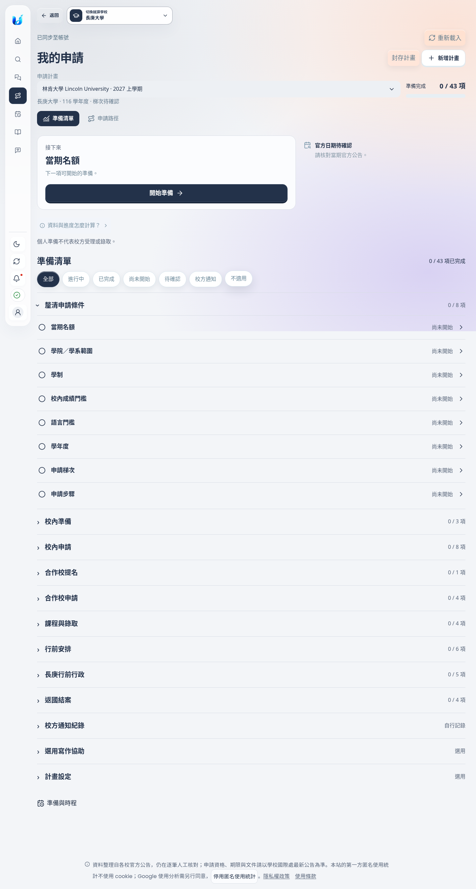
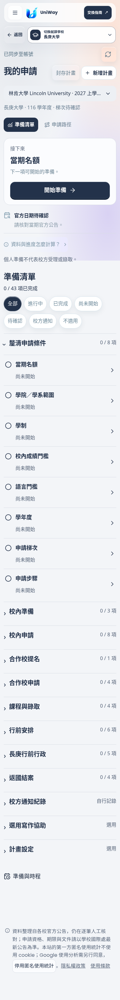
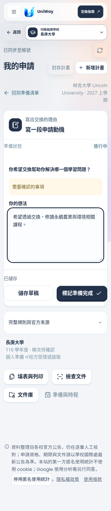
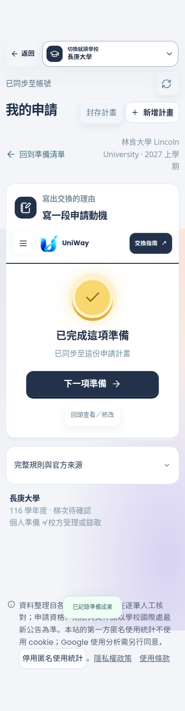

# UniWay：以任務為主的申請工作區

這次調整以 UX 稽核的保存安全、下一步與手機操作問題為優先。保留 UniWay 的字體、深藍主色、玻璃介面、品牌標誌及明暗主題；不加入新的必經教學流程。

## 使用者會看到的改變

- 「我的申請」預設開啟準備清單。最上方是可直接進入的下一步；手機和平板也保留期限資訊。原有路徑仍可切換查看。
- 沒有計畫時，可選「找適合的學校」或「我已有目標」。學校詳情的「開始準備」直接帶入學校，已有計畫則續接，不必先加入志願。
- 核心任務按原有申請階段分組。設定、選用寫作及校方通知排在後面，預設收合。
- 以完成任務數呈現個人準備進度。設定、選用寫作、校方通知與未確認適用的條件式文件不灌入分母；不適用項目不計分。
- 主要操作與輸入使用 18px；核心輔助資訊至少 16px。主要點擊區至少 48px；下一步只有兩次輕微亮起，尊重「減少動態效果」。
- 按鈕寫明結果，例如「儲存草稿」「標記文件備妥」「記錄我已送件」。普通確認不再要求先勾一次再按一次；自行送件紀錄保留明確確認。
- 「準備與時程」列出申請計畫入口，避免已有計畫卻看到沒有申請的困惑。

## 保存與恢復的行為

一般任務文字及文件連結在停止輸入 900ms 後保存到原有加密、帳號隔離的儲存服務。文件上傳仍需使用者選檔並明確同意；完成狀態仍需明確操作。

| 情境 | 行為 |
| --- | --- |
| 返回、前進、切任務、切計畫 | 先將未同步輸入留在分頁記憶體，按帳號、母校、計畫、任務隔離，回到任務可恢復 |
| 正在儲存時繼續輸入 | 舊回應不蓋掉新文字；續存較新的內容 |
| 儲存失敗 | 保留輸入、顯示未儲存與錯誤，可再次儲存 |
| 其他分頁先保存 | 停止自動覆寫；載入最新版本後顯示比對內容，由使用者明確保存 |
| 登入逾期 | 私人畫面立即清除；未同步草稿最多在原分頁記憶體保留 15 分鐘，只向重新驗證的原帳號恢復 |
| Google 重新登入 | 有待恢復草稿時開啟獨立登入視窗，保留原分頁；透過原有 `/auth/me` 驗證新 session，不信任 popup 訊息或傳送草稿給 popup |
| 登入視窗被阻擋 | 原分頁不跳走，顯示允許視窗後重試的操作指引 |
| 登出／登入另一帳號 | 清除分頁的待恢復草稿；不跨帳號套用 |
| 重新整理／關閉分頁 | 有未保存內容時使用瀏覽器離開提醒；已保存內容由伺服器恢復 |
| 封存含未保存草稿的計畫 | 先帶回待保存任務；保存後才能封存。封存保留既有資料 |
| 未修改已完成內容再保存 | 保持完成狀態；實質改動後提示重新確認 |

未同步內容不寫入 localStorage/sessionStorage。記憶體保留不等於離線永久保存：強制關閉、重新整理後仍離開、分頁被作業系統回收，或逾期超過 15 分鐘，都不能保證恢復未同步內容。

## 下一步與官方狀態

排序為：本計畫未同步草稿 → 14 天內已確認的當期官方期限 → 上次進行中的草稿 → 可開始的準備事項。所有推薦都尊重現有前置條件；設定與全新選用寫作不佔預設下一步。

後端新增 `deadline_confirmed` 回傳欄位：只有當期官方來源且沒有待確認旗標的期限才可驅動優先排序。參考年度／待核對日期保留在任務細節，不當成確定期限催辦；畫面日期明示臺灣時間。

清單完成是使用者自行記錄的準備成果。校方通知、校方受理與錄取不屬於平台驗證的進度；UniWay 不代送申請。既有 API 的權限、版本衝突與前置條件驗證仍然有效。

## 稽核項目對照

| 稽核 | 本次處理 | 邊界 |
| --- | --- | --- |
| U01 返回丟失草稿 | 已修正，包含 history 與跨計畫切換 | 未同步內容限原分頁 |
| U14 登入逾期丟失草稿 | 已加入同帳號短暫恢復、Google 視窗重驗證 | 實際 Google 第三方登入仍需 staging 實帳號驗收；測試只模擬 provider 頁面 |
| U02 兩套申請入口 | 加入共用計畫索引與直接續接入口 | 尚未合併舊志願工作區、任務狀態與路徑 registry；不做推測性進度搬移 |
| U03 小螢幕隱藏下一步／期限 | 已修正，核心卡片不隱藏 | 無當期日期時顯示待確認 |
| U04 地圖操作與雙重捲動 | 預設階段清單，正常向下閱讀 | 路徑保留為次要檢視 |
| U05 未選校空白入口 | 可先找學校，已知目標可直接開始 | 建立正式計畫仍需申請學年度與出國年份 |
| U06 重複設定確認 | 設定移出必做任務與進度 | 舊設定節點留作相容入口 |
| U07 下一步排序 | 未同步、當期期限、續作、可用任務 | 跨校期限比較仍屬後續階段 |
| U08 完成度混算 | 前端改用適用任務的完成數，移除微型分數 | 後端舊 aggregate 保留相容；此頁不以它當作校方進度 |
| U09 狀態篩選 | 增加待確認、不適用、校方通知 | 外部通知一律標示自行記錄 |
| U10 保存與草稿範圍 | 任務自動保存與明確狀態；衝突人工比對 | 內嵌正式表單仍沿用原共用草稿，尚未拆成各校文件版本 |
| U11 模糊按鈕 | 改為動詞與實際結果 | 送件按鈕明示個人紀錄 |
| U15 未改內容進度倒退 | 已修正 | 實質修改會重新要求確認 |
| U16 完成後焦點消失 | 焦點移到成功摘要、可繼續下一任務 | 尚未進行真人讀屏研究 |
| U12 標題不一致 | 「準備與時程」頁面標題同步 | 保留既有深連結 |
| U13 結果事件 | 建立計畫、保存、恢復事件 | 僅接受結果、任務類型、HTTP 狀態；不收集文字、文件名、任務或計畫 ID |

## 驗證與畫面

隔離的 FastAPI 測試伺服器、臨時資料目錄與虛構學生帳號，使用 Chromium／Playwright 操作。未讀寫正式學生資料。

測試涵蓋：返回／前進、儲存失敗、儲存期間新輸入、同帳號恢復、跨帳號清除、跨學期隔離、版本衝突比對、直接建立計畫／重複點擊、下一步排序、完成狀態與焦點、手機／平板／桌機、減少動態效果、原有內嵌工具。

2026-11-01 本機驗證：相關測試分批通過 75 項（含 13 項專門 UX 瀏覽器回歸），另針對最後的顯示／衝突修正重跑對應案例。JavaScript／Python 語法、OpenAPI 相容性與 `git diff --check` 通過。390／834／1440px 實際頁面沒有水平溢出或 JavaScript 執行錯誤；下一步按鈕位於首屏。尚未執行整個專案測試套件。

執行相關測試：

```bash
EXCHANGE_ENVIRONMENT=test EXCHANGE_AUTH_METHODS=email,google,facebook \
EXCHANGE_INFO_DATA_DIR=/tmp/uniway-ux-tests \
PLAYWRIGHT_CHROMIUM_EXECUTABLE_PATH=/usr/bin/chromium \
.venv/bin/python -m pytest tests/test_application_path.py tests/test_analytics_core.py \
tests/e2e/test_application_task_ux.py tests/e2e/test_application_level_tools.py \
tests/e2e/test_my_application_entry.py -q
```

以下是實際瀏覽器畫面，內容為測試資料：

| 桌機準備清單 | 手機準備清單 |
| --- | --- |
|  |  |

| 手機草稿 | 完成回饋 |
| --- | --- |
|  |  |

[平板](checklist-834.png) · [深色模式](checklist-dark.png) · [未選校入口](empty-desktop.png) · [計畫索引](plans-desktop.png)

## 後續階段

下一階段再處理跨校期限／材料比較、舊志願與計畫資料模型整合、各校文件版本、完整 onboarding 與真人任務測試。這次不會將不同學校、年份或學期的舊進度自動搬入新計畫，也不會把所有已知規則視為完整當期申請要求。
