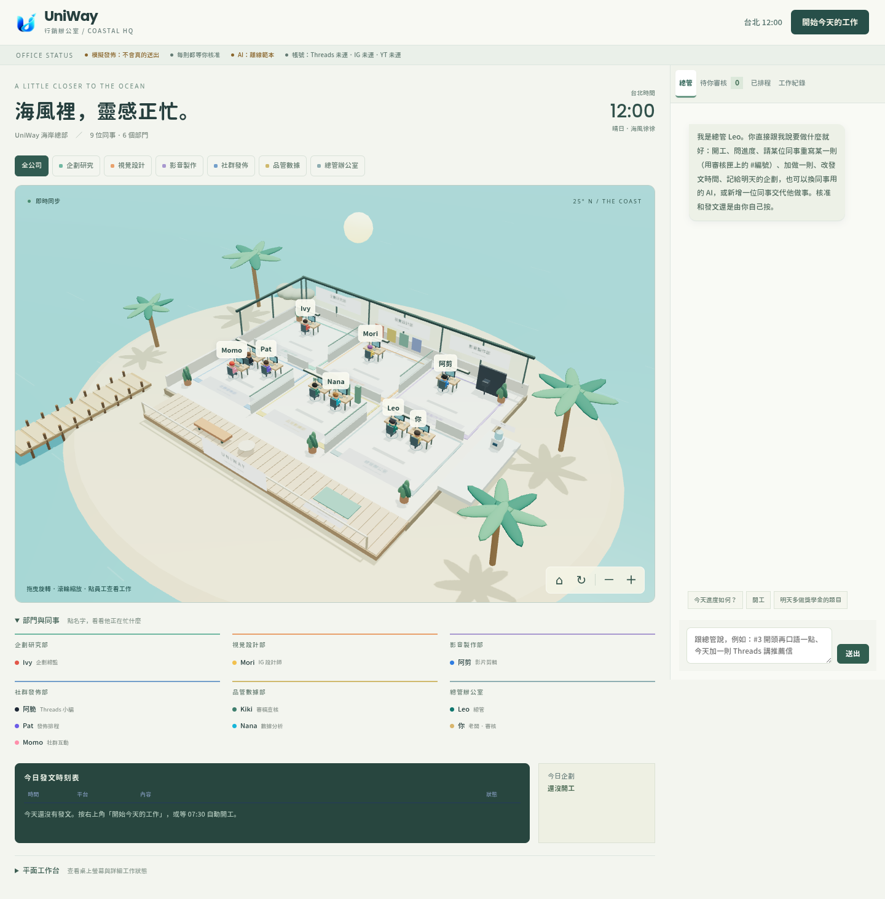
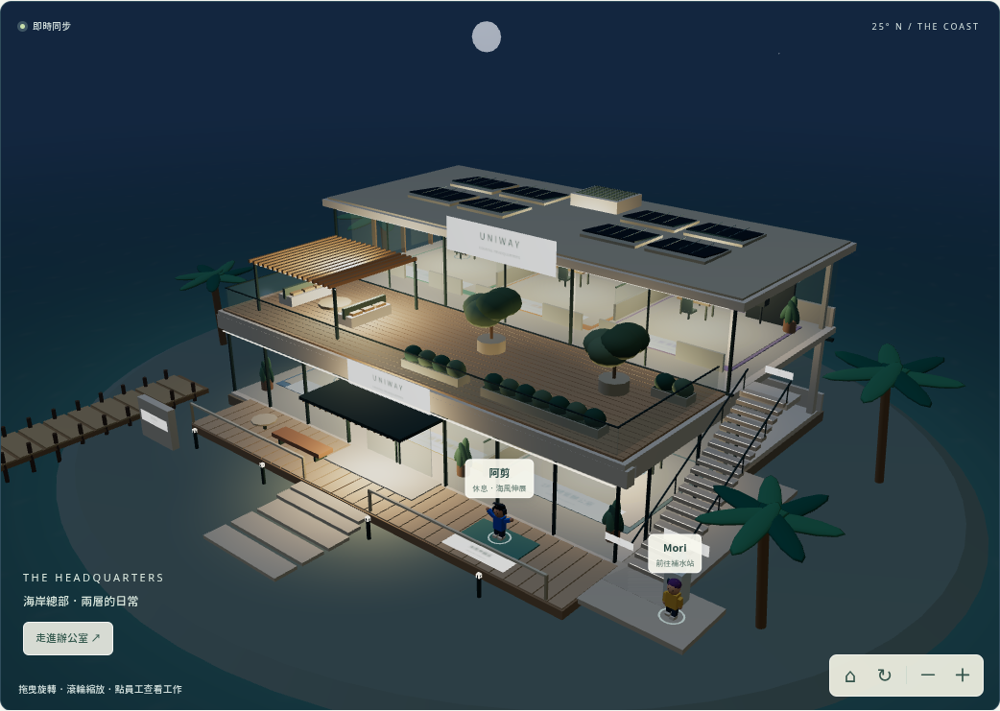
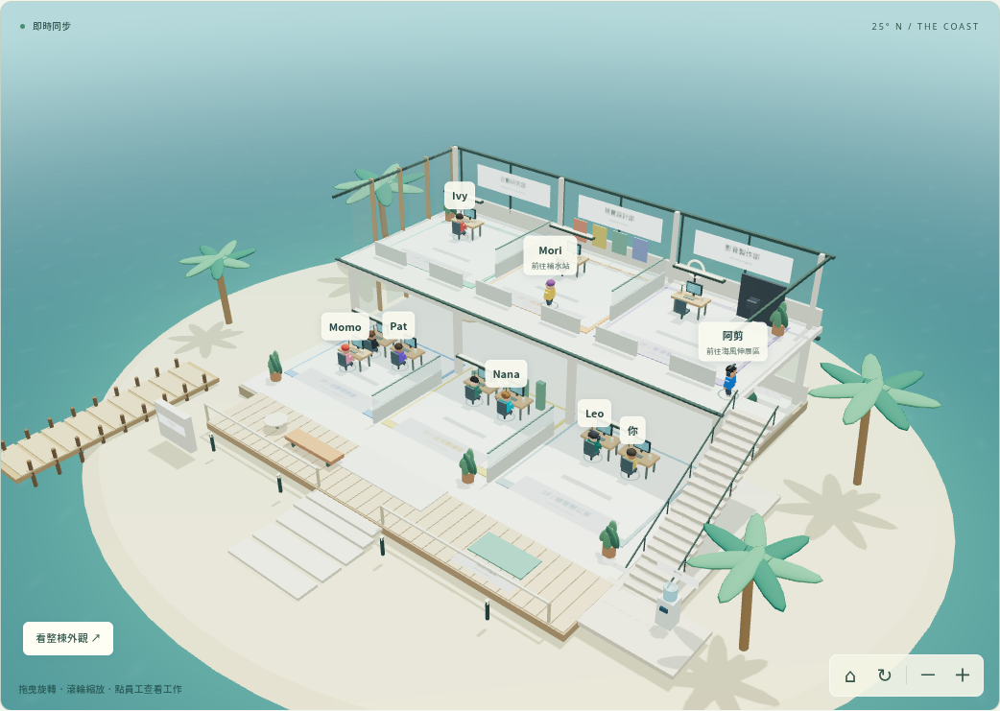

# UniWay 行銷辦公室・海岸總部

一間「看得見」的 3D 海邊 AI 行銷公司：8 位執行成員與總管 Leo，依職責坐在六個部門的座位上，各用一台電腦，每天自動企劃、寫 Threads、做 IG 輪播與限動、剪 Reels／YouTube Shorts（週日再做一支長影片）、審稿查核、排程發佈、抓成效、擬留言回覆。你坐在最後一張桌子，旁邊是總管 Leo（主腦，預設用 Antigravity）：你用聊天交代事情，Leo 分派給大家、做完回報。所有草稿像登機證一樣送到你面前，核准後才會發出去。





[手機版預覽（含六位新增同事）](docs/coastal-mobile.png)

## 3D 海岸公司

辦公室是一整棟兩層樓的海岸總部：玻璃立面、公司招牌、雙扇入口、木格柵雨棚、樓板、二十階外側樓梯與屋頂花園。屋頂有太陽能板，花園有木平台、植栽、樹、沙發與棚架；公司周圍有海面、沙灘、棕櫚樹、木棧道與海景露台。

海岸採熱帶度假風格：深藍外海過渡到碧綠淺灘，海面有多方向波紋、隨視角改變的天空／日月光反射、水下光紋與岸邊碎浪。沙灘沿不規則岸線緩緩沉入水中，有乾濕色差，岸上擺著帆布遮陽傘與躺椅。棕櫚樹有彎曲樹幹、樹皮生長紋、椰子、弧形葉軸與數百片細長羽葉，微風會帶動葉尖；花台也換成帶葉脈的熱帶植栽。

建築以較深的木色、深綠金屬窗框和奶油色石材拉開對比。近看有木紋、石材凹凸、織物紋理、反射玻璃、立面格柵、屋簷收邊、排水管、欄杆固定座與太陽能板網格；公司招牌採深底淺字與金屬框。

上方有三個導覽視角：**整棟公司**看完整建築；**剖面辦公室**收起屋頂、花園樓板與前側玻璃，直接看兩層部門；**屋頂花園**拉近露台休憩空間。也可按「走進辦公室」切換內外。選部門時會自動開剖面，鏡頭移到正確樓層。完整外觀中，室內姓名會收起；到戶外或樓梯的同事仍會顯示活動。

每個部門有獨立招牌、地板配色、隔間與工作桌：

| 樓層 | 部門 | 同事 | 工作區特色 |
| --- | --- | --- | --- |
| 2F | 企劃研究部 | Ivy、新增的自訂同事 | 研究與企劃工作桌，可容納 Ivy 加六位新同事 |
| 2F | 視覺設計部 | Mori | 色票展示牆、設計工作桌 |
| 2F | 影音製作部 | 阿剪 | 攝影背景、環形燈、攝影機 |
| 1F | 社群發佈部 | 阿脆、Pat、Momo | 寫文、發佈、社群互動的三個座位 |
| 1F | 品管數據部 | Kiki、Nana | 審稿與分析桌、數據圖表 |
| 1F | 總管辦公室 | Leo、你 | 總管與老闆相鄰，點你的名字開審核匣 |



[屋頂花園預覽](docs/coastal-garden.png)

- **看公司**：拖曳旋轉、滾輪或雙指縮放，也能用畫面右下的旋轉、放大、縮小和回到全公司按鈕。上方部門按鈕會拉近該部門；員工名冊可以用鍵盤操作。
- **看工作**：點 3D 員工、姓名標籤或名冊，開啟原本的資訊卡，查看正在使用的 AI、工作螢幕與紀錄。任務交接會有一張紙飛向接手同事。新增或移除同事時，3D 座位與名冊同步更新。
- **真實時鐘**：依辦公室設定的 `OFFICE_TIMEZONE`（預設 `Asia/Taipei`）讀取目前時間，每 15 秒更新。05:30–07:00 晨光、07:00–17:00 白天、17:00–18:30 黃昏，18:30–05:30 月夜；晚上 19:00 一定是夜景。太陽／月亮、海色、環境光、部門燈與桌燈一起變化，入口、花園棚架、樓梯與步道也會亮燈。海面有隨光線改變的水色、細浪與岸邊白沫。這是依時鐘呈現的藝術日夜週期，不是天氣預報或每日實際日出日落計算。
- **待命小動作**：只有 `idle`／`done` 的同事會隨機在座位打瞌睡、沿走道去飲水機裝水，或到露台伸展運動。二樓同事會從外側樓梯逐階下樓，到地面露台休息，回程沿原路上樓。同時最多四位休息，飲水區和運動區各一人；收到工作立即停止休息，走動中的同事沿原路回座位。`waiting`／`error` 保留等待處理／需要協助提醒。休息動畫只影響畫面，不會呼叫 AI 或改變後端任務狀態。
- **手機與顯示設定**：手機上方看公司、下方聊天與審核。遠景中重疊的姓名會自動收起，點部門拉近或使用完整名冊即可查看每位同事。系統開啟「減少動態效果」時，不會隨機散步、運動或飛紙，海浪與樹葉也會定格；只在鏡頭、工作或時鐘改變時重繪。切到其他分頁會暫停場景繪製；後端排程仍照常運作。
- **備用工作台**：原本的平面工作台收在下方，可展開看桌上螢幕；WebGL 不支援或中斷時會自動展開，聊天、審核和排程仍可操作。
- **電視模式**：網址加 `?tv`，以全寬海岸公司展示，隱藏聊天面板。

場景由本機附帶的 Three.js 0.180.0 與程式幾何模型繪製；材質、天空反射環境與植物也在本機產生，不需外部 CDN、貼圖／3D 模型下載或新增 API 金鑰。海面使用程序化反射近似，並非真實天氣、流體模擬或整棟建築的鏡面倒影。動態場景會依繪圖速度調整 3D 畫布解析度，介面文字保持清晰；減少動態效果的靜態視圖保留完整解析度。白天停用不需要的室內燈光運算；員工以距離與經過時間行走，不會因為一幀只能走一階而卡在樓梯。更新後重新啟動辦公室、重新整理網頁即可。

## 辦公室裡有誰

| 座位 | 角色 | 用哪個 AI（`.env.example` 的分配） | 每天做什麼 |
|------|------|------|------------|
| Ivy | 企劃總監 | 查資料：Antigravity；排內容：Claude Code | 先上網查這兩週學生在討論什麼（每條附來源），再讀平台數字（目前支援幾所大學、幾筆合作校）、`sources/audit/` 最新一天的已核實官方公告、上週成效，排出今天的內容；照 3:3:3:1 輪替 IG 內容支柱 |
| 阿脆 | Threads 小編 | Claude Code | 去商業化的真人口吻；第一行點名族群或痛點，用提問、二選一、清單、小編碎碎念、今日公告五種角度；主文不放網址，網址放第一則留言；每篇附一張 4:5 圖卡（`OFFICE_THREADS_IMAGES=0` 可關掉） |
| Mori | 視覺設計師（全公司唯一做圖的人） | IG 文案與做圖排版：Claude Code；封面插圖：Codex | 寫 IG 輪播文案；**所有圖片**（輪播、限動、Threads 配圖）都由她先讀設計準則、再讀需求，排好版面才出圖（見「圖片都由 Mori 做」）；封面插圖可交給 Codex 畫；hashtag 最多 5 個 |
| 阿剪 | 影片剪輯 | Claude Code | 30～45 秒直式腳本（前 3 秒鉤子、每個畫面都有大字幕），逐格算圖並配上合成音樂；同一支影片發 Reels 和 YouTube Shorts；週日做 2～4 分鐘橫式「本週交換情報懶人包」 |
| Kiki | 審稿查核 | Codex | 程式規則＋AI 審稿：字數、連結位置、hashtag 數、平台數字不能誇大、沒有官方來源不能寫日期、禁用「保證錄取／官方合作」等字眼；不合格退回作者改一次。寫的人和審的人用不同家的 AI，比較容易抓到盲點 |
| Pat | 發佈排程 | Antigravity | 發文前最後檢查一次（公告有沒有改、是不是跟最近重複），有疑慮就退回給你；到排定時間用程式呼叫 Threads／Instagram／YouTube 官方 API，Threads 發完主文立刻在第一則留言補上連結；你核准的資料更新提案，也由 Pat 用程式開成 GitHub draft PR（見「資料更新提案與 draft PR」，不合併） |
| Nana | 數據分析 | Antigravity | 每晚抓成效，把 Threads 上互動最好的題目交給企劃重製成 IG（Threads 測試題目、IG 放大轉換的雙平台閉環），並寫 2～4 點建議給隔天的企劃 |
| Momo | 社群互動 | Claude Code | 發文後 30 分鐘～3 小時去看留言、擬回覆；回覆陌生人一律等你核准 |
| Leo | 總管（主腦） | Antigravity | 你和大家之間的窗口：聽你在聊天裡交代的事、分派給對的同事、做完回報；每天開工結束會整理「哪些等你看」 |
| 你 | 老闆 | — | 跟 Leo 聊天交代事情；在「待你審核」核准、修改、立即發佈或退回 |

## 一天怎麼運作

```
07:30  開工：企劃讀資料、排內容 → 寫手、設計、剪輯同時產出 → 審稿 → 草稿送到你的審核匣
       → 總管 Leo 在聊天裡跟你說哪些等你看（你可以在手機上打開辦公室網頁審核、跟 Leo 說要改哪裡）
12:30  Threads 第 1 篇（主文 → 第一則留言放連結）
18:00  YouTube Shorts
19:30  Instagram 輪播或 Reels，19:45 限動
21:00  Threads 第 2 篇
發文後 30 分鐘  社群互動看留言、擬回覆給你核准
23:30  數據分析抓成效，明天企劃參考
週日   多一支 YouTube 長影片
```

時間都可以在 `.env` 改。沒核准的草稿不會發；核准時已經過了排定時間的，下一輪（30 秒內）就發。

## 在你的電腦上跑起來

Windows 和 Mac 都可以。Python 不用自己裝，uv 會自動下載；剪影片用的 ffmpeg 也已經包在套件裡。

**1. 安裝工具**（裝完關掉終端機再打開，新指令才找得到）

| | Windows（PowerShell） | Mac（終端機） |
|---|---|---|
| uv | `powershell -ExecutionPolicy ByPass -c "irm https://astral.sh/uv/install.ps1 \| iex"` | `curl -LsSf https://astral.sh/uv/install.sh \| sh` |
| Git | `winget install --id Git.Git -e` | 第一次打 `git` 會提示安裝 |

三個 AI 工具（**裝好後各自在新的終端機執行一次並登入**）：

| | Windows（PowerShell） | Mac（終端機） | 登入 |
|---|---|---|---|
| Claude Code | `irm https://claude.ai/install.ps1 \| iex` | `curl -fsSL https://claude.ai/install.sh \| bash` | 執行 `claude`，登入 Claude 帳號 |
| Codex | 先 `winget install OpenJS.NodeJS.LTS`，再 `npm.cmd install -g @openai/codex` | `npm install -g @openai/codex` | 執行 `codex`，選用 ChatGPT 登入 |
| Antigravity | `irm https://antigravity.google/cli/install.ps1 \| iex` | `curl -fsSL https://antigravity.google/cli/install.sh \| bash` | 執行 `agy`，選 Google 登入 |

裝完要**關掉終端機再開一個新的**，再重新啟動辦公室，新指令才找得到。沒裝的工具不會讓辦公室停下來，那幾張桌子會改用備援。

**2. 下載並啟動**

```bash
git clone https://github.com/blizzard-new/abroad.git
cd abroad/marketing/agent-office
uv sync
uv run playwright install chromium     # 算圖用的瀏覽器（已經有 Chromium 的話可以改設 CHROMIUM_PATH）
cp .env.example .env                   # Windows：copy .env.example .env
uv run office check --ping             # 檢查工具、每張桌子的 AI 有沒有登入、社群帳號
uv run office serve                    # 打開 http://127.0.0.1:8780
```

按右上角「開始今天的工作」就會開工。`.env` 預設是「模擬發佈」：該送出的 API 請求只會寫進 `var/outbox/`，不會真的發文。圖片、影片在 `var/media/`。

`office check` 會列出每一項的狀態（○ 好了、× 要處理、△ 提醒），× 後面會寫怎麼修。

不開網頁也可以：

```bash
uv run office run --force     # 立刻跑一天
uv run office list            # 看草稿
uv run office approve 3 --now # 核准 #3 並馬上發
uv run office facts           # 看平台數字與今天可引用的官方公告
```

**3. 讓它一直開著**：辦公室要開著才會 07:30 自動開工、到時間發文；電腦睡著就會停。

- Windows：「設定 → 系統 → 電源」把睡眠改成「永不」；想開機自動啟動，用「工作排程器」建一個「登入時」執行的工作：程式填 uv 的完整路徑（在 PowerShell 打 `(Get-Command uv).Source` 查）、引數填 `run office serve`、起始位置填 `agent-office` 資料夾。
- Mac：用 `caffeinate -i uv run office serve` 啟動，跑著的時候就不會睡著。
- 手機：見下面的「用手機跟 Leo 說話」。

## 上線步驟

建議依序做，每一步都確認沒問題再往下：

1. **離線試跑**：照上面先跑一天，看草稿長什麼樣子。
2. **接上 AI 工具**：登入 Claude Code、Codex、Antigravity，`uv run office check --ping` 的 AI 都是 ○。
3. **接上社群帳號**（見「接上 Threads、Instagram、YouTube」），`uv run office check` 的帳號都是 ○，仍保持 `OFFICE_DRY_RUN=1`，到 `var/outbox/` 看會送出的內容。
4. **正式發佈**：改成 `OFFICE_DRY_RUN=0`，保持 `OFFICE_APPROVAL=manual`，每天花 5 分鐘審核。
5. 跑順幾週後，想放手再改 `OFFICE_APPROVAL=auto`（審稿通過就自動排程；留言回覆仍然要你核准）。

## 跟總管聊天

右側面板的第一個分頁是「總管」。直接打字，例如：

- 「今天進度如何？」
- 「開工」
- 「#3 的圖重做，重點用色塊」→ Leo 請 Mori **重新設計**那則的圖（版面重排、封面插圖重畫），文字一個字都不動；「#3 開頭再口語一點」是改文字，兩種不一樣
- 「#3 開頭再口語一點」→ Leo 交給寫那則的同事重寫，再經過審稿，改好放回審核匣（`#編號` 就是審核匣登機證右邊的號碼，訊息裡的編號可以點）
- 「今天加一則 Threads 講推薦信」「今天加做一支 Reels 講交換預算」
- 「#5 改到 20:30 發」「#2 退回，太像廣告」
- 「明天多做獎學金的題目」→ 記給隔天早上的企劃，用過一次就清掉

- 「大家現在用什麼模型？」「Kiki 改用 Sonnet，思考強度 high」「阿脆改用 Opus，xhigh」「Kiki 改回原本的設定」→ Leo 會換掉那位同事用的工具、模型或思考強度，桌上螢幕和同事資訊卡會顯示新的設定

- 「新增一位同事叫小美，負責研究 Dcard 和 PTT 上學生在討論什麼，用 Claude Code 的 Sonnet，思考強度 high」→ 辦公室多一張桌子和一個新的像素人
- 「請小美查這週大家在問什麼」→ 小美做完在聊天裡回報（附來源）；「請阿寫寫一則 Threads 講托福和雅思怎麼選」→ 草稿先給 Kiki 審稿，再放進審核匣等你核准
- 「小美改用 Opus」「請小美離開」

- 「請小公主負責驗證 Dora 和 dora2 的巡查結果」→ 驗證員：巡查同事發現的新公告或不一致，先交給她重新打開官網驗證，確認平台要更新的才送進審核匣（見「資料更新提案與 draft PR」）
- 「新增 Dora 和 dora2 兩位校園情報研究員，把平台的大學平分給她們，每天巡查官網」→ Leo 直接讀這台電腦上專案裡的大學清單（不用上 GitHub），依順序平分；從隔天起每天開工時，兩人各自打開負責學校的官網，看有沒有新的交換公告、規定有沒有改、和平台資料是否一致，回報「🆕 新公告／⚠️ 和平台不一致／✅ 沒有變化」，每則附上看的頁面網址；有新公告或不一致的學校，會再整理成「資料更新提案」送進你的審核匣（見「資料更新提案與 draft PR」）
- 「請小美每天看 Dcard 交換版」→ 變成小美每天固定的工作
- 「Dora 和 dora2 每天早上十點和下午五點各巡查一次」→ 每位新同事可以有自己的時間，一天最多 6 次；沒設定就在每天開工時做一次。辦公室關著時錯過的時間，開機後只補做一次

**每天幾點做什麼**

- 「每天早上 9 點開工」「Threads 改成每天 8:30、12:30、21:00 發」→ 改每天的時間表（開工、Threads、IG、YouTube 發文時間）。Threads 有幾個時間，每天就寫幾篇。說「開工時間改回原本的」就回到 `.env` 的設定
- 「每天 15:00 叫阿脆寫一則 Threads 講獎學金截止日」→ 每天固定時間做的事：原本的同事可以固定寫 Threads（阿脆）、做 IG 輪播（Mori）、做 Reels（阿剪）；新同事可以固定查資料回報、寫 Threads、巡查學校。最多 12 個，每個都有編號（R1、R2…）
- 「現在有哪些固定排程？」「把 R2 刪掉」
- 到時間 Leo 會在聊天裡說「⏰ 固定排程 R1」並交代下去，做好的草稿一樣先過 Kiki 審稿，再等你核准才發；辦公室關著時錯過的時間，開機後只補做一次

新同事最多 6 位，關掉辦公室再打開也還在。新同事用的 AI 失敗時會依序換其他 AI，全部失敗時會照實說出每個 AI 失敗的原因。他們能做兩種事：查資料、分析、想點子後回報給你，或寫 Threads 草稿；IG 圖和影片仍由 Mori、阿剪做。原本的 9 位同事不能被請走。

Leo 能做的事：開工、請同事重寫、加做一則、改發文時間、退回、記給明天、查看和調整每位同事用的 AI，以及新增同事、交代工作給新同事、請新同事離開。**它不能核准、不能發文、不能開 PR 或合併，也不能改帳號、金鑰或模擬模式**，就算你在聊天裡要求也一樣，那些永遠由你在審核匣自己按。Leo 用 Antigravity 思考；Antigravity 沒回應時會照備援順序換人，全部都不行時，它仍聽得懂「開工」和「進度」。

## 用手機跟 Leo 說話、收通知

辦公室接一個你自己的 Telegram 機器人：在手機上傳訊息給它，就是跟總管 Leo 說話；有事它會主動傳給你。電腦不用對外開放（機器人是電腦主動去 Telegram 拿訊息）。

**設定一次（5 分鐘）**

1. 手機裝 Telegram，搜尋 **@BotFather**，傳 `/newbot`，照它問的取名字（例如「UniWay 總管」）和帳號（要以 `bot` 結尾）。它會回你一串 token。
2. 把 token 填進 `.env`：`TELEGRAM_BOT_TOKEN=123456:ABC...`
3. 在電腦執行（先關掉正在跑的 `office serve`）：
   ```bash
   uv run office auth telegram
   ```
   它會印出一個連結，用手機打開、在 Telegram 按「開始」，就會收到「已連上」。
4. 重新啟動 `uv run office serve`。`uv run office check` 的「手機」那一行會是 ○。

**之後怎麼用**

- 直接打字給機器人＝跟 Leo 說話，跟網頁的「總管」分頁一樣：「今天進度如何？」「開工」「#3 開頭再口語一點」「#5 改到 20:30 發」「明天多做獎學金的題目」。Leo 說的話（包括每天開工後的整理）都會傳到手機。
- 你會收到的通知：
  - 📝 **草稿等你核准**：附文案（輪播、影片附封面圖），下面有「✅ 核准」「↩️ 退回」按鈕
  - ⚠️ **需要你看一下**：審稿沒過，或發文前檢查擋下來（可以「照樣核准」或跟 Leo 說要怎麼改）
  - 🚀 **已發出**：附貼文連結
  - ❌ **發佈失敗**：附原因
- 只有你用 `office auth telegram` 連上的那個 Telegram 帳號說的話才算數，別人找到這個機器人也不會有任何回應。按鈕跟網頁上的核准一樣是你本人按的；Leo 自己仍然不能核准。
- 辦公室要開著（`uv run office serve`）機器人才會回；電腦關機時傳的訊息，開機後會依序處理。

**也想在手機上看整間辦公室（動畫、審核匣、改文案）**

用 [Tailscale](https://tailscale.com/download)：電腦和手機都裝、登入同一個帳號，它們就像在同一個私人網路，不用對外開放。

1. `.env` 設 `OFFICE_ACCESS_TOKEN=<自己想一串密碼>`，以及 `OFFICE_URL=http://<電腦名稱>:8780`（電腦名稱在 Tailscale App 裡看得到）。
2. 用 `uv run office serve --host 0.0.0.0` 啟動。Windows 跳出防火牆詢問時，允許「私人網路」。
3. 手機第一次打開 `http://<電腦名稱>:8780/?token=<那串密碼>`，之後會記住。通知裡也會附上辦公室的連結。

**給其他電腦一個公開連結（不用裝 Tailscale）**

用 Cloudflare 的免費 Quick Tunnel，不用帳號、不用開防火牆：

1. `.env` **一定要**設 `OFFICE_ACCESS_TOKEN=<一串很長的密碼>`，然後重開 `uv run office serve`（一樣用預設的 127.0.0.1）。沒有這串密碼，拿到連結的人都能按核准。
2. 安裝一次：`winget install --id Cloudflare.cloudflared -e`（Mac：`brew install cloudflared`），裝完重開 PowerShell。
3. 另開一個 PowerShell 視窗執行 `cloudflared tunnel --url http://localhost:8780`，畫面會出現 `https://xxxx.trycloudflare.com`。
4. 其他電腦打開 `https://xxxx.trycloudflare.com/?token=<那串密碼>`，之後會記住。

這個網址每次重開 cloudflared 都會換；兩個視窗（serve 和 cloudflared）都要開著，連結才打得開。

**3D 太卡**：遠端桌面、沒有顯示卡或瀏覽器關掉「硬體加速」時，3D 會很吃力。辦公室偵測到畫面一直卡，會自動改用平面工作台；也可以直接開 `/?flat`。想強制開 3D 用 `/?3d`。

## Claude Code、Codex、Antigravity 怎麼分工

每張桌子的 AI 在 `.env` 的 `OFFICE_BRAINS` 指定，格式是「角色=工具」。`.env.example` 預設的分工：

- **Claude Code**：寫文案（Threads、IG 說明欄、留言回覆）、寫影片腳本、排內容。
- **Codex**：審稿，和畫 IG 封面插圖（`OFFICE_IMAGES=codex`）。
- **Antigravity**：主腦（總管 Leo），以及上網查資料、解讀數據、發文前最後檢查。

辦公室不會打開這些工具的視窗，而是用它們的「無介面模式」從程式呼叫，用的是你已經登入的訂閱：

| 工具 | 辦公室怎麼叫它 | 先做這件事 |
|------|----------------|------------|
| Claude Code | `claude -p --output-format json --json-schema …`，要求照固定格式回答 | 安裝後在終端機執行 `claude` 登入你的 Claude 帳號 |
| Codex | `codex exec - --output-schema …`；畫圖時用內建的 `$imagegen` | 安裝後執行 `codex` 登入 ChatGPT 帳號 |
| Antigravity | `agy -p "…"`，從輸出裡讀出 JSON | 安裝 Antigravity CLI 並登入；先跑 `agy --help`，參數不同就改 `OFFICE_ANTIGRAVITY_COMMAND` |

幾件要知道的事：

- **每次都在空資料夾裡執行**：審稿、寫稿只能讀不能寫；Codex 只在畫圖時能寫進那個暫存資料夾。工具碰不到辦公室的檔案和你的程式碼。
- **會自動換人**：某個工具沒安裝、沒登入、額度用完或超過 `OFFICE_BRAIN_TIMEOUT` 秒沒回應，就依 `OFFICE_BRAIN_FALLBACK` 往下換（預設 Claude Code → Claude API → 離線範本），換人時桌上的泡泡會說出原因。
- **查資料一定要能上網**：查資料這一步只會交給能上網的工具（Antigravity、Claude Code）；都不行就跳過，不會讓不能上網的 AI 憑空編。查到的東西都附來源，只當線索，審稿仍會擋下沒有官方來源的日期。
- **發文本身是程式，不是 AI**：Antigravity 只能在發文前「擋下來給你看」，不能決定發什麼、發到哪；按下送出的永遠是固定的程式碼。被擋下的貼文會回到你的審核匣並寫明原因，你再核准一次就會直接發。
- **Claude Code 會用你的訂閱**：辦公室呼叫 Claude Code 時會拿掉 `ANTHROPIC_API_KEY`，避免它改用 API 計費。
- **Antigravity 的 CLI 還在變動**：有人回報從程式呼叫會卡住，所以它的每次呼叫都有逾時，逾時就換下一個工具。
- 三家官方都建議「自動化用 API 金鑰」。用訂閱跑自己的排程沒有問題，但會吃訂閱額度；如果哪天某個工具不再允許用訂閱登入跑無介面模式，把那張桌子改成 `api` 就好。

想換分工，只要改 `OFFICE_BRAINS`，例如全部交給 Claude Code：`OFFICE_BRAINS=claude-code`；只換審稿：把 `reviewer=codex` 改成 `reviewer=antigravity`。

## 接上 Threads、Instagram、YouTube

### 哪張桌子用哪個帳號

只有三張桌子會碰帳號，而且每個平台只連一次，三張桌子共用：

| 桌子 | Threads | Instagram | YouTube |
|------|---------|-----------|---------|
| Pat（發佈） | 發文、第一則留言補連結 | 發輪播、Reels、限動 | 上傳 Shorts 與長影片 |
| Momo（社群互動） | 讀留言、送出你核准的回覆 | 讀留言、送出你核准的回覆 | — |
| Nana（數據） | 讀成效 | 讀成效 | 讀觀看數 |

其他人（Leo、Ivy、阿脆、Mori、阿剪、Kiki 和新同事）只做草稿，碰不到帳號，也拿不到權杖。GitHub 權杖同樣只有 Pat 的程式碼用得到（見「資料更新提案與 draft PR」）。連好之後，辦公室上方會顯示「帳號：Threads @你的帳號 · IG @… · YT 頻道名」。

連帳號都用 `uv run office auth …`：它會查出權杖屬於哪個帳號，連同帳號 ID 存進 `var/office.sqlite3`（不進 Git），Meta 的權杖每週自動延長。連完跑 `uv run office check`，會實際問每個平台「這個權杖是誰的」（只讀取，不會發文）。

### Threads

1. 到 [Meta for Developers](https://developers.facebook.com/) 建立 App，使用案例選 **Access the Threads API**，勾選 `threads_basic`、`threads_content_publish`、`threads_read_replies`、`threads_manage_replies`、`threads_manage_insights`。
2. 「應用程式角色 → 新增人員」把要發文的 Threads 帳號加為 **Threads 測試人員**，再到 Threads App 的「設定 → 帳號 → 網站權限 → 邀請」接受。只發自己的帳號時用開發模式就可以，不用送 App 審查。
3. 把 App 設定裡的 **Threads App secret** 填進 `.env` 的 `THREADS_APP_SECRET`。
4. 在使用案例的設定頁按 **Generate Access Token**，登入後複製權杖：
   ```bash
   uv run office auth threads --token <剛剛複製的權杖>
   ```
   會顯示「已連上 Threads @你的帳號」。短期權杖（1 小時）會自動換成約 60 天的長期權杖。

### Instagram

1. IG 帳號要是**專業帳號**（商業或創作者），在 IG App 的「設定 → 帳號類型和工具」切換。
2. 同一個 Meta App 再加入 Instagram 的使用案例（後台名稱類似「管理 Instagram 上的訊息和內容」），選 **API setup with Instagram login**，勾選 `instagram_business_basic`、`instagram_business_content_publish`、`instagram_business_manage_comments`、`instagram_business_manage_insights`。
3. 在同一頁新增你的 IG 帳號並按 **Generate token**（產生權杖）；把 **Instagram App secret** 填進 `INSTAGRAM_APP_SECRET`，然後：
   ```bash
   uv run office auth instagram --token <產生的權杖>
   ```
   後台產生的已經是長期權杖，會照原樣存好。
4. **圖片和影片必須有公開網址**（Instagram 與 Threads 是從網址抓檔，不收上傳），選一種：
   - `OFFICE_MEDIA_HOST=supabase`（建議）：在 Supabase Storage 建一個 **public** bucket（預設名稱 `marketing-media`），填 `SUPABASE_URL` 與 `SUPABASE_SERVICE_ROLE_KEY`。service role key 權限很大，只能放在這台電腦的 `.env`。
   - `OFFICE_MEDIA_HOST=static`：讓這台電腦的 `/media/` 對外（例如用 tunnel），填 `OFFICE_PUBLIC_BASE_URL`。這時**一定要設 `OFFICE_ACCESS_TOKEN`**，否則任何人都能打開辦公室按核准。

   沒設定時 Threads 不附圖、只發文字，IG 貼文和影片會在審核匣標示發佈失敗。

### YouTube

1. 在 [Google Cloud Console](https://console.cloud.google.com/) 建專案，啟用 **YouTube Data API v3**。
2. OAuth 同意畫面選「外部」，把自己加為測試使用者；**發布狀態改成「正式版」**（測試中的 App 拿到的授權 7 天就失效）。
3. 建立 OAuth 用戶端，類型選「電腦版應用程式」，把 ID 與密鑰填進 `.env` 的 `YOUTUBE_CLIENT_ID`、`YOUTUBE_CLIENT_SECRET`，然後：
   ```bash
   uv run office auth youtube   # 會打開瀏覽器，登入要發影片的頻道並同意
   ```
   Google 可能會警告「這個應用程式未經驗證」，那是你自己的 App，按「進階 → 前往」即可。完成後顯示「已連上 YouTube 頻道「…」」。
4. Google 規定：API 專案沒通過 YouTube 稽核前，用 API 上傳的影片一律是「私人」。先設 `YOUTUBE_PRIVACY=private`，到 YouTube Studio 手動公開，或申請稽核。

## 資料更新提案與 draft PR

Dora、小公主這類巡查同事發現「官網有新公告」或「官網和平台資料不一致」時，辦公室會自動把它整理成一份**資料更新提案**，送進你的審核匣（卡片上寫著 GitHub・資料更新提案）。你核准之後，**Pat** 用固定程式在 GitHub 開一個 **draft PR**；你自己到 GitHub 看、補上實際的資料更新、按 Merge。

```
Dora 巡查發現落差 → 驗證員（例如小公主）重新打開官網驗證、比對平台資料 → 確認要更新的，附修改清單進審核匣
  → 你核准 → Pat 開 draft PR → CI 跑測試 → 你在 GitHub 看過、依修改清單補上資料更新、按 Merge
```

**指定驗證員（一次）**：在聊天跟 Leo 說「請小公主負責驗證 Dora 和 dora2 的巡查結果」（名字換成你的驗證同事，要是新同事）。之後巡查同事每發現新公告或不一致，會先自動交給她：

- 她**自己重新打開官網**，不只信 Dora 的說法，再和平台現有的已核實規則（`verified_window_deadlines.py` 裡該校的截止日、送件與讀書計畫規定）比對。
- 她對每一所學校給一個判定：**需要更新**、平台已是最新、不屬於校級交換（例如雙聯學位說明會、外部活動）、官網上無法證實、頁面打不開。只有「需要更新」的才會變成提案，其餘的在 Dora 的報告後面用「🔎」列出她的理由，不會打擾你的審核匣。
- 需要更新的提案會附**修改清單**：改哪個檔案的哪個欄位、平台現在寫什麼、建議改成什麼、官網上的原文依據。
- 她的 AI 掛掉或漏答時，那一所仍然會送到審核匣，但標成「需修改」並寫明沒有完成二次驗證，不會漏掉。驗證員和巡查的人不能是同一位；沒有指定驗證員時，行為和以前一樣（只有巡查同事的說法，卡片上會註明）。
- 跟 Leo 說「取消驗證員」就恢復成不驗證。

為什麼是這樣設計：同事每天讀的是各校官網，那是不可信的網頁，網頁裡的文字可能誘導 AI。所以 AI 只負責「說發現了什麼」，GitHub 這一步全是固定程式碼，AI 拿不到權杖、也碰不到 git：

- **只新增一個檔案**：`sources/audit/proposals/日期-學校-編號.json`（發現、驗證結果與修改清單、官方來源、平台目前的紀錄）。PR 不會改動任何平台資料；合併它只是留下紀錄。真正的資料更新，由你（或在這個 PR 分支上開 Claude Code／Codex）確認官方來源後補上再合併。
- **永遠是 draft**，分支一定是 `office/` 開頭的新分支，不會碰 `main`。程式裡沒有任何「合併、關閉、刪除、強制推送」的功能；Leo 和同事也不能開 PR。
- **永遠等你核准**，不受 `OFFICE_APPROVAL=auto` 影響。來源網址不在該校官網網域（或沒附）的提案，會標成「需修改」，提醒你先自己點開確認。
- 同一所學校已經有提案在審核匣、或今天同一個頁面你已經處理過，就不會再送一份。
- 網頁來的文字進到 PR 說明前都會處理過：`@帳號` 不會通知任何人，HTML、連結語法和藏在文字裡的網址都不會變成可點的連結。

**設定（一次，約 5 分鐘）**

1. 到 GitHub 的 **Settings → Developer settings → Personal access tokens → Fine-grained tokens → Generate new token**。Repository access 選 **Only select repositories**，只選 `blizzard-new/abroad`；Permissions 只開 **Contents: Read and write**、**Pull requests: Read and write**（Metadata 會自動是唯讀），到期日自己決定。不要用傳統（classic）權杖，那會涵蓋你帳號的所有 repo。
2. 在辦公室電腦執行，貼上權杖（輸入時不會顯示）：
   ```bash
   uv run office auth github
   ```
   它會問 GitHub 這是誰的權杖、能不能寫入這個 repo，沒問題才存進 `var/office.sqlite3`（不進 Git）。也可以改在 `.env` 填 `OFFICE_GITHUB_TOKEN`。`uv run office check` 的「GitHub」那一行是 ○ 就好了。
3. **先用模擬模式試**（預設）：核准的提案只會寫進 `var/outbox/`，不會真的開 PR。看過內容 OK，再在 `.env` 設 `OFFICE_GITHUB_DRY_RUN=0` 並重新啟動；這一個開關只管 GitHub，不影響社群貼文是否模擬。
4. 建議到 repo 的 **Settings → Branches** 為 `main` 開保護規則（要求 PR、要求 CI 通過）。權杖是最後一道防線之外的第二道：就算權杖外洩，也推不進 `main`。

**日常**：審核匣的卡片按「核准並開 draft PR」，Pat 馬上開（手機 Telegram 也有同樣的按鈕）；PR 連結會出現在「已排程」分頁和 Telegram。不要的提案按「退回」。核准後失敗（例如權杖過期）會在「已排程」分頁顯示原因，修好後用 `uv run office approve <編號> --now` 再試一次；上次做到一半的分支和檔案會接著用，不會重複。

## 圖片都由 Mori 做

辦公室裡**只有 Mori 一個人做圖**。寫文案的同事（阿脆、新同事、Mori 自己的輪播）寫好、審稿通過之後，把「要做哪一張圖」交給她；她先讀你的設計準則，再讀對方的需求和文案，排出：

- **整組規格**：邊距（60～100 px）、主標題字級（72～96）、正文字級（36～44）、行距（1.4～1.6 倍）、重點色（藍／青綠／珊瑚）、整組唯一的強調手法（換色／色塊／放大）、頁碼位置（右上角／頁尾）。
- **逐頁版面**：每頁一個主要訊息，選用「重點加說明卡」「步驟」「比較」「大數字」其中一種；標題依語意斷行；每頁最多突出 1～2 個關鍵詞；逐頁大綱會顯示在她桌上的螢幕。
- 程式照她的設計出圖。她**只決定怎麼排，不能改文案的一個字**：標題斷行、強調的字、步驟、比較的兩邊，都必須是原文裡本來就有的字；數字超出範圍、版面不成立時，程式會自動改回安全的版面，並把「Mori 的設計備註」寫在審核匣那則的備註裡。她覺得某頁資訊太多、該刪減或拆頁時，也寫在備註，由你和作者決定，她不自己動文案（文案已經過 Kiki 的事實查核）。

**設計準則放在哪裡**：`office/brand.py` 的 `VISUAL_BRIEF`，就是你給的那段準則。想改她的設計原則，改這段文字，重新啟動辦公室就生效。她用哪個 AI 由 `.env` 的 `OFFICE_BRAINS` 裡的 `visual=` 決定（不設就跟著 `designer=`）；設 `visual=offline` 就不請 AI 設計，圖照樣做，用預設版面（邊距 80、標題 88、正文 44、行距 1.5）。

**為什麼以前改提示詞沒有用**：圖是固定的 HTML 版型畫出來的，AI 只提供文字，字級、邊距、版面都寫死在版型裡，沒有任何地方會讀你的排版提示詞；Leo 的「重寫」也只改文字、沿用同一個版型和同一張插圖。現在版型改成由 Mori 的設計控制，並新增「重做圖」。

**重做圖**：在聊天說「#3 的圖重做，重點用色塊」，Leo 會請 Mori 依你的要求重新設計並重新出圖，做好放回審核匣（輪播和 Threads 配圖可以；影片請跟阿剪說）。影片的畫面仍由阿剪的版型決定，不在這次範圍。

## 策略對照：NotebookLM 的建議落在哪裡

| 行銷策略 | 辦公室怎麼做 |
|----------|--------------|
| Threads 創造話題、IG 展示與轉化 | 每天 2 篇 Threads ＋ 1 則 IG；數據分析把 Threads 爆文交給企劃重製成 IG |
| IG 內容 3:3:3:1（價值／引流／信任／品牌故事） | 企劃以 10 天為一輪：價值、信任各 3 天做輪播，引流 3 天做 Reels，1 天說品牌故事 |
| Threads 去商業化、真人口吻 | 每個 AI 都先讀同一份品牌語氣規範；離線範本也有小編碎碎念角度 |
| 第一行點名族群或痛點、二選一、清單 | 五種 Threads 角度輪流用 |
| 主文不放連結，放第一則留言或主頁 | 審稿規則擋下主文網址；發佈時自動補第一則留言；IG 說明欄寫「連結在主頁」 |
| 黃金 30 分鐘 | 社群互動在發文後 30 分鐘開始看留言、擬回覆 |
| Reels 9:16、30～45 秒、前 3 秒鉤子、動態字幕 | 影片腳本與審稿規則都檢查；字幕放在 Reels 介面不會蓋到的位置 |
| 輪播以「被收藏」為目標 | 一張一件事，最後一張是收藏／分享／連結在主頁 |
| 限時動態每天經營 | 每則 IG 貼文後 15 分鐘發一張限動（見下方限制） |
| 數據回饋 | 每晚抓 Threads／IG／YouTube 成效 |

## 安全設計

- **預設不會發文**：`OFFICE_DRY_RUN` 只有明確寫 `0` 才會關掉模擬模式。
- **預設每則都要你核准**；留言回覆永遠要你核准。
- **事實只來自資料**：平台數字從 `src/exchange_info/university_registry.py` 即時計算（新增學校，貼文數字自動跟上）；公告只引用 `sources/audit/` 標記為 confirmed update 且附官方網址的條目。審稿會擋下超過平台實際數字的說法，以及沒有來源的日期。
- 審稿不過的草稿標成「需修改」，列出問題給你決定，不會自動發出。
- 權杖、金鑰只在 `.env` 與 `var/`，紀錄裡的權杖都遮成 `***`。
- **AI 碰不到 GitHub**：資料更新提案由程式開成 draft PR，只能新增 `sources/audit/proposals/` 下的一個 JSON 檔、只能開在 `office/` 開頭的新分支，沒有合併或刪除的功能；每一份都要你核准。

## 限制

- Instagram API 不能加限動互動貼紙（投票、問答、連結貼紙），也不能使用 App 內的熱門音樂；限動是純圖片，影片音樂是程式合成、沒有版權問題。需要貼紙的限動請手動發。
- Instagram 一篇最多 5 個 hashtag（2025 年底起的平台規定）；Threads 每篇一個主題標籤、主文 500 字。
- 影片是動態字幕＋吉祥物動畫，沒有旁白。
- Meta 的長期權杖約 60 天，辦公室每週自動延長；超過 60 天沒開機就要重新授權。

## 吉祥物一定有眼睛

`suitcase.webp` 只有吉祥物的身體，**眼睛是官網用 CSS 畫上去的**（見 `src/exchange_info/static/assets/mascot/README.md`）。所以辦公室做的圖和影片有兩種吉祥物，各用不同方式保證有臉：

- **版型裡的吉祥物**（輪播、限動、Threads 配圖、Reels／Shorts）：`office/render/mascot-face.css` 用和官網、宣傳影片相同的座標，在身體上畫兩顆眼睛和淡粉紅腮紅；影片裡還會每幾秒眨一次眼。這是程式處理，不靠 AI 記得，也不用跟任何同事交代。
- **AI 畫的封面插圖**（`OFFICE_IMAGES=codex`）：吉祥物長相寫在 `office/brand.py` 的 `MASCOT`，所有同事讀的品牌指引、Mori 寫 `art_prompt` 的說明、Codex 的生圖指令都會帶到。生圖是 AI 憑描述畫的，**不保證每次都像**，覺得不像就在審核匣退回。Leo 的「重寫」只改文字（沿用原本那張插圖）；想重畫圖要說「#編號 的圖重做」（見「圖片都由 Mori 做」）。

想改吉祥物的樣子（例如換配色、加表情）：版型改 `render/mascot-face.css`，AI 畫的改 `brand.py` 的 `MASCOT`。

## 費用

用 `.env.example` 的分工時，AI 都走你既有的 Claude、ChatGPT、Google 訂閱，不另外付 API 費，但會吃各自的用量額度：每天大約 Claude Code 8～12 次、Codex 4～6 次（含 1 張圖）、Antigravity 3～8 次再加上你跟總管聊天的次數（每句一次）。只有備援換到 Claude API 時才會計費（以 `claude-opus-5-5` 估計全天約 1～2 美元，`OFFICE_MODEL=claude-sonnet-5-5` 約可省一半）。Threads、Instagram、YouTube API 本身免費（有每日發文上限，遠高於這裡的用量）。

## 設定一覽

見 [`.env.example`](.env.example)，每一行都有說明。

## 檔案

| 路徑 | 內容 |
|------|------|
| `office/agents/` | 每位 agent 一個檔案；`chief.py` 是總管，`hire.py` 是 Leo 新增的同事 |
| `office/pipeline.py` | 一天的流程：企劃 → 產出 → 審稿 → 送審 |
| `office/scheduler.py` | 辦公室時鐘：開工、發文、看留言、抓數據、延長權杖 |
| `office/brains.py` | Claude Code、Codex、Antigravity、Claude API 的呼叫方式與備援順序 |
| `office/llm.py` | 每個角色的提示詞，以及離線範本寫手 |
| `office/brand.py` | 品牌語氣、內容支柱、平台數字與今日公告 |
| `office/rules.py` | 審稿規則 |
| `office/visual.py` | Mori 的設計（整組規格＋逐頁版面）的檢查：只能動排版、不能改字；範圍外的數字與不成立的版面自動改回安全版面 |
| `office/render/` | 輪播／限動／影片的 HTML 版型、吉祥物的臉（`mascot-face.css`）、算圖與配樂 |
| `office/platforms/` | Threads、Instagram、YouTube、媒體網址、GitHub（只開 draft PR 的用戶端，`github.py` 裡寫死了能動的檔案與分支） |
| `office/proposals.py` | 資料更新提案：巡查發現（經驗證員確認）→ 審核匣卡片 → PR 要放的檔案與說明（含修改清單、網頁文字的清理、官網網域檢查、重複檢查） |
| `office/accounts.py`、`office/checkup.py` | 連帳號（`office auth`）與開工前檢查（`office check`） |
| `office/telegram.py` | 手機：Telegram 機器人跟 Leo 對話、通知、核准按鈕 |
| `office/server.py`、`office/static/` | 辦公室網頁與即時事件 |
| `office/static/office-world.js`、`office-world-state.js` | 3D 海岸場景、部門座位、真實時鐘與待命活動 |
| `office/static/office-building.js` | 兩層建築、可切換外牆／屋頂、樓梯與花園；重複建築細節以 instancing 合併繪製 |
| `office/static/office-nature.js` | 本機材質、天空反射環境、棕櫚羽葉、熱帶植栽、風動、沙灘與遮陽躺椅 |
| `office/static/office-ocean.js` | 多方向波面、Fresnel 天空／光線反射、水深色差、水下光紋與碎浪；與沙灘共用岸線定義 |
| `office/static/vendor/` | 隨套件提供的 Three.js、OrbitControls 與 MIT 授權 |
| `tests/` | `uv run pytest`（算圖測試需要 Chromium） |


## 海岸場景驗證

```bash
node --test tests/test_world_state.mjs
node --test tests/test_nature_geometry.mjs
uv run pytest -q tests/test_server.py tests/test_config.py tests/test_rules.py tests/test_pipeline.py tests/test_offline_writer.py tests/test_platforms.py tests/test_tuning.py
# 瀏覽器驗收（需可用的 Chromium；不用開真實社群帳號）
OFFICE_BROWSER_TESTS=1 CHROMIUM_PATH=/path/to/chromium uv run pytest -q tests/test_coastal_browser.py
```

瀏覽器測試以獨立臨時資料庫、離線 AI 和關閉排程器的本機服務執行，測試台北中午／19:00、三種導覽視角、兩層部門與員工資訊卡、編輯與核准、SSE 打斷三種休息、走樓梯途中收到工作並回到二樓、六位新同事、手機、動態切換減少動態效果、靜止場景仍能接收工作事件，以及 WebGL 備援。幾何測試檢查葉片與海灘的頂點、法線、風動權重及岸線一致性。測試的草稿不會發到社群。
