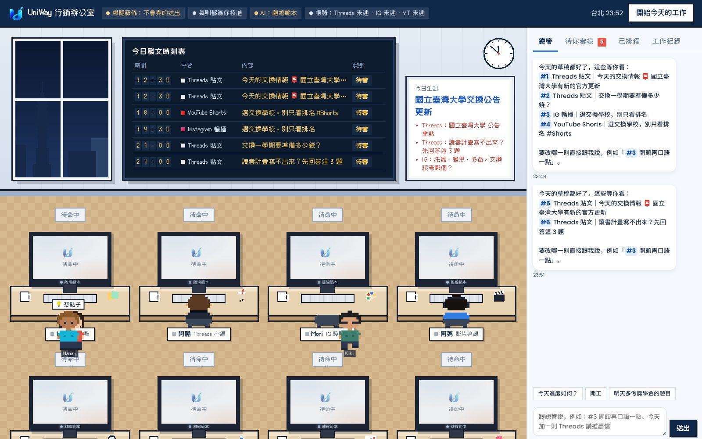
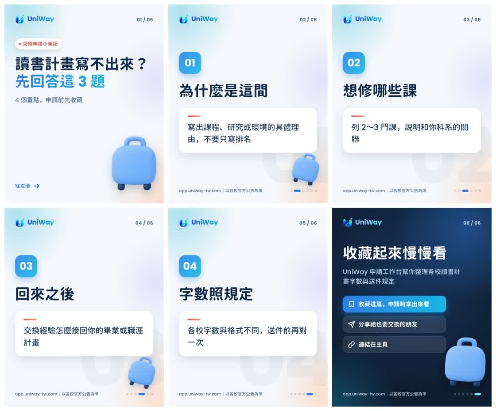

# UniWay 行銷辦公室

一間「看得見」的 AI 行銷辦公室：8 位 AI agent 各坐一張桌子、各用一台電腦，每天自動企劃、寫 Threads、做 IG 輪播與限動、剪 Reels／YouTube Shorts（週日再做一支長影片）、審稿查核、排程發佈、抓成效、擬留言回覆。你坐在最後一張桌子，旁邊是總管 Leo（主腦，預設用 Antigravity）：你用聊天交代事情，Leo 分派給大家、做完回報。所有草稿像登機證一樣送到你面前，核准後才會發出去。



- 整間辦公室是像素風格：每位同事是一個小像素人。手上沒有工作的同事，過幾秒會起身在走道上散步、去喝水或泡咖啡，一有工作就走回座位坐好（同時最多四個人在走動）。點走動中的人也能看他的資訊卡。
- 每位 agent 的螢幕顯示他現在正在做的事：Threads 小編的草稿會一個字一個字打出來、設計師的螢幕會長出輪播圖、剪輯師的螢幕有算圖進度條、發佈員的螢幕是 API 呼叫紀錄。
- 每台螢幕下緣印著這張桌子正在用的 AI（Claude Code、Codex、Antigravity…）；某個工具沒回應、改用備援時，桌上的對話泡泡會說出來。
- 工作交接時，會有一張紙從一張桌子飛到下一張桌子（企劃 → 寫手 → 審稿 → 你 → 發佈）。
- 牆上的「今日發文時刻表」是機場出發看板：每則貼文是一班飛機，待審、準時、已起飛、延誤一目了然。
- 窗外是台北的天色（跟著台北時間變化），白板上是企劃寫的今日主軸。
- 網址加上 `?tv` 是全螢幕的電視模式，可以掛在實體辦公室的牆上當看板。

## 辦公室裡有誰

| 座位 | 角色 | 用哪個 AI（`.env.example` 的分配） | 每天做什麼 |
|------|------|------|------------|
| Ivy | 企劃總監 | 查資料：Antigravity；排內容：Claude Code | 先上網查這兩週學生在討論什麼（每條附來源），再讀平台數字（目前支援幾所大學、幾筆合作校）、`sources/audit/` 最新一天的已核實官方公告、上週成效，排出今天的內容；照 3:3:3:1 輪替 IG 內容支柱 |
| 阿脆 | Threads 小編 | Claude Code | 去商業化的真人口吻；第一行點名族群或痛點，用提問、二選一、清單、小編碎碎念、今日公告五種角度；主文不放網址，網址放第一則留言 |
| Mori | IG 設計師 | 文案：Claude Code；封面插圖：Codex | 6 張 4:5 輪播圖（封面鉤子 → 重點 → 收藏／分享／連結在主頁），封面放 Codex 畫的插圖，再做一張提醒看新貼文的限動；hashtag 最多 5 個 |
| 阿剪 | 影片剪輯 | Claude Code | 30～45 秒直式腳本（前 3 秒鉤子、每個畫面都有大字幕），逐格算圖並配上合成音樂；同一支影片發 Reels 和 YouTube Shorts；週日做 2～4 分鐘橫式「本週交換情報懶人包」 |
| Kiki | 審稿查核 | Codex | 程式規則＋AI 審稿：字數、連結位置、hashtag 數、平台數字不能誇大、沒有官方來源不能寫日期、禁用「保證錄取／官方合作」等字眼；不合格退回作者改一次。寫的人和審的人用不同家的 AI，比較容易抓到盲點 |
| Pat | 發佈排程 | Antigravity | 發文前最後檢查一次（公告有沒有改、是不是跟最近重複），有疑慮就退回給你；到排定時間用程式呼叫 Threads／Instagram／YouTube 官方 API，Threads 發完主文立刻在第一則留言補上連結 |
| Nana | 數據分析 | Antigravity | 每晚抓成效，把 Threads 上互動最好的題目交給企劃重製成 IG（Threads 測試題目、IG 放大轉換的雙平台閉環），並寫 2～4 點建議給隔天的企劃 |
| Momo | 社群互動 | Claude Code | 發文後 30 分鐘～3 小時去看留言、擬回覆；回覆陌生人一律等你核准 |
| Leo | 總管（主腦） | Antigravity | 你和大家之間的窗口：聽你在聊天裡交代的事、分派給對的同事、做完回報；每天開工結束會整理「哪些等你看」 |
| 你 | 老闆 | — | 跟 Leo 聊天交代事情；在「待你審核」核准、修改、立即發佈或退回 |

## 一天怎麼運作

```
07:30  開工：企劃讀資料、排內容 → 寫手、設計、剪輯同時產出 → 審稿 → 草稿送到你的審核匣
       → 總管 Leo 在聊天裡跟你說哪些等你看（你可以在手機上打開辦公室網頁審核、跟 Leo 說要改哪裡）
12:30  Threads 第 1 篇（主文 → 第一則留言放連結）
18:00  YouTube Shorts
19:30  Instagram 輪播或 Reels，19:45 限動
21:00  Threads 第 2 篇
發文後 30 分鐘  社群互動看留言、擬回覆給你核准
23:30  數據分析抓成效，明天企劃參考
週日   多一支 YouTube 長影片
```

時間都可以在 `.env` 改。沒核准的草稿不會發；核准時已經過了排定時間的，下一輪（30 秒內）就發。

## 在你的電腦上跑起來

Windows 和 Mac 都可以。Python 不用自己裝，uv 會自動下載；剪影片用的 ffmpeg 也已經包在套件裡。

**1. 安裝工具**（裝完關掉終端機再打開，新指令才找得到）

| | Windows（PowerShell） | Mac（終端機） |
|---|---|---|
| uv | `powershell -ExecutionPolicy ByPass -c "irm https://astral.sh/uv/install.ps1 \| iex"` | `curl -LsSf https://astral.sh/uv/install.sh \| sh` |
| Git | `winget install --id Git.Git -e` | 第一次打 `git` 會提示安裝 |

三個 AI 工具（**裝好後各自在新的終端機執行一次並登入**）：

| | Windows（PowerShell） | Mac（終端機） | 登入 |
|---|---|---|---|
| Claude Code | `irm https://claude.ai/install.ps1 \| iex` | `curl -fsSL https://claude.ai/install.sh \| bash` | 執行 `claude`，登入 Claude 帳號 |
| Codex | 先 `winget install OpenJS.NodeJS.LTS`，再 `npm.cmd install -g @openai/codex` | `npm install -g @openai/codex` | 執行 `codex`，選用 ChatGPT 登入 |
| Antigravity | `irm https://antigravity.google/cli/install.ps1 \| iex` | `curl -fsSL https://antigravity.google/cli/install.sh \| bash` | 執行 `agy`，選 Google 登入 |

裝完要**關掉終端機再開一個新的**，再重新啟動辦公室，新指令才找得到。沒裝的工具不會讓辦公室停下來，那幾張桌子會改用備援。

**2. 下載並啟動**

```bash
git clone https://github.com/blizzard-new/abroad.git
cd abroad/marketing/agent-office
uv sync
uv run playwright install chromium     # 算圖用的瀏覽器（已經有 Chromium 的話可以改設 CHROMIUM_PATH）
cp .env.example .env                   # Windows：copy .env.example .env
uv run office check --ping             # 檢查工具、每張桌子的 AI 有沒有登入、社群帳號
uv run office serve                    # 打開 http://127.0.0.1:8780
```

按右上角「開始今天的工作」就會開工。`.env` 預設是「模擬發佈」：該送出的 API 請求只會寫進 `var/outbox/`，不會真的發文。圖片、影片在 `var/media/`。

`office check` 會列出每一項的狀態（○ 好了、× 要處理、△ 提醒），× 後面會寫怎麼修。

不開網頁也可以：

```bash
uv run office run --force     # 立刻跑一天
uv run office list            # 看草稿
uv run office approve 3 --now # 核准 #3 並馬上發
uv run office facts           # 看平台數字與今天可引用的官方公告
```

**3. 讓它一直開著**：辦公室要開著才會 07:30 自動開工、到時間發文；電腦睡著就會停。

- Windows：「設定 → 系統 → 電源」把睡眠改成「永不」；想開機自動啟動，用「工作排程器」建一個「登入時」執行的工作：程式填 uv 的完整路徑（在 PowerShell 打 `(Get-Command uv).Source` 查）、引數填 `run office serve`、起始位置填 `agent-office` 資料夾。
- Mac：用 `caffeinate -i uv run office serve` 啟動，跑著的時候就不會睡著。
- 手機：見下面的「用手機跟 Leo 說話」。

## 上線步驟

建議依序做，每一步都確認沒問題再往下：

1. **離線試跑**：照上面先跑一天，看草稿長什麼樣子。
2. **接上 AI 工具**：登入 Claude Code、Codex、Antigravity，`uv run office check --ping` 的 AI 都是 ○。
3. **接上社群帳號**（見「接上 Threads、Instagram、YouTube」），`uv run office check` 的帳號都是 ○，仍保持 `OFFICE_DRY_RUN=1`，到 `var/outbox/` 看會送出的內容。
4. **正式發佈**：改成 `OFFICE_DRY_RUN=0`，保持 `OFFICE_APPROVAL=manual`，每天花 5 分鐘審核。
5. 跑順幾週後，想放手再改 `OFFICE_APPROVAL=auto`（審稿通過就自動排程；留言回覆仍然要你核准）。

## 跟總管聊天

右側面板的第一個分頁是「總管」。直接打字，例如：

- 「今天進度如何？」
- 「開工」
- 「#3 開頭再口語一點」→ Leo 交給寫那則的同事重寫，再經過審稿，改好放回審核匣（`#編號` 就是審核匣登機證右邊的號碼，訊息裡的編號可以點）
- 「今天加一則 Threads 講推薦信」「今天加做一支 Reels 講交換預算」
- 「#5 改到 20:30 發」「#2 退回，太像廣告」
- 「明天多做獎學金的題目」→ 記給隔天早上的企劃，用過一次就清掉

- 「大家現在用什麼模型？」「Kiki 改用 Sonnet，思考強度 high」「阿脆改用 Opus，xhigh」「Kiki 改回原本的設定」→ Leo 會換掉那位同事用的工具、模型或思考強度，桌上螢幕和同事資訊卡會顯示新的設定

Leo 能做的事：開工、請同事重寫、加做一則、改發文時間、退回、記給明天，以及查看和調整每位同事用的 AI。**它不能核准、不能發文，也不能改帳號、金鑰或模擬模式**，就算你在聊天裡要求也一樣，那些永遠由你在審核匣自己按。Leo 用 Antigravity 思考；Antigravity 沒回應時會照備援順序換人，全部都不行時，它仍聽得懂「開工」和「進度」。

## 用手機跟 Leo 說話、收通知

辦公室接一個你自己的 Telegram 機器人：在手機上傳訊息給它，就是跟總管 Leo 說話；有事它會主動傳給你。電腦不用對外開放（機器人是電腦主動去 Telegram 拿訊息）。

**設定一次（5 分鐘）**

1. 手機裝 Telegram，搜尋 **@BotFather**，傳 `/newbot`，照它問的取名字（例如「UniWay 總管」）和帳號（要以 `bot` 結尾）。它會回你一串 token。
2. 把 token 填進 `.env`：`TELEGRAM_BOT_TOKEN=123456:ABC...`
3. 在電腦執行（先關掉正在跑的 `office serve`）：
   ```bash
   uv run office auth telegram
   ```
   它會印出一個連結，用手機打開、在 Telegram 按「開始」，就會收到「已連上」。
4. 重新啟動 `uv run office serve`。`uv run office check` 的「手機」那一行會是 ○。

**之後怎麼用**

- 直接打字給機器人＝跟 Leo 說話，跟網頁的「總管」分頁一樣：「今天進度如何？」「開工」「#3 開頭再口語一點」「#5 改到 20:30 發」「明天多做獎學金的題目」。Leo 說的話（包括每天開工後的整理）都會傳到手機。
- 你會收到的通知：
  - 📝 **草稿等你核准**：附文案（輪播、影片附封面圖），下面有「✅ 核准」「↩️ 退回」按鈕
  - ⚠️ **需要你看一下**：審稿沒過，或發文前檢查擋下來（可以「照樣核准」或跟 Leo 說要怎麼改）
  - 🚀 **已發出**：附貼文連結
  - ❌ **發佈失敗**：附原因
- 只有你用 `office auth telegram` 連上的那個 Telegram 帳號說的話才算數，別人找到這個機器人也不會有任何回應。按鈕跟網頁上的核准一樣是你本人按的；Leo 自己仍然不能核准。
- 辦公室要開著（`uv run office serve`）機器人才會回；電腦關機時傳的訊息，開機後會依序處理。

**也想在手機上看整間辦公室（動畫、審核匣、改文案）**

用 [Tailscale](https://tailscale.com/download)：電腦和手機都裝、登入同一個帳號，它們就像在同一個私人網路，不用對外開放。

1. `.env` 設 `OFFICE_ACCESS_TOKEN=<自己想一串密碼>`，以及 `OFFICE_URL=http://<電腦名稱>:8780`（電腦名稱在 Tailscale App 裡看得到）。
2. 用 `uv run office serve --host 0.0.0.0` 啟動。Windows 跳出防火牆詢問時，允許「私人網路」。
3. 手機第一次打開 `http://<電腦名稱>:8780/?token=<那串密碼>`，之後會記住。通知裡也會附上辦公室的連結。

## Claude Code、Codex、Antigravity 怎麼分工

每張桌子的 AI 在 `.env` 的 `OFFICE_BRAINS` 指定，格式是「角色=工具」。`.env.example` 預設的分工：

- **Claude Code**：寫文案（Threads、IG 說明欄、留言回覆）、寫影片腳本、排內容。
- **Codex**：審稿，和畫 IG 封面插圖（`OFFICE_IMAGES=codex`）。
- **Antigravity**：主腦（總管 Leo），以及上網查資料、解讀數據、發文前最後檢查。

辦公室不會打開這些工具的視窗，而是用它們的「無介面模式」從程式呼叫，用的是你已經登入的訂閱：

| 工具 | 辦公室怎麼叫它 | 先做這件事 |
|------|----------------|------------|
| Claude Code | `claude -p --output-format json --json-schema …`，要求照固定格式回答 | 安裝後在終端機執行 `claude` 登入你的 Claude 帳號 |
| Codex | `codex exec - --output-schema …`；畫圖時用內建的 `$imagegen` | 安裝後執行 `codex` 登入 ChatGPT 帳號 |
| Antigravity | `agy -p "…"`，從輸出裡讀出 JSON | 安裝 Antigravity CLI 並登入；先跑 `agy --help`，參數不同就改 `OFFICE_ANTIGRAVITY_COMMAND` |

幾件要知道的事：

- **每次都在空資料夾裡執行**：審稿、寫稿只能讀不能寫；Codex 只在畫圖時能寫進那個暫存資料夾。工具碰不到辦公室的檔案和你的程式碼。
- **會自動換人**：某個工具沒安裝、沒登入、額度用完或超過 `OFFICE_BRAIN_TIMEOUT` 秒沒回應，就依 `OFFICE_BRAIN_FALLBACK` 往下換（預設 Claude Code → Claude API → 離線範本），換人時桌上的泡泡會說出原因。
- **查資料一定要能上網**：查資料這一步只會交給能上網的工具（Antigravity、Claude Code）；都不行就跳過，不會讓不能上網的 AI 憑空編。查到的東西都附來源，只當線索，審稿仍會擋下沒有官方來源的日期。
- **發文本身是程式，不是 AI**：Antigravity 只能在發文前「擋下來給你看」，不能決定發什麼、發到哪；按下送出的永遠是固定的程式碼。被擋下的貼文會回到你的審核匣並寫明原因，你再核准一次就會直接發。
- **Claude Code 會用你的訂閱**：辦公室呼叫 Claude Code 時會拿掉 `ANTHROPIC_API_KEY`，避免它改用 API 計費。
- **Antigravity 的 CLI 還在變動**：有人回報從程式呼叫會卡住，所以它的每次呼叫都有逾時，逾時就換下一個工具。
- 三家官方都建議「自動化用 API 金鑰」。用訂閱跑自己的排程沒有問題，但會吃訂閱額度；如果哪天某個工具不再允許用訂閱登入跑無介面模式，把那張桌子改成 `api` 就好。

想換分工，只要改 `OFFICE_BRAINS`，例如全部交給 Claude Code：`OFFICE_BRAINS=claude-code`；只換審稿：把 `reviewer=codex` 改成 `reviewer=antigravity`。

## 接上 Threads、Instagram、YouTube

### 哪張桌子用哪個帳號

只有三張桌子會碰帳號，而且每個平台只連一次，三張桌子共用：

| 桌子 | Threads | Instagram | YouTube |
|------|---------|-----------|---------|
| Pat（發佈） | 發文、第一則留言補連結 | 發輪播、Reels、限動 | 上傳 Shorts 與長影片 |
| Momo（社群互動） | 讀留言、送出你核准的回覆 | 讀留言、送出你核准的回覆 | — |
| Nana（數據） | 讀成效 | 讀成效 | 讀觀看數 |

其他人（Leo、Ivy、阿脆、Mori、阿剪、Kiki）只做草稿，碰不到帳號，也拿不到權杖。連好之後，辦公室上方會顯示「帳號：Threads @你的帳號 · IG @… · YT 頻道名」。

連帳號都用 `uv run office auth …`：它會查出權杖屬於哪個帳號，連同帳號 ID 存進 `var/office.sqlite3`（不進 Git），Meta 的權杖每週自動延長。連完跑 `uv run office check`，會實際問每個平台「這個權杖是誰的」（只讀取，不會發文）。

### Threads

1. 到 [Meta for Developers](https://developers.facebook.com/) 建立 App，使用案例選 **Access the Threads API**，勾選 `threads_basic`、`threads_content_publish`、`threads_read_replies`、`threads_manage_replies`、`threads_manage_insights`。
2. 「應用程式角色 → 新增人員」把要發文的 Threads 帳號加為 **Threads 測試人員**，再到 Threads App 的「設定 → 帳號 → 網站權限 → 邀請」接受。只發自己的帳號時用開發模式就可以，不用送 App 審查。
3. 把 App 設定裡的 **Threads App secret** 填進 `.env` 的 `THREADS_APP_SECRET`。
4. 在使用案例的設定頁按 **Generate Access Token**，登入後複製權杖：
   ```bash
   uv run office auth threads --token <剛剛複製的權杖>
   ```
   會顯示「已連上 Threads @你的帳號」。短期權杖（1 小時）會自動換成約 60 天的長期權杖。

### Instagram

1. IG 帳號要是**專業帳號**（商業或創作者），在 IG App 的「設定 → 帳號類型和工具」切換。
2. 同一個 Meta App 再加入 Instagram 的使用案例（後台名稱類似「管理 Instagram 上的訊息和內容」），選 **API setup with Instagram login**，勾選 `instagram_business_basic`、`instagram_business_content_publish`、`instagram_business_manage_comments`、`instagram_business_manage_insights`。
3. 在同一頁新增你的 IG 帳號並按 **Generate token**（產生權杖）；把 **Instagram App secret** 填進 `INSTAGRAM_APP_SECRET`，然後：
   ```bash
   uv run office auth instagram --token <產生的權杖>
   ```
   後台產生的已經是長期權杖，會照原樣存好。
4. **圖片和影片必須有公開網址**（Instagram 與 Threads 是從網址抓檔，不收上傳），選一種：
   - `OFFICE_MEDIA_HOST=supabase`（建議）：在 Supabase Storage 建一個 **public** bucket（預設名稱 `marketing-media`），填 `SUPABASE_URL` 與 `SUPABASE_SERVICE_ROLE_KEY`。service role key 權限很大，只能放在這台電腦的 `.env`。
   - `OFFICE_MEDIA_HOST=static`：讓這台電腦的 `/media/` 對外（例如用 tunnel），填 `OFFICE_PUBLIC_BASE_URL`。這時**一定要設 `OFFICE_ACCESS_TOKEN`**，否則任何人都能打開辦公室按核准。

   沒設定時 Threads 純文字照發，IG 貼文和影片會在審核匣標示發佈失敗。

### YouTube

1. 在 [Google Cloud Console](https://console.cloud.google.com/) 建專案，啟用 **YouTube Data API v3**。
2. OAuth 同意畫面選「外部」，把自己加為測試使用者；**發布狀態改成「正式版」**（測試中的 App 拿到的授權 7 天就失效）。
3. 建立 OAuth 用戶端，類型選「電腦版應用程式」，把 ID 與密鑰填進 `.env` 的 `YOUTUBE_CLIENT_ID`、`YOUTUBE_CLIENT_SECRET`，然後：
   ```bash
   uv run office auth youtube   # 會打開瀏覽器，登入要發影片的頻道並同意
   ```
   Google 可能會警告「這個應用程式未經驗證」，那是你自己的 App，按「進階 → 前往」即可。完成後顯示「已連上 YouTube 頻道「…」」。
4. Google 規定：API 專案沒通過 YouTube 稽核前，用 API 上傳的影片一律是「私人」。先設 `YOUTUBE_PRIVACY=private`，到 YouTube Studio 手動公開，或申請稽核。

## 策略對照：NotebookLM 的建議落在哪裡

| 行銷策略 | 辦公室怎麼做 |
|----------|--------------|
| Threads 創造話題、IG 展示與轉化 | 每天 2 篇 Threads ＋ 1 則 IG；數據分析把 Threads 爆文交給企劃重製成 IG |
| IG 內容 3:3:3:1（價值／引流／信任／品牌故事） | 企劃以 10 天為一輪：價值、信任各 3 天做輪播，引流 3 天做 Reels，1 天說品牌故事 |
| Threads 去商業化、真人口吻 | 每個 AI 都先讀同一份品牌語氣規範；離線範本也有小編碎碎念角度 |
| 第一行點名族群或痛點、二選一、清單 | 五種 Threads 角度輪流用 |
| 主文不放連結，放第一則留言或主頁 | 審稿規則擋下主文網址；發佈時自動補第一則留言；IG 說明欄寫「連結在主頁」 |
| 黃金 30 分鐘 | 社群互動在發文後 30 分鐘開始看留言、擬回覆 |
| Reels 9:16、30～45 秒、前 3 秒鉤子、動態字幕 | 影片腳本與審稿規則都檢查；字幕放在 Reels 介面不會蓋到的位置 |
| 輪播以「被收藏」為目標 | 一張一件事，最後一張是收藏／分享／連結在主頁 |
| 限時動態每天經營 | 每則 IG 貼文後 15 分鐘發一張限動（見下方限制） |
| 數據回饋 | 每晚抓 Threads／IG／YouTube 成效 |

## 安全設計

- **預設不會發文**：`OFFICE_DRY_RUN` 只有明確寫 `0` 才會關掉模擬模式。
- **預設每則都要你核准**；留言回覆永遠要你核准。
- **事實只來自資料**：平台數字從 `src/exchange_info/university_registry.py` 即時計算（新增學校，貼文數字自動跟上）；公告只引用 `sources/audit/` 標記為 confirmed update 且附官方網址的條目。審稿會擋下超過平台實際數字的說法，以及沒有來源的日期。
- 審稿不過的草稿標成「需修改」，列出問題給你決定，不會自動發出。
- 權杖、金鑰只在 `.env` 與 `var/`，紀錄裡的權杖都遮成 `***`。

## 限制

- Instagram API 不能加限動互動貼紙（投票、問答、連結貼紙），也不能使用 App 內的熱門音樂；限動是純圖片，影片音樂是程式合成、沒有版權問題。需要貼紙的限動請手動發。
- Instagram 一篇最多 5 個 hashtag（2025 年底起的平台規定）；Threads 每篇一個主題標籤、主文 500 字。
- 影片是動態字幕＋吉祥物動畫，沒有旁白。
- Meta 的長期權杖約 60 天，辦公室每週自動延長；超過 60 天沒開機就要重新授權。

## 費用

用 `.env.example` 的分工時，AI 都走你既有的 Claude、ChatGPT、Google 訂閱，不另外付 API 費，但會吃各自的用量額度：每天大約 Claude Code 8～12 次、Codex 4～6 次（含 1 張圖）、Antigravity 3～8 次再加上你跟總管聊天的次數（每句一次）。只有備援換到 Claude API 時才會計費（以 `claude-opus-5-5` 估計全天約 1～2 美元，`OFFICE_MODEL=claude-sonnet-5-5` 約可省一半）。Threads、Instagram、YouTube API 本身免費（有每日發文上限，遠高於這裡的用量）。

## 設定一覽

見 [`.env.example`](.env.example)，每一行都有說明。

## 檔案

| 路徑 | 內容 |
|------|------|
| `office/agents/` | 每位 agent 一個檔案；`chief.py` 是總管 |
| `office/pipeline.py` | 一天的流程：企劃 → 產出 → 審稿 → 送審 |
| `office/scheduler.py` | 辦公室時鐘：開工、發文、看留言、抓數據、延長權杖 |
| `office/brains.py` | Claude Code、Codex、Antigravity、Claude API 的呼叫方式與備援順序 |
| `office/llm.py` | 每個角色的提示詞，以及離線範本寫手 |
| `office/brand.py` | 品牌語氣、內容支柱、平台數字與今日公告 |
| `office/rules.py` | 審稿規則 |
| `office/render/` | 輪播／限動／影片的 HTML 版型、算圖與配樂 |
| `office/platforms/` | Threads、Instagram、YouTube、媒體網址 |
| `office/accounts.py`、`office/checkup.py` | 連帳號（`office auth`）與開工前檢查（`office check`） |
| `office/telegram.py` | 手機：Telegram 機器人跟 Leo 對話、通知、核准按鈕 |
| `office/server.py`、`office/static/` | 辦公室網頁與即時事件 |
| `tests/` | `uv run pytest`（算圖測試需要 Chromium） |


