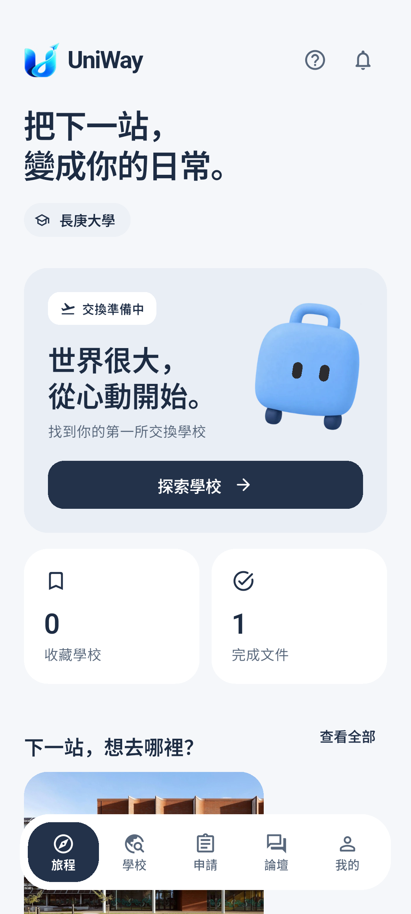
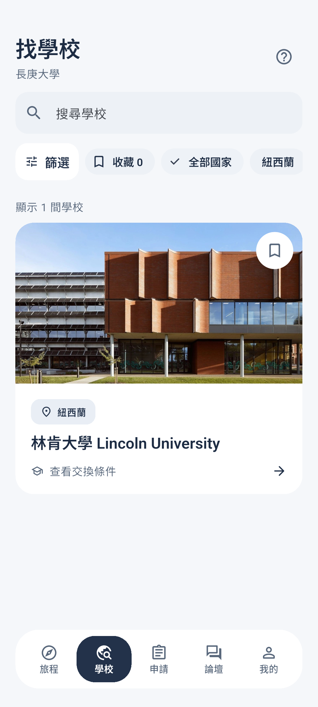
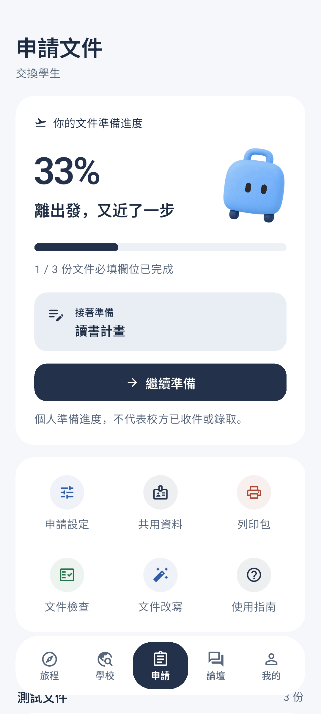
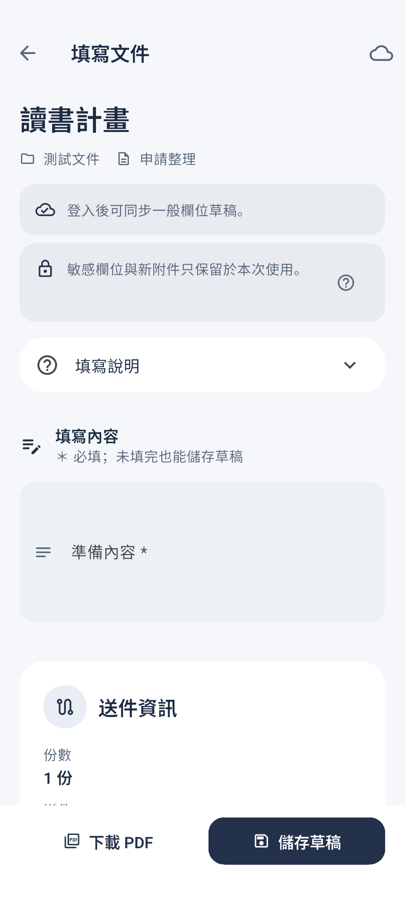

# UniWay 2.1.9 介面與驗證紀錄

## 設計範圍

沿用 Flutter 與既有 API、帳號授權、文件草稿及同步機制。品牌圖示取自網站的 `uniway-logo.webp`／`uniway-mark.webp`，吉祥物取自網站的 `mascot/suitcase.webp`，眼睛位置依網站原有設定。沒有引用其他 App 的商標、吉祥物或圖片。

- [Toss](https://wwit.design/2021/02/16/toss/)：明亮背景、資訊層級及有文字的底部導覽。
- [revolt](https://wwit.design/2025/03/15/revolt/)：照片列表、獨立搜尋及底部篩選。
- [3.3](https://wwit.design/2024/11/03/3o3/)：主要進度卡片與下一步。
- [Planfit](https://wwit.design/2023/07/24/planfit/)：旅程首頁的主要行動。
- [Pillyze](https://wwit.design/2022/12/18/pillyze/)：論壇的問題摘要與回覆資訊。

主要色：背景 `#F5F7FA`、白色卡片、重點 `#23324A`、淺藍 `#E9EEF5`、文字 `#1D2C43`。深層頁沿用相同表單、按鈕及卡片元件。吉祥物只播放短暫進場動作，離開頁面停止動畫，並尊重減少動態效果設定。

首頁數字來自現有收藏與文件狀態；日期只使用現有個人行事曆資料；沒有資料時顯示引導。文件進度依適用模板必填欄位完成數計算，保留與校方正式狀態的區分。

## 驗證

Flutter 3.44.6 / Dart 3.12.2；Windows 使用獨立英文路徑建置副本。

- `flutter analyze --no-pub`：通過，沒有問題。
- `flutter test --no-pub`：122 項通過。
- 版面測試包含 320px／375px、812×375 橫向、768×1024 平板、2 倍文字、減少動態及高對比設定。
- `integration_test/design_219_test.dart`：Android API 36.1 模擬器通過五個分頁、篩選、收藏、33% 文件進度及繼續填寫入口。
- `flutter drive --driver=test_driver/design_219_driver.dart --target=integration_test/design_219_test.dart -d <emulator>`：將八張原生 Flutter 畫面輸出到 `build/design-219/`。

畫面驗證使用隔離的測試帳號狀態、示範貼文與文件，不寫入正式 API。截圖中的完成數與貼文不是正式使用者資料；校園照片沿用已打包素材，未重新查核學校規定。本次未測試真實 Google 帳號授權、遠端推播投遞或實體手機完整使用流程。

## 品牌圖示重建

`dart run tool/build_brand_icons.dart` 使用既有品牌原圖，產生 Android 各解析度圖示、adaptive icon 前景及 iOS 圖示／啟動素材。新增 `image` 僅為開發依賴；沒有新增執行期 UI 套件。

簽署 APK 使用專案 `scripts/build-android-preview.ps1`，不把密鑰或密碼放進專案。沒有修改或部署伺服器、套用資料庫變更、合併分支或新增學校資料查核。

## 原生畫面截圖

| 旅程 | 學校 | 申請 |
| --- | --- | --- |
|  |  |  |

| 論壇 | 登入 | 文件 |
| --- | --- | --- |
|  |  |  |

[篩選面板](docs/design-219/219-filters.png) · [旅程下半部](docs/design-219/219-journey.png)
